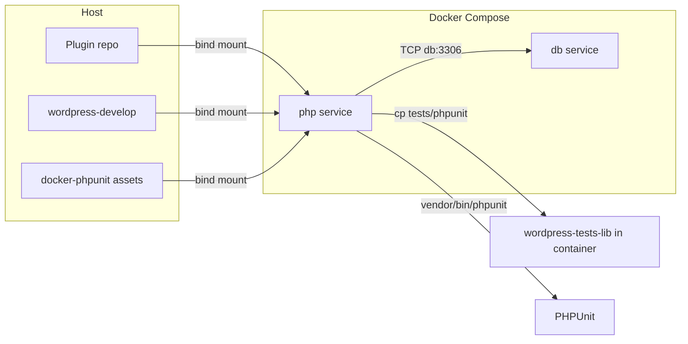

# Docker PHPUnit environment

Run WordPress plugin unit tests **inside Docker** when:

- MySQL is not installed on the host
- You want a fixed PHP version (e.g. 8.1) regardless of host PHP
- You already have a [wordpress-develop](https://github.com/WordPress/wordpress-develop) checkout for the PHPUnit test library

This flow uses **two temporary containers**: a database service and a PHP CLI service. PHPUnit runs in the PHP container; the plugin and `wordpress-develop` are bind-mounted from the host.

Bundled assets live in [`assets/docker-phpunit/`](../assets/docker-phpunit/).

## Prerequisites

| Requirement | Notes |
|-------------|-------|
| Docker Engine | Docker Desktop or equivalent |
| Plugin repo | `composer install` completed; `vendor/bin/phpunit` exists |
| wordpress-develop | Clone with `src/` and `tests/phpunit/` present |
| Host tools | `envsubst` from GNU gettext (`brew install gettext` on macOS) |
| PHPUnit bootstrap | Plugin uses `WP_TESTS_DIR` (see [scaffolding.md](../references/scaffolding.md)) |
| WooCommerce tests | WooCommerce checkout and `WOOCOMMERCE_ROOT` configured |

## Quick start

### 1. Copy assets to a working directory

Keep Docker files **outside** the plugin git tree (recommended) or in an ignored folder:

```bash
cp -r assets/docker-phpunit ~/path/to/wp-plugin-phpunit-env
cd ~/path/to/wp-plugin-phpunit-env
```

### 2. Configure environment

```bash
cp env.example .env
```

Edit `.env` — set at minimum:

| Variable | Example | Purpose |
|----------|---------|---------|
| `PLUGIN_ROOT` | `/path/to/my-plugin` | Plugin repository root |
| `WORDPRESS_DEVELOP_ROOT` | `/path/to/wordpress-develop` | wordpress-develop checkout |
| `PLUGIN_MAIN_FILE` | `my-plugin.php` | Main plugin file, relative to `PLUGIN_ROOT` |
| `WOOCOMMERCE_ROOT` | `/path/to/woocommerce` | Required only when tests activate WooCommerce |

Other variables have sensible defaults (PHP 8.1, MySQL 8, test DB credentials).

`DOCKER_PHPUNIT_DIR` is **set automatically** by `run-phpunit.sh` to the directory holding the script. Do not set it in `.env` — a stale value would mount the wrong folder into the container.

`run-phpunit.sh` overrides the host-only `PLUGIN_ROOT` with `/var/www/plugin`
and maps `PLUGIN_MAIN_FILE` to `BOOTSTRAP_FILE=/var/www/plugin/<file>` inside
the container. This allows `WPDevTest\Setup` to locate and load the mounted
plugin.

For WooCommerce tests, set `WOOCOMMERCE_ROOT` to a WooCommerce checkout and include `woocommerce/woocommerce.php` in `tests/plugins-list.php`. The compose file mounts that checkout at WordPress's plugin path.

### 3. Run tests

```bash
chmod +x run-phpunit.sh teardown.sh
# Full suite
./run-phpunit.sh

# Single test or group
./run-phpunit.sh 'MyTestClass'
./run-phpunit.sh 'itShouldDoSomething'
```

### 4. Tear down

```bash
./teardown.sh
# or: docker compose down -v
```

## How it works



On each run, `run-phpunit.sh`:

1. Starts `db` and `php` via Docker Compose
2. Copies `wordpress-develop/tests/phpunit` into the container at `WP_TESTS_LIB_CONTAINER_PATH` (default `/var/www/wordpress-tests-lib`)
3. Renders `wp-tests-config.php` from the template (DB host = Docker service name `db`)
4. Sets `WP_TESTS_DIR`, `WP_TESTS_CONFIG_FILE_PATH`, container `PLUGIN_ROOT`, and container `BOOTSTRAP_FILE` for PHPUnit
5. Executes `./vendor/bin/phpunit` inside the PHP container from `PLUGIN_CONTAINER_PATH`

The copy step keeps the test library self-contained inside the container and avoids relying on host-only paths at runtime.

## Plugin `phpunit.xml` / bootstrap

PHPUnit inside Docker receives `WP_TESTS_DIR` from the shell environment, which **overrides** any path in `phpunit.xml` for that run.

**Always** use the scaffolding bootstrap — do not invent a custom loader:

```php
<?php

declare( strict_types=1 );

require dirname( __DIR__, 2 ) . '/vendor/autoload.php';

WPDevTest\Setup::setup( static function () {
    // optional plugin-specific setup
} );
```

See [scaffolding.md](../references/scaffolding.md). Configure host paths in `phpunit.xml.dist`; let `run-phpunit.sh` export `WP_TESTS_DIR` for Docker runs.

## Architecture choices

### Why PHP in Docker but plugin on the host?

- `vendor/` and autoloading stay in sync with your editor and `composer install` on the host
- No image rebuild when code changes — bind mounts are live
- Same pattern works for any plugin with a standard PHPUnit layout

### Why copy `tests/phpunit` into the container?

- `wp-tests-config.php` lives next to the copied library (`WP_TESTS_CONFIG_FILE_PATH`)
- `DB_HOST` uses the Docker network hostname (`db`), not `127.0.0.1`
- Agents and CI get a repeatable path independent of host layout

### Database safety

PHPUnit uses the `wptests_` table prefix and **drops tables** on shutdown. Use a dedicated test database (`DB_NAME` in `.env`), never production data.

## Apple Silicon (ARM64)

Default images in `env.example` use multi-arch Hub images (`mysql:8.0`, `wordpress:php8.1-apache`). If an image fails on ARM64, set in `.env`:

```bash
DOCKER_DEFAULT_PLATFORM=linux/amd64
```

Or pin platform per service in `docker-compose.yml`.

## Troubleshooting

| Symptom | Check |
|---------|-------|
| `Class "WP_UnitTestCase" not found` | `WORDPRESS_DEVELOP_ROOT` correct; copy step ran; `WP_TESTS_DIR` exported |
| Database connection error | `db` service healthy; `DB_HOST` in generated config is `db` (service name) |
| `vendor/autoload.php` missing | Run `composer install` in `PLUGIN_ROOT` on the host |
| Port already in use | Change `MYSQL_HOST_PORT` in `.env` |
| Tests hang on MySQL | `docker compose logs db`; wait for healthcheck |

## Agent workflow

When a user has no local MySQL and a wordpress-develop checkout:

1. Copy `assets/docker-phpunit/` to a directory outside the plugin repo
2. `cd` into that directory — **all remaining steps run there**, never from the plugin root
3. Create `.env` from `env.example` with absolute `PLUGIN_ROOT`, `WORDPRESS_DEVELOP_ROOT`, `PLUGIN_MAIN_FILE`, and (for WooCommerce) `WOOCOMMERCE_ROOT`
4. `chmod +x run-phpunit.sh teardown.sh`
5. Run `./run-phpunit.sh '<filter>'` for the target test
6. Run `./teardown.sh` when finished

`run-phpunit.sh` exports `DOCKER_PHPUNIT_DIR` itself (the script's own directory) and runs `docker compose` from there. Do not set that variable, and do not run `docker compose` from the plugin root — the bind mounts would point at the wrong folder.

Do not commit `.env` or generated `wp-tests-config.php` into the plugin repository.
