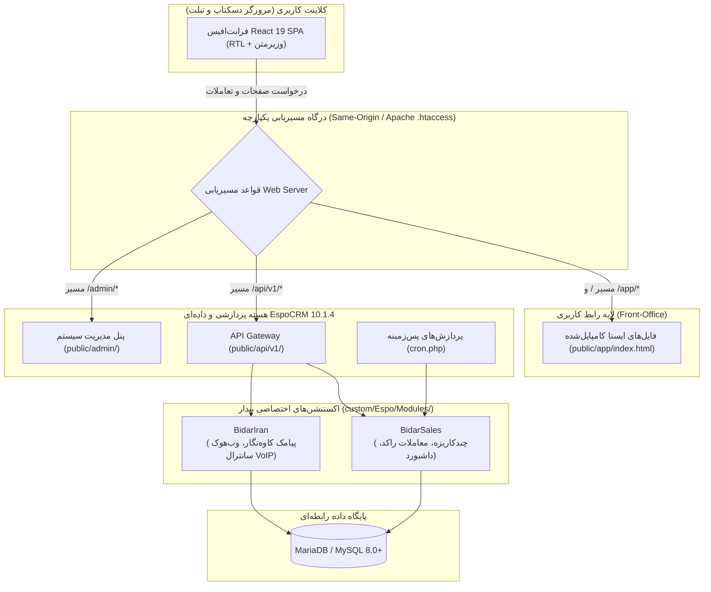

# بیدار (BidarCRM)

> **سامانه مدیریت ارتباط با مشتری (CRM) و خط لوله فروش B2B مبتنی بر معماری هیبریدی Headless**  
> *نسخه ۱.۰.۰ | متصل به هسته آزموده EspoCRM 10.1.4 | آماده استقرار روی هاست‌های اشتراکی ایران*

[](package.json)
[](engine.version)
[](LICENSE)
[](LICENSE-EXTENSIONS-AGPL3.txt)
[](#راستی‌آزمایی-و-تست‌ها)

---

## ۱. درباره بیدار (BidarCRM)

**بیدار (BidarCRM)** یک سامانه مدیریت ارتباط با مشتریان و قیف فروش است که با رویکرد «سادگی، سرعت و تجربه کاربری بومی» برای تیم‌های فروش مدرن در ایران توسعه یافته است.

در بسیاری از سازمان‌ها، سامانه‌های CRM سنتی به دلیل پیچیدگی افراطی، رابط کاربری شلوغ و کندی در هاست‌های داخلی متروکه می‌شوند. بیدار این مشکل را با یک **معماری هیبریدی بدون‌سر (Headless Hybrid Architecture)** حل کرده است:
1. **فرانت‌آفیس فوق‌العاده سریع و سبک:** رابط کاربری مدرن با React 19، Tailwind CSS، فونت خوانای وزیرمتن و پشتیبانی ذاتی از راست‌به‌چپ (RTL) و تقویم شمسی.
2. **بک‌اند پایدار و مطمئن سازمانی:** استفاده از هسته منجمد و بهینه‌سازی‌شده EspoCRM 10.1.4 برای مدیریت داده‌ها، سطوح دسترسی (ACL)، جریان‌های کاری و ارتباط با پایگاه داده MariaDB/MySQL.
3. **اکستنشن‌های بومی اختصاصی:** ماژول‌های کاملاً هماهنگ با اکوسیستم کسب‌وکار ایران (درایور پیامک کاوه‌نگار، وب‌هوک سانترال و تلفن ابری VoIP، هشدارهای پوسیدگی معامله و کاریزهای چندگانه).
4. **نصب با یک کلیک در هاست اشتراکی:** بسته زیپ کامپایل‌شده بدون هیچ‌گونه نیاز به نصب Node.js یا Composer در هاست‌های اشتراکی cPanel و DirectAdmin.

---

## ۲. دیاگرام معماری سامانه

بیدار با بهره‌گیری از مسیریابی مبدأ یکسان (Same-Origin Routing)، نیاز به پیکربندی‌های پیچیده CORS را به‌طور کامل از بین برده است. تمامی تعاملات از طریق پورت و دامنه یکپارچه سرور وب (Apache یا NGINX) کنترل می‌شوند:



---

## ۳. قابلیت‌های کلیدی بیدار

### ۳.۱. مدیریت معاملات و کاریز فروش چندگانه (Multi-Pipeline Kanban)
- نمایش بصری مراحل فروش در قالب تابلوهای ستونی کانبان با قابلیت کشیدن و رها کردن (@dnd-kit).
- تفکیک کاریزهای مختلف (مثلاً کاریز «فروش سازمانی»، کاریز «خدمات پشتیبانی»، کاریز «دوره‌های آموزشی»).
- ایجاد سریع معامله با ثبت نام، ارزش ریالی، مرحله کاریز، مخاطب و حساب کاربری متصل.

### ۳.۲. سامانه پایش و نجات معاملات راکد (Rotten Deals Detection)
- تعیین حد آستانه پوسیدگی بر حسب روز برای هر مرحله از خط لوله (`rottenDays`).
- محاسبه بلادرنگ تأخیر و نمایش برچسب‌های رنگی وضعیت (عادی، در مرز پوسیدگی، پوسیده).
- ثبت خودکار تاریخچه آخرین تعامل (`lastActivityAt`) در تمام رخدادهای مرتبط با معامله.

### ۳.۳. نمای ۳۶۰ درجه جزئیات معامله و جریان رخدادها (Stream Timeline)
- کارت جامع اطلاعات مالی، طرف حساب، اطلاعات تماس با امکان شماره‌گیری و ایمیل مستقیم.
- نوار ثبت سریع یادداشت (Quick Log Bar) با الصاق درلحظه به جریان زمانی.
- امکان تغییر سریع وضعیت معامله به «برنده شده» (Won) یا «از دست رفته» (Lost).

### ۳.۴. بومی‌سازی جامع برای ایران (Iran Localization)
- **تقویم و تاریخ جلالی:** تبدیل دقیق و دوطرفه تاریخ‌های میلادی و شمسی با فونت اعداد فارسی.
- **درایور پیامک کاوه‌نگار:** درایور استاندارد PHP با امکان ارسال پیامک‌های اعتبارسنجی و اطلاع‌رسانی سرنخ‌ها.
- **وب‌هوک سانترال تلفن ابری (VoIP):** دریافت گزارش تماس‌های ورودی/خروجی، تطبیق خودکار با مخاطبان و ثبت تماس در تایم‌لاین با احراز هویت ایمن در برابر حملات تحلیل زمانی (`hash_equals`).

### ۳.۵. داشبورد و نمودار قیف فروش (Dashboard & KPIs)
- کارت‌های شاخص‌های کلیدی عملکرد (KPIs): مجموع فروش موفق، معاملات جاری، ارزش ریالی در جریان، نرخ تبدیل.
- نمودار قیف معاملات با تفکیک مراحل و نمایش درصد افت و تبدیل.
- لیست پیگیری‌های دارای اولویت و تماس‌های معوقه فروشندگان.

---

## ۴. ساختار مخزن پروژه (Monorepo)

```text
bidar/
├── apps/
│   └── web/                   # فرانت‌افیس React 19 + TypeScript + Vite + Tailwind CSS
├── packages/
│   └── e2e/                   # سوئیت مانیتورینگ و تست‌های انتها-به-انتها (E2E)
├── extensions/
│   ├── bidar-sales/           # اکستنشن چندکاریزه، پوسیدگی معاملات و داشبورد فروش
│   ├── bidar-iran/            # اکستنشن درایور پیامک کاوه‌نگار و وب‌هوک سانترال VoIP
│   └── phpunit.xml            # پیکربندی تست‌های واحد و یکپارچگی بک‌اند
├── deploy/                    # قالب‌های مسیریابی وب‌سرور (Apache .htaccess و NGINX)
├── scripts/
│   ├── dev-setup.sh           # اسکریپت آماده‌سازی محیط توسعه لوکال
│   └── build-release.sh       # اسکریپت بیلد و پکیج‌بندی بسته هاست اشتراکی
├── tests/
│   ├── installer/             # آزمون‌های اعتبارسنجی پکیج و شبیه‌ساز نصب پاک
│   └── ui-level/              # سوئیت تست‌های رگرسیون بصری و هندسی چندصفحه‌ای
├── engine.version             # نسخه هسته پین‌شده (10.1.4)
├── composer.json              # تعریف پکیج و Autoload اکستنشن‌های بک‌اند
└── package.json               # ورک‌اسپیس ریشه و اسکریپت‌های ارکستراسیون
```

---

## ۵. راهنمای راه‌اندازی محیط توسعه (Developer Setup)

### پیش‌نیازها
- **PHP:** نسخه 8.3 یا بالاتر به همراه اکستنشن‌های `pdo_mysql`، `mbstring`، `gd`، `curl`، `zip`، `intl`.
- **Node.js:** نسخه 20.x یا 22.x LTS به همراه `npm`.
- **Composer:** نسخه 2.x جهت اجرای تست‌های PHPUnit.
- **Docker & Docker Compose:** (اختیاری) جهت بالا آوردن سریع پایگاه داده و وب‌سرور.

### مراحل راه‌اندازی گام‌به‌گام

۱. **کلون کردن مخزن:**
   ```bash
   git clone https://github.com/abolfazl-moeini/didar.git bidar
   cd bidar
   ```

۲. **آماده‌سازی خودکار محیط توسعه:**
   اسکریپت زیر هسته EspoCRM 10.1.4 را دانلود نموده و ماژول‌های `extensions/` را به صورت سیم‌لینک در مسیر `engine/custom/Espo/Modules/` قرار می‌دهد:
   ```bash
   bash scripts/dev-setup.sh
   ```

۳. **نصب وابستگی‌های جاوااسکریپت:**
   ```bash
   npm install
   ```

۴. **اجرای سرور توسعه فرانت‌افیس (Vite Dev Server):**
   ```bash
   npm --prefix apps/web run dev
   ```
   فرانت‌افیس در آدرس `http://localhost:5173/app/` در دسترس خواهد بود.

---

## ۶. راستی‌آزمایی و تست‌ها

پروژه بیدار مجهز به هرم تست چندسطحی شامل آزمون‌های واحد، یکپارچگی، رگرسیون بصری و E2E است:

۱. **تست‌های واحد و کامپوننت‌های فرانت‌افیس (Vitest):**
   ```bash
   npm --prefix apps/web test
   ```
   *(شامل ۶۳ تست موفق روی کامپوننت‌های کانبان، احراز هویت، داشبورد، جزئیات معامله و توکن‌های طراحی)*

۲. **تست‌های واحد و یکپارچگی اکستنشن‌های بک‌اند (PHPUnit):**
   ```bash
   vendor/bin/phpunit -c extensions/phpunit.xml
   ```
   *(شامل ۳۰ تست موفق و ۱۱۹ assertion بر روی هوک‌های معاملات، وب‌هوک سانترال و درایور کاوه‌نگار)*

۳. **تست‌های سوئیت E2E و مانیتورینگ سناریومحور:**
   ```bash
   npm --prefix packages/e2e run test:all
   ```
   *(شامل ۷ تست زنجیره‌ای پوشش‌دهنده ۶ سناریوی حیاتی فروش)*

۴. **تست‌های ممیزی بصری و هندسی چندصفحه‌ای (ui-level):**
   ```bash
   node tests/ui-level/run-ui-checks.mjs --dry-run
   ```

۵. **اجرای یکجای تمام تست‌های سیستم:**
   ```bash
   npm run test:all
   ```

---

## ۷. استقرار در هاست اشتراکی (Production Deployment)

یکی از افتخارات معماری بیدار، بی‌نیازی کامل سرور پروداکشن به ابزارهایی چون Git، Node.js، NPM یا Composer است.

### ساخت بسته رسمی انتشار
برای ایجاد فایل فشرده توزیع مستقل، دستور زیر را اجرا کنید:
```bash
npm run build:release
# یا به صورت مستقیم:
bash scripts/build-release.sh
```
بسته نهایی در مسیر زیر ایجاد می‌شود:
```text
dist/bidar-crm-v1.0.0.zip  (~37 MB)
```

### نصب در هاست سی‌پنل (cPanel) یا دایرکت‌ادمین (DirectAdmin)
۱. فایل `bidar-crm-v1.0.0.zip` را در پوشه ریشه سایت خود (معمولاً `public_html`) آپلود و از حالت فشرده خارج (Extract) کنید.
۲. در سی‌پنل یک پایگاه داده MySQL با کاراکترست `utf8mb4_unicode_ci` ایجاد کنید.
۳. در مرورگر به آدرس `https://yourdomain.com/install` یا `https://yourdomain.com/admin/install` رفته و مراحل نصب هسته را تکمیل کنید.
۴. کران‌جاب سی‌پنل را برای اجرای هر دقیقه‌ای اسکریپت `cron.php` تنظیم نمایید:
   ```bash
   * * * * * /usr/local/bin/php /home/username/public_html/cron.php > /dev/null 2>&1
   ```
۵. سامانه آماده بهره‌برداری است! فرانت‌افیس بیدار در آدرس اصلی دامنه شما (`/`) لود خواهد شد و پنل ادمین از طریق مسیر `/admin` در دسترس مدیران خواهد بود.

> برای مطالعه راهنمای تفصیلی و گام‌به‌گام، سند [راهنمای نصب هاست اشتراکی](docs/INSTALL_SHARED_HOSTING_FA.md) را مطالعه فرمایید.

---

## ۸. اسناد فنی و راهنماها

- [راهنمای جامع API های اختصاصی بیدار](docs/API.md)
- [راهنمای نصب و راه‌اندازی در هاست‌های اشتراکی cPanel و DirectAdmin](docs/INSTALL_SHARED_HOSTING_FA.md)
- [راهنمای کاربری پرسنل فروش بیدار](docs/USER_MANUAL_FA.md)
- [تاریخچه تفصیلی تغییرات نسخه ۱.۰.۰](CHANGELOG.md)

---

## ۹. مرزبندی لایسنس و حقوق نرم‌افزار (License Boundary)

این پروژه از یک مدل مرزبندی شفاف دوگانه (Dual Boundary) پیروی می‌کند:
- **کلاینت مستقل و ابزارهای تست (`apps/web`, `packages/e2e`):** تحت لایسنس بسیار آزاد **The Unlicense** (مالکیت عمومی / Public Domain) منتشر شده‌اند. استفاده، کپی، بازنویسی و بهره‌برداری تجاری یا غیرتجاری از این بخش‌ها بدون هیچ قید و شرطی آزاد است.
- **اکستنشن‌های بک‌اند هماهنگ با هسته (`extensions/`):** از آنجا که ماژول‌های PHP بیدار مستقیماً درون فضای پردازشی EspoCRM بارگذاری شده و اینترفیس‌های آن را پیاده‌سازی می‌کنند، مطابق با الزامات هسته تحت لایسنس **GNU AGPL-3.0** عرضه شده‌اند (مشاهده سند [LICENSE-EXTENSIONS-AGPL3.txt](LICENSE-EXTENSIONS-AGPL3.txt)).

---

## ۱۰. سلب ادعای نشان تجاری و اصالت کدهای پیاده‌سازی (Clean-Room IP)

پروژه **بیدار (BidarCRM)** یک بازپیاده‌سازی کاملاً مستقل، تمیز (Clean-Room Implementation) و متن‌باز بر روی هسته جهانی EspoCRM است. این پروژه هیچ‌گونه وابستگی سازمانی، مشارکت، تأییدیه یا پیوند تجاری با محصول یا شرکت تجاری «دیدار» (Didar CRM) ندارد. 

تمامی کدهای فرانت‌اند، مؤلفه‌های رابط کاربری، استایل‌های Tailwind CSS، منطق‌های بیزنس PHP و متادیتای سیستم از ابتدا به صورت اورجینال نگاشته شده‌اند و هیچ دارایی نرم‌افزاری، لوگو، نشان تجاری یا کد اختصاصی کپی‌شده‌ای در این مخزن وجود ندارد. کلیه نشان‌های تجاری یادشده در متون صرفاً جهت ارجاع به رده عملکردی نرم‌افزار مورد استفاده قرار گرفته‌اند و متعلق به مالکان قانونی آن‌ها هستند.
