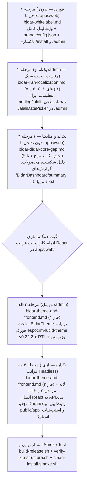

# نقشه راه کلان و ترتیب قطعی پیاده‌سازی پلن‌های بیدار (Bidar CRM Roadmap)

این پوشه شامل چهار پلن اجرایی مستقل اما به هم پیوسته برای تبدیل هسته **BidarCRM v1.0.1** (مبتنی بر EspoCRM 10.1.4 + React 19 SPA) به یک محصول کاملاً **وایت‌لیبل، ایرانی‌سازی‌شده، مجهز به امکانات پایه فروش (هم‌تراز دیدار) و دارای رابط کاربری یکپارچه در `/admin` و `/`** است.

> [!IMPORTANT]
> **هماهنگی با ایجنت فرانت‌اند (قانون عدم تداخل):**
> در حال حاضر کار روی بازطراحی React در پوشه `apps/web/` در جریان است. بر اساس تصمیم پروژه، **مراحل ۱ تا ۳ (لایه‌های بک‌اند، پیکربندی، اینستالر، متادیتا و پنل `/admin`) در اولویت اول اجرا می‌شوند** و تمام تغییرات مرتبط با `apps/web/` و تم جدید در **مرحله ۴ (آخرین مرحله)** پس از تثبیت کامل فرانت React انجام می‌گیرد.

---

## ۱. ترتیب قطعی پیاده‌سازی (Master Execution Order)

### جدول خلاصه پلن‌ها و ترتیب اجرا

| ترتیب | سند پلن | حوزه مسئولیت | تداخل با `apps/web/` | وضعیت وابستگی |
| :---: | :--- | :--- | :---: | :--- |
| **۱** | [bidar-whitelabel.md](file:///Users/moeini/Dev/didar/docs/plans/bidar-whitelabel.md) | وایت‌لیبل کامل پروژه با برند پیش‌فرض `Bidar CRM` / `بیدار CRM`، پیکربندی مرکزی `brand.config.json`، پاکسازی `/install/`، `/admin/`، ایمیل‌ها و رعایت AGPLv3 | بخش `apps/web/` به مرحله ۴ موکول شده | **شروع فوری (بدون پیش‌نیاز)** |
| **۲** | [bidar-iran-localization.md](file:///Users/moeini/Dev/didar/docs/plans/bidar-iran-localization.md) | ایرانی‌سازی کامل (تقویم شمسی، شنبه، ریال/تومان `IRR`/`IRT`، نرمال‌سازی حروف/ارقام، کد ملی/شبا، تقویم `/admin`) — **نوشته‌شده با دقت اتمی برای ایجنت‌های ضعیف‌تر** | فازهای ۱، ۲، ۳ و ۵ صفر تداخل؛ فاز ۴ در مرحله ۴ | پس از مرحله ۱ (یا موازی با آن) |
| **۳** | [bidar-didar-core-gap.md](file:///Users/moeini/Dev/didar/docs/plans/bidar-didar-core-gap.md) | پوشش امکانات پایه فروش دیدار (دلیل شکست، محصولات و اقلام معامله، گزارش‌های تکمیلی نشانگر، گروه مشتری، پیش‌بینی، هدف‌گذاری، پین‌شده‌ها، صندوق پیامک) | لایه بک‌اند/متادیتا صفر تداخل؛ لایه UI در مرحله ۴ | پس از مرحله ۲ (به `JalaliHelper` برای بازه‌های ماه شمسی وابسته است) |
| **۴** | [bidar-theme-and-frontend.md](file:///Users/moeini/Dev/didar/docs/plans/bidar-theme-and-frontend.md) | توسعه تم پیش‌فرض `/admin` (`BidarTheme` بر پایه `espocrm-lucid-theme` v0.22.2 + RTL + وزیرمتن لوکال) + نهایی‌سازی فرانت Headless React (`apps/web/` و خروجی استاتیک `public/app/`) و اصلاح روت `/` | مستقیم روی `extensions/bidar-theme/` و `apps/web/` | **آخرین مرحله — پس از تکمیل کار ایجنت فرانت** |

---

## ۲. نقشه مسیرهای واقعی مخزن (Monorepo Source-of-Truth)

> [!CAUTION]
> **قانون طلایی برای همه ایجنت‌ها (به‌ویژه ایجنت‌های سبک‌تر):**
> هرگز تغییرات دائمی را مستقیم داخل `/Users/moeini/Dev/bidar-crm/source/` یا `engine/` بدون ثبت در مخزن اصلی `/Users/moeini/Dev/didar/` انجام ندهید؛ زیرا اسکریپت `scripts/build-release.sh` بسته نهایی را از روی کدهای مخزن اصلی و فایل `.cache/EspoCRM-10.1.4.zip` می‌سازد و تغییرات دستی بیرون مخزن در ریلیز بعدی از بین می‌روند.

| لایه در مخزن `/Users/moeini/Dev/didar` | مسیر خروجی در بسته ZIP تولیدی (`dist/bidar-crm-v*.zip`) | توضیح فنی |
| :--- | :--- | :--- |
| `extensions/bidar-sales/` *(بدون پوشه `src/`)* | `custom/Espo/Modules/BidarSales/` | ماژول فروش (مسیر واقعی API: `GET /api/v1/BidarDashboard/summary`) |
| `extensions/bidar-iran/` *(بدون پوشه `src/`)* | `custom/Espo/Modules/BidarIran/` | ماژول بومی‌سازی، پیامک کاوه‌نگار و وب‌هوک VoIP (`POST /api/v1/BidarVoip/webhook`) |
| `extensions/bidar-theme/` *(ایجاد در مرحله ۴)* | `custom/Espo/Modules/BidarTheme/` + `client/custom/modules/bidar-theme/` | تم اختصاصی پنل `/admin` بر پایه Lucid v0.22.2 |
| `client/custom/modules/bidar-iran/` *(ایجاد در مرحله ۲)* | `client/custom/modules/bidar-iran/` | فایل‌های JS/CSS تقویم شمسی `JalaliDatePicker` برای `/admin` |
| `apps/web/` *(React 19 + Vite 6 + Tailwind v3.4.15)* | `public/app/` | فرانت Headless (خروجی کاملاً استاتیک؛ بدون نیاز به Node.js در هاست) |
| `assets/brand/` | `public/app/brand/` + `client/img/` + `client/custom/modules/bidar-theme/img/` | منبع واحد لوگوها و فاوآیکون‌های SVG بیدار |
| `config/brand.config.json` *(ایجاد در مرحله ۱)* | تزریق در زمان بیلد و `data/config.php` | مانیفست مرکزی وایت‌لیبل (پیش‌فرض: `Bidar CRM` / `بیدار CRM`) |
| `deploy/htaccess.template` و `deploy/public-htaccess.template` | `.htaccess` و `public/.htaccess` | قوانین روتینگ Same-Origin آپاچی (شامل حفظ `^client/ - [L]` و `^install$`) |
| `deploy/nginx.conf.template` | راهنمای استقرار NGINX | پیکربندی مرجع NGINX |
| `scripts/build-release.sh` | تولید `dist/bidar-crm-vX.Y.Z.zip` | بسته‌بندی یک‌مرحله‌ای هاست اشتراکی (بدون Node/Composer در ران‌تایم) |

---

## ۳. استانداردهای فنی غیرقابل نقض (Invariants از نسخه `v1.0.1`)

1. **ساختار PSR-4 بدون پوشه `src/`:** کلاس‌های PHP در `extensions/bidar-*/` مستقیماً زیر ریشه ماژول قرار می‌گیرند (`Api/`, `Hooks/`, `Services/`, `Support/`, `FieldProcessing/`).
2. **اینترفیس‌های رسمی EspoCRM 10.1.4:**
   - اکشن‌های API: `implements Espo\Core\Api\Action` با `process(Request $request): Response` و کلید `"actionClassName"` در `routes.json`.
   - هوک‌ها: `implements Espo\Core\Hook\Hook\BeforeSave` یا `AfterSave` با امضای `(Entity $entity, SaveOptions $options): void`.
   - فیلد لودرها: `implements Espo\Core\FieldProcessing\Loader` با ثبت در `Resources/metadata/recordDefs/<Entity>.json`.
3. **حفظ قوانین حیاتی اینستالر و کلاینت در `.htaccess`:** قانون `RewriteRule ^client/ - [L]` و `RewriteRule ^install$ install/ [R=301,L]` هرگز نباید حذف یا به `public/client/` تغییر داده شوند.
4. **نسخه Tailwind در `apps/web/`:** فرانت از **Tailwind CSS v3.4.15** استفاده می‌کند (نه v4). از درج سینتکس `@theme` یا `@import "tailwindcss"` متعلق به v4 خودداری کنید.
5. **گیت‌های الزامی پس از هر مرحله:**
   - `composer dump-autoload && vendor/bin/phpunit -c extensions/phpunit.xml`
   - `npm --prefix apps/web run test:ci && npm --prefix apps/web run build` *(در مراحل دارای تغییر فرانت)*
   - `bash scripts/build-release.sh && bash tests/installer/verify-zip-structure.sh dist/bidar-crm-v*.zip && bash tests/installer/clean-install-smoke.sh dist/bidar-crm-v*.zip`

---

## ۴. جدول پیشگیری از تداخل فایل‌ها بین مراحل ۱ تا ۴ (Merge Safety Matrix)

| فایل / مسیر مشترک | مرحله ۱ (Whitelabel) | مرحله ۲ (Iran Localization) | مرحله ۳ (Didar Core Gap) | مرحله ۴ (Theme & Frontend) | قانون ادغام ایمن |
| :--- | :--- | :--- | :--- | :--- | :--- |
| `scripts/build-release.sh` | افزودن `bidar-brand` + اجرای `apply-whitelabel.php` | بسته‌بندی آفلاین `morilog/jalali` + کپی `client/custom/modules/bidar-iran` | — | افزودن `bidar-theme` + کپی `client/custom/modules/bidar-theme` | هر مرحله بلوک مستقل خود را اضافه می‌کند |
| `extensions/bidar-sales/Resources/metadata/entityDefs/Opportunity.json` | — | — | افزودن `lossReason` و `lossReasonNote` به `fields` | — | حفظ ۳ فیلد فعلی (`lastActivityAt`, `isRotten`, `daysSinceLastActivity`) |
| `entityDefs/{Account,Contact}.json` | — | در `extensions/bidar-iran/` (`nationalId`, `nationalCode` و ...) | در `extensions/bidar-sales/` (`customerGroups`) | — | در دو ماژول مجزا هستند؛ EspoCRM آن‌ها را خودکار Merge می‌کند |
| `deploy/htaccess.template` | حذف هدر `X-Powered-By` | — | — | افزودن `RewriteRule ^$ public/app/index.html [L]` | حفظ همیشگی `RewriteRule ^client/ - [L]` و `^install$` |
| `apps/web/*` | — | — | — | اجرای یکجای دلتای UI، فونت لوکال، `brand.ts` و `@doranjs/*` | صفر تغییر در مراحل ۱ تا ۳ |

