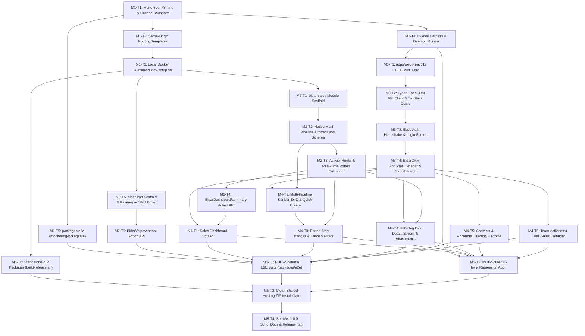

# سند اجرایی ASF v6: نقشه راه و تفکیک وظایف فاز اول **BidarCRM (بیدار)**

> **وضعیت:** آماده ورود به کارخانه نرم‌افزار خودکار (**ASF v6**) — صرفاً پلن (بدون پیاده‌سازی)  
> **نام محصول:** **BidarCRM** (`bidar` / بیدار)  
> **معماری فاز اول:** موتور **EspoCRM 10.1.4** (بک‌اند، ORM، ACL و REST API) + فرانت‌اند اختصاصی **Front-Office Headless** (فقط ۶ تا ۸ صفحه روزمره فروش)؛ پنل تنظیمات و مدیریت سیستم روی `/admin` بومی EspoCRM باقی می‌ماند.  
> **دامنه فاز دوم:** مهاجرت به Full Headless در سند [asf-phase-2-future.md](./asf-phase-2-future.md) مستند شده و **اکیداً خارج از دامنه فعلی است و نباید اجرا یا آغاز شود.**  
> **مستندات مرجع تحقیق:**  
> • تحلیل تفصیلی ویدئوهای آموزشی و دموهای یوتیوب: [YOUTUBE_WALKTHROUGHS.md](../research/YOUTUBE_WALKTHROUGHS.md)  
> • کاتالوگ ۸ فیچر و سناریوهای جامع E2E: [FEATURES_AND_SCENARIOS.md](../research/FEATURES_AND_SCENARIOS.md)  
> • ساختار تخصیص مدل‌ها و ایجنت‌ها: [MULTI_AGENT_ASF_TOPOLOGY.md](../research/MULTI_AGENT_ASF_TOPOLOGY.md)  
> **متدولوژی اجباری:** TDD مکانیکی (قرمز → سبز) + تست بصری و هندسی با `/Users/moeini/Dev/ui-level` + تست E2E در `packages/e2e` مبتنی بر `monitoring-boilerplate` (`@wpdev/monitor-core`) + واچ‌داگ همگانی.

---

## ۱. اصول غیرقابل‌مذاکره معماری و کیفیت (System Invariants)

| شناسه | قانون | شرح دقیق |
| :--- | :--- | :--- |
| `INV-01` | **انجماد هسته بدون Submodule** | هیچ خطی از هسته رسمی EspoCRM ویرایش نمی‌شود. نسخه `10.1.4` در `engine.version` پین شده، به صورت Release Tarball در پوشه `engine/` (ثبت‌شده در `.gitignore`) دانلود می‌شود و اکستنشن‌های بیدار صرفاً در مسیر رسمی **`custom/Espo/Modules/<ModuleName>`** با فایل `Resources/module.json` متصل می‌شوند. |
| `INV-02` | **مرزبندی حقوقی و لایسنس (تله ۴)** | فرانت‌اند مستقل (`apps/web`) و پکیج E2E (`packages/e2e`) که صرفاً از طریق HTTP/REST API ارتباط می‌گیرند می‌توانند با لایسنس اختصاصی/آزاد دلخواه مالک پروژه منتشر شوند؛ اما اکستنشن‌های PHP بک‌اند (`extensions/bidar-sales` و `extensions/bidar-iran`) که در داخل فرآیند EspoCRM اجرا می‌شوند و اینترفیس‌های آن را پیاده‌سازی می‌کنند، از نظر حقوقی زیر چتر **AGPL-3.0** قرار دارند و باید هدر لایسنس و مرزبندی شفاف داشته باشند. |
| `INV-03` | **مرزبندی فاز اول (Front-Office Only)** | تنها صفحات روزمره فروش (ورود، داشبورد، کانبان کاریز، جزئیات معامله + تایم‌لاین، اشخاص و شرکت‌ها، فعالیت‌ها و تقویم شمسی) در React ساخته می‌شوند. مدیریت کاربران، نقش‌ها/ACL، ایمیل/SMTP، ایمپورت، مدیریت کاریزها و Entity Manager روی `/admin` بومی EspoCRM باقی می‌مانند. |
| `INV-04` | **استفاده حداکثری از API بومی EspoCRM 10.1.4** | قبل از ساخت Endpoint جدید، از APIهای داخلی EspoCRM 10.1.4 (`/api/v1/App/user`, `/api/v1/App/destroyAuthToken`, `/api/v1/Kanban/Opportunity`, `/api/v1/Kanban/order`, `/api/v1/Opportunity/:id/stream`, `/api/v1/GlobalSearch`, `/api/v1/Attachment`, `/api/v1/OpenApi`, و موجودیت‌های بومی `Pipeline` / `PipelineStage`) استفاده می‌شود. |
| `INV-05` | **TDD مکانیکی (ASF Build Loop)** | در هر تسک کدنویسی: نوبت **RED** صرفاً مجاز به ویرایش فایل‌های `test_globs` است و باید با خطای مورد انتظار شکست بخورد (`test(scope): ...`). نوبت **GREEN** هرگز به فایل‌های تست دست نمی‌زند و با حداقل کد تست را سبز می‌کند (`feat(scope): ...`). تست‌های واحد فاقد دسترسی شبکه هستند و فقط مرزهای بیرونی (HTTP، ساعت، فایل‌سیستم) Fake می‌شوند. |
| `INV-06` | **گیت بصری و هندسی `ui-level`** | هر صفحه و کامپوننت اصلی فرانت‌اند باید دارای مرجع طراحی (HTML/SVG Ref در `tests/ui-level/refs/`) باشد و از هر دو گیت `/Users/moeini/Dev/ui-level` عبور کند: **Gate 1** (هندسه DOM، استایل‌های Computed و CIEDE2000 با $\Delta E_{00} < 2.0$) و **Gate 2** (تفاضل پیکسلی SIMD با `maskSelectors` برای مقادیر پویا مثل ساعت/مبلغ). |
| `INV-07` | **پکیج E2E مستقل مبتنی بر `monitoring-boilerplate`** | تست‌های E2E در پوشه مجزای `packages/e2e` دقیقاً با قرارداد [`monitoring-boilerplate`](https://github.com/abolfazl-moeini/monitoring-boilerplate) و موتور `@wpdev/monitor-core` (زنجیره سناریوها، تست قرارداد آفلاین، شبیه‌ساز Mock E2E و اجرای زنده روی مرورگر) پیاده می‌شوند. |
| `INV-08` | **تاریخ شمسی در لایه UI / ذخیره میلادی UTC** | دیتابیس و API همواره تاریخ میلادی UTC (`YYYY-MM-DD HH:mm:ss` و `YYYY-MM-DD`) نگه می‌دارند. تبدیل به هجری شمسی (`Asia/Tehran`) منحصراً در فرانت‌اند با `date-fns-jalali` و `react-multi-date-picker` (با تست سال‌های کبیسه مثل ۳۰ اسفند ۱۴۰۳) انجام می‌شود. |
| `INV-09` | **مسیریابی Same-Origin بدون CORS** | در محیط توسعه (Vite Proxy) و تولید (Apache `.htaccess` / NGINX) تمام درخواست‌ها هم‌دامنه هستند: `/api/v1/*` ← API هسته؛ `/admin` و `/client/*` و `/install/*` و `?entryPoint=*` ← هسته بومی EspoCRM؛ `/app/*` و مسیرهای Front-Office ← SPA فرانت‌اند (`public/app/index.html` با `base: '/app/'`). |
| `INV-10` | **محافظت واچ‌داگ و میکروکامیت** | کلیه دستورات شل و گیت‌ها با `/usr/bin/timeout <seconds>s` اجرا می‌شوند. تغییرات به صورت میکروکامیت‌های اتمیک Conventional Commits ثبت می‌شوند. |
| `INV-11` | **آمادگی بی‌اصطکاک برای فاز ۲** | فرم‌های ثابت فاز ۱ ماژولار طراحی می‌شوند تا در فاز ۲ کامپوننت `DynamicFieldRenderer` به‌سادگی در بخش «اطلاعات تکمیلی» تزریق شود؛ تمام تماس‌های API پشت لایه Repository تایپ‌شده قرار می‌گیرند. |
| `INV-12` | **ممنوعیت مطلق آغاز فاز ۲ (Phase 2 Ban)** | فاز دوم صرفاً نقشه راه آینده است. در چرخه فعلی اجرای ASF تحت هیچ شرایطی نباید وارد فاز دوم شد و نباید هیچ‌یک از کدهای مربوط به فاز دوم پیاده‌سازی شوند. تمرکز ۱۰۰٪ بر تکمیل موفق و سبز شدن فاز اول است. |
| `INV-13` | **توپولوژی چندایجنت با مدل‌های تعیین‌شده** | اجرای ساخت در ASF با توزیع سه ایجنت زیر انجام می‌شود:<br>• **Codex با مدل `gpt-6-luna`:** لید کدنویسی، ایجاد تست‌های RED و پیاده‌سازی کدهای GREEN.<br>• **Antigravity (agy) با مدل `gemini-3.8-flash`:** بازبینی کد (Code Review)، ارزیابی داوری و ممیزی بصری `ui-level`.<br>• **WorkBuddy با مدل `hy4-flash`:** دستیار کمکی، کنترل مضاعف (Double-Check) و اجرای بیلدها و تست‌های پایانی. |
| `INV-14` | **تعادل UX/UI و مرزبندی حقوقی (Very Similar UX, Similar Clean UI, Zero 100% Copy)** | بر اساس نیازمندی صریح محصول:<br>• **شباهت حداکثری UX (بسیار شبیه):** گردش کار (Workflow)، سادگی و روانی، چیدمان کاریز، درگ اند دراپ کانبان، ثبت سریع معاملات، تایم‌لاین ۳۶۰ درجه، چرخه فعالیت‌ها (تیک زدن و ثبت پیگیری بعدی) و تقویم شمسی دقیقاً با بالاترین شباهت ارگونومیک به دیدار پیاده‌سازی می‌شوند تا کاربر فروش هیچ اصطکاکی حس نکند.<br>• **شباهت ظاهری UI (شبیه ولی بدون کپی ۱۰۰٪):** ظاهر کلی سیستم، حس و حال بصری (Look & Feel)، نظم کارت‌ها، فضای روشن و دلباز و سلسله‌مراتب بصری هم‌رده و شبیه به دیدار خواهد بود؛ اما کپی ۱۰۰٪ و عینی نیست:<br>  - پالت رنگی شیک و متمایز با پایه سرمه‌ای/نیلی (`#4F46E5` / `#0F172A`)، زمردی برای معاملات برنده (`#10B981`) و مرجانی/یاقوتی برای هشدارهای پوسیدگی (`#EF4444`) بدون کپی‌برداری از کدهای رنگی و تم خاص دیدار.<br>  - آیکون‌ها صرفاً از بسته استاندارد `Lucide React` (لایسنس ISC) بدون استفاده از وکتورها یا آیکون‌های گرافیکی اختصاصی دیدار.<br>  - تایپوگرافی با فونت آزاد `Vazirmatn` (لایسنس OFL).<br>  - میکروکپی‌ها، متون راهنما و عناوین اختصاصی نگارش می‌شوند تا هیچ ریسک کپی‌رایت متنی یا تصویری وجود نداشته باشد.<br>  - مراجع بصری `tests/ui-level/refs/*.html` این تعادل طلایی (UX کاملاً روان + UI مدرن و آشنا بدون کپی عینی) را مبنای ارزیابی قرار می‌دهند. |

---

## ۲. قرارداد ماشینی ورک‌اسپیس برای ASF v6 (`WorkspaceSpec`)

این بخش دقیقاً منطبق بر مدل‌های `PathPolicy` و `Gate` در `asf_factory.contracts` تنظیم شده است تا موتور ASF بدون ابهام بتواند نوبت‌های RED/GREEN و گیت‌ها را اجرا کند:

```yaml
product:
  name: BidarCRM
  slug: bidar
  version: 1.0.0
  mode: create
  engine:
    name: EspoCRM
    version: "10.1.4"
    custom_modules_path: "engine/custom/Espo/Modules"

path_policy:
  test_globs:
    - "extensions/**/tests/**/*Test.php"
    - "apps/web/src/**/*.test.{ts,tsx}"
    - "apps/web/src/test/**/*.{ts,tsx}"
    - "packages/e2e/test/**/*.test.js"
    - "packages/e2e/scenarios/**/*.js"
    - "tests/ui-level/**/*"
    - "tests/installer/**/*"
  src_globs:
    - "extensions/bidar-sales/src/**/*"
    - "extensions/bidar-sales/Resources/**/*"
    - "extensions/bidar-sales/manifest.json"
    - "extensions/bidar-iran/src/**/*"
    - "extensions/bidar-iran/Resources/**/*"
    - "extensions/bidar-iran/manifest.json"
    - "apps/web/src/**/*.{ts,tsx,css}"
    - "apps/web/index.html"
    - "apps/web/vite.config.ts"
    - "deploy/**/*"
    - "scripts/**/*"
    - "packages/e2e/monitor.config.js"
    - "packages/e2e/lib/**/*"
  locked_globs:
    - "engine/**/*"
    - "engine.version"
  forbidden_added_patterns:
    - "TODO: implement"
    - "skip("
    - ".only("
    - "markTestSkipped("

gates:
  preflight:
    - name: ui-level-doctor
      cmd: ["/usr/bin/timeout", "30s", "node", "/Users/moeini/Dev/ui-level/dist/cli.js", "doctor"]
      stage: fast
      timeout_s: 30
    - name: runtime-versions
      cmd: ["/usr/bin/timeout", "15s", "bash", "-c", "php -v && node -v && npm -v"]
      stage: fast
      timeout_s: 15
  fast:
    - name: phpunit-unit
      cmd: ["/usr/bin/timeout", "60s", "vendor/bin/phpunit", "-c", "extensions/phpunit.xml", "--testsuite", "unit"]
      stage: fast
      timeout_s: 60
    - name: web-typecheck-and-unit
      cmd: ["/usr/bin/timeout", "90s", "npm", "--prefix", "apps/web", "run", "test:ci"]
      stage: fast
      timeout_s: 90
    - name: e2e-contract
      cmd: ["/usr/bin/timeout", "45s", "npm", "--prefix", "packages/e2e", "test"]
      stage: fast
      timeout_s: 45
  full:
    - name: web-build
      cmd: ["/usr/bin/timeout", "120s", "npm", "--prefix", "apps/web", "run", "build"]
      stage: full
      timeout_s: 120
    - name: e2e-mock-simulation
      cmd: ["/usr/bin/timeout", "120s", "npm", "--prefix", "packages/e2e", "run", "test:all"]
      stage: full
      timeout_s: 120
  acceptance:
    - name: ui-level-audit
      cmd: ["/usr/bin/timeout", "180s", "node", "tests/ui-level/run-ui-checks.mjs"]
      stage: acceptance
      timeout_s: 180
    - name: e2e-live-local
      cmd: ["/usr/bin/timeout", "240s", "npm", "--prefix", "packages/e2e", "run", "start:local"]
      stage: acceptance
      timeout_s: 240
  package:
    - name: release-zip-build-and-verify
      cmd: ["/usr/bin/timeout", "300s", "bash", "scripts/build-release.sh"]
      stage: package
      timeout_s: 300
```

---

## ۳. ساختار نهایی مونورپو (`bidar`)

```text
bidar/
├── apps/
│   └── web/                              # فرانت‌اند Front-Office (React 19 + TS + Vite + Tailwind + shadcn/ui + RTL)
├── extensions/                           # اکستنشن‌های بک‌اند EspoCRM (لایسنس AGPL-3.0)
│   ├── phpunit.xml                       # تنظیمات PHPUnit برای تست واحد و یکپارچگی اکستنشن‌ها
│   ├── bidar-sales/                      # ماژول BidarSales (فعال‌سازی Multi-Pipeline، پوسیدگی معامله، داشبورد)
│   │   ├── manifest.json
│   │   ├── Resources/module.json         # {"order": 50} برای کشف خودکار توسط Module loader
│   │   ├── Resources/metadata/...
│   │   ├── Resources/routes.json
│   │   ├── src/                          # Hooks (BeforeSave/AfterSave), Api (Action), Services
│   │   └── tests/
│   └── bidar-iran/                       # ماژول BidarIran (درایور پیامک کاوه‌نگار + وب‌هوک VoIP)
│       ├── manifest.json
│       ├── Resources/module.json         # {"order": 51}
│       ├── Resources/metadata/app/smsProviders.json
│       ├── Resources/metadata/integrations/Kavenegar.json
│       ├── Resources/routes.json
│       ├── src/                          # Sms/KavenegarSender, Api/PostVoipWebhook, Services
│       └── tests/
├── packages/
│   └── e2e/                              # پکیج مستقل E2E مبتنی بر monitoring-boilerplate و @wpdev/monitor-core
│       ├── monitor.config.js
│       ├── lib/scenario.js
│       ├── scenarios/01..06-*.js
│       ├── test/core.test.js
│       ├── test/e2e-simulation.test.js
│       ├── Dockerfile & docker-compose.yml
│       └── .env.example
├── tests/
│   ├── ui-level/                         # مراجع طراحی HTML/SVG و رانر دیمون ui-level
│   │   ├── refs/                         # login.html, shell.html, dashboard.html, kanban.html, deal-detail.html, ...
│   │   └── run-ui-checks.mjs
│   └── installer/                        # تست ساختاری و نصب آزمایشی فایل ZIP نهایی
├── deploy/
│   ├── htaccess.template                 # مسیریابی سه‌گانه Same-Origin آپاچی (سازگار با public/ و client/ و install/)
│   ├── nginx.conf.template               # نمونه کانفیگ NGINX برای VPS
│   └── admin-entry.php                   # نقطه ورود تمیز برای /admin به هسته بومی
├── scripts/
│   ├── dev-setup.sh                      # دانلود EspoCRM 10.1.4 در engine/ و symlink به custom/Espo/Modules/
│   └── build-release.sh                  # تولید بسته واحد dist/bidar-crm-v1.0.0.zip بدون نیاز به Node/Composer روی سرور
├── docker-compose.dev.yml                # محیط محلی یکپارچه PHP 8.3 + Apache + MariaDB 11 برای توسعه و E2E
├── composer.json                         # ابزارهای dev بک‌اند (PHPUnit) و autoload تست‌ها
├── package.json                          # npm workspaces (apps/web, packages/e2e) و اسکریپت‌های هماهنگ‌کننده
├── engine.version                        # 10.1.4
└── .gitignore                            # engine/, dist/, build/, .ui-level/, node_modules/, vendor/
```

---

## ۴. گراف وابستگی وظایف (Task DAG — ۲۶ تسک اتمیک)



---

## ۵. مشخصات تفصیلی تسک‌ها برای ورود به ASF

---

### مایل‌استون ۱: زیرساخت مونورپو، محیط اجرای محلی و هارنس‌های تست (`M1`)

#### `M1-T1` — اسکلت مونورپو، انجماد هسته و مرزبندی لایسنس
- **Metadata:** `kind: chore` | `size: S` | `feature_key: infra-monorepo` | `depends_on: []`
- **فایل‌ها:** `engine.version`, `.gitignore`, `package.json`, `composer.json`, `extensions/phpunit.xml`, `LICENSE-EXTENSIONS-AGPL3.txt`
- **هدف (Goal):** ثبت نسخه `10.1.4` در `engine.version`، تعریف ورک‌اسپیس npm (`apps/web`, `packages/e2e`)، راه‌اندازی PHPUnit 11+ در ریشه برای تست واحد اکستنشن‌ها بدون وابستگی به MySQL، نادیده گرفتن `engine/`, `dist/`, `build/`, `.ui-level/` در `.gitignore` و مستندسازی مرز لایسنس (AGPL-3.0 برای `extensions/*` در مقابل لایسنس آزاد فرانت‌اند).
- **دستور اعتبارسنجی:** `/usr/bin/timeout 30s grep -qx "10.1.4" engine.version && test -f extensions/phpunit.xml`
- **معیارهای پذیرش (Given/When/Then):**
  - `AC-M1-01`: **Given** مخزن خام، **When** بررسی فایل‌های پایه اجرا می‌شود، **Then** نسخه `10.1.4` پین شده و `git check-ignore engine/ dist/ .ui-level/` همگی خروجی معتبر می‌دهند.
- **کامیت:** `chore(repo): scaffold bidar monorepo, pin EspoCRM 10.1.4, and set license boundaries`

#### `M1-T2` — قالب‌های مسیریابی Same-Origin (Apache و NGINX)
- **Metadata:** `kind: chore` | `size: M` | `feature_key: infra-routing` | `depends_on: [M1-T1]`
- **فایل‌ها:** `deploy/htaccess.template`, `deploy/nginx.conf.template`, `deploy/public-htaccess.template`
- **هدف (Goal):** طراحی رول‌های مسیریابی سازگار با ساختار واقعی EspoCRM 10.1.4 (پوشه‌های `public/`, `public/api/v1/`, `public/install/`, `client/`, و پارامتر `?entryPoint=`):
  1. `/api/v1/*` ← هدایت به `public/api/v1/index.php` همراه با حفظ هدر `HTTP_ESPO_CGI_AUTH`.
  2. `/client/*` و `/install/*` و `/oauth-callback.php` و درخواست‌های دارای `?entryPoint=` ← عبور مستقیم به فایل‌های بومی EspoCRM.
  3. `/admin` و `/admin/*` ← هدایت به `public/index.php` (پنل مدیریت بومی Backbone).
  4. `/app/*` ← سرو فایل‌های استاتیک بیلد Vite (`public/app/*`).
  5. سایر مسیرهای Front-Office (`/`, `/login`, `/deals/*`, `/contacts/*`, `/accounts/*`, `/activities`, `/calendar`) ← Fallback به `public/app/index.html`.
  6. مسدودسازی دسترسی مستقیم به `data/`, `application/`, `custom/`, `vendor/`.
- **دستور اعتبارسنجی:** `/usr/bin/timeout 30s grep -q "HTTP_ESPO_CGI_AUTH" deploy/htaccess.template && grep -q "public/app/index.html" deploy/htaccess.template`
- **معیارهای پذیرش:**
  - `AC-M1-02`: **Given** یک درخواست به `/api/v1/App/user`، `/admin` یا `/deals/123`، **When** قواعد رول آپاچی/NGINX ارزیابی می‌شوند، **Then** بدون نیاز به CORS به مقصد صحیح هدایت شده و هیچ تداخلی با `/client/` یا `/install/` ایجاد نمی‌شود.
- **کامیت:** `feat(deploy): add Same-Origin Apache and NGINX routing templates for BidarCRM`

#### `M1-T3` — محیط اجرای محلی Docker و اسکریپت `scripts/dev-setup.sh`
- **Metadata:** `kind: chore` | `size: M` | `feature_key: infra-dev-runtime` | `depends_on: [M1-T1, M1-T2]`
- **فایل‌ها:** `docker-compose.dev.yml`, `scripts/dev-setup.sh`
- **هدف (Goal):**
  - فایل `docker-compose.dev.yml` با سرویس‌های `app` (PHP 8.3 + Apache + اکستنشن‌های مورد نیاز EspoCRM: pdo_mysql, gd, zip, intl, mbstring, curl, bcmath) و `db` (MariaDB 11).
  - اسکریپت `scripts/dev-setup.sh` با محافظت واچ‌داگ و پشتیبانی از کش محلی (یا سورس محلی در متغیر محیطی `ESPO_TARBALL_PATH`): نسخه خوانده‌شده از `engine.version` را در `engine/` اکسترکت کرده و پوشه‌های `extensions/bidar-sales` و `extensions/bidar-iran` را به **`engine/custom/Espo/Modules/BidarSales`** و **`engine/custom/Espo/Modules/BidarIran`** سیم‌لینک می‌کند و دستور `php engine/command.php rebuild` را آماده می‌سازد.
- **دستور اعتبارسنجی:** `/usr/bin/timeout 30s bash -n scripts/dev-setup.sh && test -x scripts/dev-setup.sh`
- **معیارهای پذیرش:**
  - `AC-M1-03`: **Given** اجرای `scripts/dev-setup.sh`، **When** هسته استخراج می‌شود، **Then** سیم‌لینک‌ها دقیقاً در `engine/custom/Espo/Modules/` قرار می‌گیرند و هیچ فایلی در `engine/application/` تغییر نمی‌کند.
- **کامیت:** `feat(infra): add Docker PHP 8.3 dev stack and idempotent dev-setup.sh`

#### `M1-T4` — یکپارچه‌سازی ابزار تست بصری و هندسی `ui-level`
- **Metadata:** `kind: chore` | `size: S` | `feature_key: infra-ui-level` | `depends_on: [M1-T1]`
- **فایل‌ها:** `tests/ui-level/manifest.json`, `tests/ui-level/run-ui-checks.mjs`, `tests/ui-level/refs/.gitkeep`
- **هدف (Goal):** پیاده‌سازی رانر چندصفحه‌ای برای `/Users/moeini/Dev/ui-level`:
  - استفاده از Warm Daemon (`ui-level daemon start` / `check --daemon --json` / `daemon stop`) برای سرعت بالا در ASF.
  - خواندن فهرست صفحات از `tests/ui-level/manifest.json` (شامل `targetUrl`, `ref`, `adapter: "html"`, `selector`, `viewport: { width: 1280, height: 800, deviceScaleFactor: 2 }`, `colorThresholdDeltaE: 2.0`, `geometryTolerancePx: 0.5`, `maskSelectors`).
  - خروجی گرفتن از گزارش ساخت‌یافته JSON و بازگرداندن کد خروج `0` (PASS)، `1` (FAIL) یا `2` (ERROR) مطابق استاندارد `ui-level`.
- **دستور اعتبارسنجی:** `/usr/bin/timeout 30s node /Users/moeini/Dev/ui-level/dist/cli.js doctor && node --check tests/ui-level/run-ui-checks.mjs`
- **معیارهای پذیرش:**
  - `AC-M1-04`: **Given** اجرای `ui-level doctor`، **When** پیش‌نیازهای Chromium و Node بررسی می‌شوند، **Then** وضعیت آماده گزارش شده و رانر چندصفحه‌ای با `--dry-run` یا مانیفست نمونه بدون خطای سینتکس اجرا می‌شود.
- **کامیت:** `test(ui): integrate ui-level warm-daemon multi-screen verification runner`

#### `M1-T5` — راه‌اندازی پکیج تست‌های E2E (`packages/e2e`) مبتنی بر `monitoring-boilerplate`
- **Metadata:** `kind: unit` | `size: M` | `feature_key: infra-e2e` | `depends_on: [M1-T1]`
- **فایل‌های تست (RED):** `packages/e2e/test/core.test.js`, `packages/e2e/test/e2e-simulation.test.js`
- **فایل‌های پیاده‌سازی (GREEN):** `packages/e2e/package.json`, `packages/e2e/monitor.config.js`, `packages/e2e/lib/scenario.js`, `packages/e2e/scenarios/01-health-and-login.js`, `packages/e2e/.env.example`, `packages/e2e/Dockerfile`, `packages/e2e/docker-compose.yml`
- **هدف (Goal):** ساختاردهی دقیق `packages/e2e` مطابق قرارداد `monitoring-boilerplate`:
  - وابستگی `"@wpdev/monitor-core": "github:abolfazl-moeini/wp-monitor#main"` و `playwright` و `dotenv`، با اسکریپت‌های `start`, `start:local`, `start:staging`, `start:prod`, `test`, `test:e2e`, `test:all`.
  - پیاده‌سازی `lib/scenario.js` (`ok`, `fail`) و رعایت قرارداد خروجی `{ name, ok, durationMs, message, error? }` و زنجیره مسئولیت (Chain of Responsibility: شکست در سناریوی $N$ باعث Skip شدن $N+1..M$ می‌شود).
  - سرور شبیه‌ساز آفلاین HTTP در `test/e2e-simulation.test.js` برای تست تمام قراردادهای E2E بدون نیاز به سرور زنده.
- **روال TDD:**
  - **RED:** نوشتن `test/core.test.js` (کشف سناریوها و بررسی قرارداد export `name` و `run`) و `test/e2e-simulation.test.js` ← شکست پیش از ایجاد ساختار.
  - **GREEN:** ایجاد فایل‌های `packages/e2e` ← سبز شدن `npm --prefix packages/e2e run test:all`.
- **دستور اعتبارسنجی:** `/usr/bin/timeout 90s npm --prefix packages/e2e run test:all`
- **معیارهای پذیرش:**
  - `AC-M1-05`: **Given** پکیج `packages/e2e`، **When** دستور `npm run test:all` اجرا می‌شود، **Then** تمام تست‌های قرارداد سناریو و شبیه‌ساز Mock E2E با کد خروج `0` پاس می‌شوند.
- **کامیت‌ها:**
  - `test(e2e): add scenario contract and offline mock simulation tests`
  - `feat(e2e): scaffold packages/e2e following monitoring-boilerplate and @wpdev/monitor-core`

#### `M1-T6` — اسکریپت تولید بسته تک‌فایل هاست اشتراکی (`scripts/build-release.sh`)
- **Metadata:** `kind: chore` | `size: M` | `feature_key: infra-release-packager` | `depends_on: [M1-T2, M1-T3]`
- **فایل‌های تست:** `tests/installer/verify-zip-structure.sh`
- **فایل‌های پیاده‌سازی:** `scripts/build-release.sh`
- **هدف (Goal):** اسکریپت تولید بسته واحد `dist/bidar-crm-v1.0.0.zip`:
  1. باز کردن نسخه پین‌شده EspoCRM (`engine.version`) در `build/release/`.
  2. کپی اکستنشن‌های `extensions/bidar-sales` و `extensions/bidar-iran` در `build/release/custom/Espo/Modules/{BidarSales,BidarIran}` (با حذف پوشه `tests/` از بسته تولیدی).
  3. اجرای `npm --prefix apps/web ci && npm --prefix apps/web run build` و کپی خروجی استاتیک در `build/release/public/app/`.
  4. جایگذاری `.htaccess` ریشه و `public/` از `deploy/` و حفظ کامل `public/install/` و `client/`.
  5. بسته‌بندی در `dist/bidar-crm-v<version>.zip` بدون هیچ فایل `node_modules/` یا `.git/`.
- **دستور اعتبارسنجی:** `/usr/bin/timeout 30s bash -n scripts/build-release.sh && bash -n tests/installer/verify-zip-structure.sh`
- **معیارهای پذیرش:**
  - `AC-M1-06`: **Given** اجرای `build-release.sh`، **When** اسکریپت `verify-zip-structure.sh` فایل زیپ را بررسی می‌کند، **Then** ساختار `custom/Espo/Modules/Bidar*`, `public/app/index.html`, `public/api/v1/index.php`, `public/install/` و `.htaccess` موجود بوده و هیچ وابستگی به Node.js/Composer روی سرور مقصد وجود ندارد.
- **کامیت:** `feat(release): add single-zip shared-hosting build script and structure verifier`

---

### مایل‌استون ۲: اکستنشن‌های بک‌اند EspoCRM به روش TDD (`M2` — لایسنس AGPL-3.0)

#### `M2-T1` — اسکلت ماژول `bidar-sales` (ساختار استاندارد EspoCRM 10.1.4)
- **Metadata:** `kind: unit` | `size: S` | `feature_key: ext-bidar-sales-core` | `depends_on: [M1-T1, M1-T3]`
- **فایل‌های تست (RED):** `extensions/bidar-sales/tests/Unit/ModuleManifestTest.php`
- **فایل‌های پیاده‌سازی (GREEN):** `extensions/bidar-sales/manifest.json`, `extensions/bidar-sales/Resources/module.json`, `extensions/bidar-sales/LICENSE` (AGPL-3.0)
- **هدف (Goal):** تعریف مانیفست رسمی EspoCRM (`acceptableVersions: [">=10.1.0"]`, `php: [">=8.3"]`, `version: "1.0.0"`) و فایل `Resources/module.json` با `{"order": 50}` برای لود شدن پس از ماژول داخلی `Crm`.
- **دستور اعتبارسنجی:** `/usr/bin/timeout 60s vendor/bin/phpunit -c extensions/phpunit.xml extensions/bidar-sales/tests/Unit/ModuleManifestTest.php`
- **معیارهای پذیرش:**
  - `AC-M2-01`: **Given** فایل‌های مانیفست و ماژول `bidar-sales`، **When** تست واحد اجرا می‌شود، **Then** JSON معتبر بوده، `order >= 50` تنظیم شده و سازگاری نسخه با `10.1.4` تأیید می‌شود.
- **کامیت‌ها:**
  - `test(bidar-sales): assert valid EspoCRM 10.1.4 manifest and module.json order`
  - `feat(bidar-sales): scaffold BidarSales custom module`

#### `M2-T2` — فعال‌سازی چندکاریزه بومی (`pipelines: true`) و متادیتای `rottenDays` / `lastActivityAt`
- **Metadata:** `kind: unit` | `size: M` | `feature_key: ext-multi-pipeline` | `depends_on: [M2-T1]`
- **فایل‌های تست (RED):** `extensions/bidar-sales/tests/Unit/PipelineMetadataTest.php`
- **فایل‌های پیاده‌سازی (GREEN):**
  - `extensions/bidar-sales/Resources/metadata/scopes/Opportunity.json` (تنظیم `"pipelines": true` جهت فعال‌سازی `Espo\Tools\Pipeline` و `KanbanService` بومی هسته ۱۰.۱.۴)
  - `extensions/bidar-sales/Resources/metadata/entityDefs/PipelineStage.json` (افزودن فیلد `rottenDays` از نوع `int` با `min: 1`, `default: null` و `color`)
  - `extensions/bidar-sales/Resources/metadata/entityDefs/Opportunity.json` (افزودن فیلد `lastActivityAt` از نوع `datetime` با ایندکس دیتابیسی + فیلد محاسباتی `isRotten` و `daysSinceLastActivity` از نوع `notStorable: true`)
  - `extensions/bidar-sales/Resources/i18n/fa_IR/Opportunity.json` و `PipelineStage.json`
  - `extensions/bidar-sales/src/Seed/DefaultPipelineSeeder.php` (ساخت کاریز پیش‌فرض فارسی «فروش اصلی» با ۵ مرحله استاندارد و آستانه `rottenDays`)
- **دستور اعتبارسنجی:** `/usr/bin/timeout 60s vendor/bin/phpunit -c extensions/phpunit.xml extensions/bidar-sales/tests/Unit/PipelineMetadataTest.php`
- **معیارهای پذیرش:**
  - `AC-M2-02`: **Given** متادیتای `BidarSales`، **When** ساختار JSON و Seed کاریز پیش‌فرض تست می‌شود، **Then** قابلیت `pipelines` روی `Opportunity` فعال بوده، فیلد `rottenDays` روی `PipelineStage` و `lastActivityAt` روی `Opportunity` بدون تداخل با هسته تعریف شده‌اند.
- **کامیت‌ها:**
  - `test(bidar-sales): assert native pipeline scope, rottenDays, and lastActivityAt metadata`
  - `feat(bidar-sales): enable native multi-pipeline and add rotten tracking metadata`

#### `M2-T3` — هوک‌های ثبت آخرین فعالیت و محاسبه‌گر بلادرنگ پوسیدگی معامله (Rotten Deals)
- **Metadata:** `kind: unit` | `size: M` | `feature_key: ext-rotten-deals` | `depends_on: [M2-T2]`
- **فایل‌های تست (RED):**
  - `extensions/bidar-sales/tests/Unit/RottenDealCalculatorTest.php`
  - `extensions/bidar-sales/tests/Unit/ActivityHooksTest.php`
- **فایل‌های پیاده‌سازی (GREEN):**
  - `extensions/bidar-sales/src/Domain/RottenDealCalculator.php` (تابع خالص با `ClockInterface` تزریقی: بررسی باز بودن معامله — نادیده گرفتن `Closed Won`/`Closed Lost` — و مقایسه `now - lastActivityAt > stage.rottenDays`)
  - `extensions/bidar-sales/src/Hooks/Opportunity/InitLastActivity.php` (پیاده‌سازی `Espo\Core\Hook\Hook\BeforeSave` برای مقداردهی اولیه `lastActivityAt` در زمان ایجاد معامله)
  - `extensions/bidar-sales/src/Hooks/Common/UpdateOpportunityActivity.php` (پیاده‌سازی `Espo\Core\Hook\Hook\AfterSave` روی `Note`, `Call`, `Meeting`, `Task` با `parentType === 'Opportunity'` برای به‌روزرسانی `lastActivityAt`)
  - `extensions/bidar-sales/src/FieldProcessing/Opportunity/RottenLoader.php` (پیاده‌سازی Loader زمان خواندن برای تزریق دقیق و بدون تاخیر `isRotten` و `daysSinceLastActivity` در پاسخ API و Kanban)
- **چرا محاسبه زمان خواندن (Read-Time) حیاتی است؟** چون پوسیدگی معامله دقیقاً بر اثر *عدم ثبت هیچ رکوردی* در گذر زمان رخ می‌دهد؛ محاسبه صرف در `AfterSave` باعث کهنگی داده می‌شود. ترکیب `lastActivityAt` ذخیره‌شده + `RottenLoader` بلادرنگ هم دقت لحظه‌ای دارد و هم با کوئری روی `lastActivityAt` فیلترپذیر است.
- **دستور اعتبارسنجی:** `/usr/bin/timeout 60s vendor/bin/phpunit -c extensions/phpunit.xml extensions/bidar-sales/tests/Unit/RottenDealCalculatorTest.php extensions/bidar-sales/tests/Unit/ActivityHooksTest.php`
- **معیارهای پذیرش:**
  - `AC-M2-03`: **Given** معامله باز با `rottenDays = 5` و `lastActivityAt` متعلق به ۶ روز قبل، **When** `RottenDealCalculator` اجرا می‌شود، **Then** `isRotten = true` و `daysSinceLastActivity = 6` برمی‌گرداند.
  - `AC-M2-04`: **Given** معامله پوسیده، **When** یک یادداشت/تماس/جلسه/وظیفه با `parentType = Opportunity` ذخیره می‌شود، **Then** `lastActivityAt` به زمان فعلی آپدیت شده و در خواندن بعدی `isRotten = false` می‌شود.
  - `AC-M2-05`: **Given** معامله با وضعیت `Closed Won` یا `Closed Lost`، **When** ۱۰۰ روز از آخرین فعالیتش بگذرد، **Then** همواره `isRotten = false` است.
- **کامیت‌ها:**
  - `test(bidar-sales): add unit tests for RottenDealCalculator and activity hooks`
  - `feat(bidar-sales): implement real-time rotten calculator and EspoCRM 10.1 hooks`

#### `M2-T4` — اندپوینت تجمیعی داشبورد فروش (`GET /api/v1/BidarDashboard/summary`)
- **Metadata:** `kind: unit` | `size: M` | `feature_key: ext-dashboard-api` | `depends_on: [M2-T3]`
- **فایل‌های تست (RED):** `extensions/bidar-sales/tests/Unit/DashboardSummaryServiceTest.php`
- **فایل‌های پیاده‌سازی (GREEN):**
  - `extensions/bidar-sales/Resources/routes.json` (مسیر `GET /BidarDashboard/summary` متصل به `Espo\Modules\BidarSales\Api\GetDashboardSummary`)
  - `extensions/bidar-sales/src/Api/GetDashboardSummary.php` (پیاده‌سازی `Espo\Core\Api\Action` با بررسی ACL دسترسی خواندن `Opportunity` و فیلتر `pipelineId` و بازه تاریخ میلادی `from`/`to` ارسالی از فرانت شمسی)
  - `extensions/bidar-sales/src/Services/DashboardSummaryService.php` (محاسبه تعداد و مجموع مبلغ معاملات باز به تفکیک مرحله قیف، مجموع فروش موفق در بازه انتخابی، تعداد معاملات پوسیده، و تعداد فعالیت‌های معوقه کاربر)
- **دستور اعتبارسنجی:** `/usr/bin/timeout 60s vendor/bin/phpunit -c extensions/phpunit.xml extensions/bidar-sales/tests/Unit/DashboardSummaryServiceTest.php`
- **معیارهای پذیرش:**
  - `AC-M2-06`: **Given** کاربر مجاز با مجموعه معاملات نمونه، **When** سرویس خلاصه داشبورد برای یک `pipelineId` و بازه زمانی فراخوانی می‌شود، **Then** ساختار دقیق `{ openCount, openAmount, wonCount, wonAmount, rottenCount, overdueActivitiesCount, funnelStages: [...] }` با رعایت ACL کاربر برمی‌گردد.
- **کامیت‌ها:**
  - `test(bidar-sales): add unit tests for DashboardSummaryService and ACL boundaries`
  - `feat(bidar-sales): implement GET /api/v1/BidarDashboard/summary action`

#### `M2-T5` — اسکلت ماژول `bidar-iran` و درایور پیامک ایرانی (کاوه‌نگار)
- **Metadata:** `kind: unit` | `size: M` | `feature_key: ext-iran-sms` | `depends_on: [M1-T1, M1-T3]`
- **فایل‌های تست (RED):**
  - `extensions/bidar-iran/tests/Unit/IranPhoneNormalizerTest.php`
  - `extensions/bidar-iran/tests/Unit/KavenegarSenderTest.php`
- **فایل‌های پیاده‌سازی (GREEN):**
  - `extensions/bidar-iran/manifest.json`, `extensions/bidar-iran/Resources/module.json` (`{"order": 51}`), `extensions/bidar-iran/LICENSE` (AGPL-3.0)
  - `extensions/bidar-iran/Resources/metadata/app/smsProviders.json` (ثبت `"Kavenegar": { "senderClassName": "Espo\\Modules\\BidarIran\\Sms\\KavenegarSender" }` مطابق ساختار رسمی `sms-providers`)
  - `extensions/bidar-iran/Resources/metadata/integrations/Kavenegar.json` (فیلدهای تنظیمات `apiKey` و `senderLine` در `/admin`)
  - `extensions/bidar-iran/src/Support/IranPhoneNormalizer.php` (تبدیل ارقام فارسی/عربی و فرمت‌های `09xx`, `+989xx`, `00989xx`, `989xx` به فرمت استاندارد E.164 `+989xxxxxxxxx` و فرمت محلی `09xxxxxxxxx`)
  - `extensions/bidar-iran/src/Sms/KavenegarSender.php` (پیاده‌سازی `Espo\Core\Sms\Sender` با کلاینت HTTP تزریقی برای تست بدون شبکه و لاگ امن بدون افشای `apiKey`)
- **دستور اعتبارسنجی:** `/usr/bin/timeout 60s vendor/bin/phpunit -c extensions/phpunit.xml extensions/bidar-iran/tests/Unit/IranPhoneNormalizerTest.php extensions/bidar-iran/tests/Unit/KavenegarSenderTest.php`
- **معیارهای پذیرش:**
  - `AC-M2-07`: **Given** شماره موبایل با ارقام فارسی `۰۹۱۲۳۴۵۶۷۸۹` یا `+989123456789`، **When** `KavenegarSender::send()` با HTTP Fake فراخوانی می‌شود، **Then** درخواست معتبر به اندپوینت کاوه‌نگار ساخته شده، در صورت خطای ۵۰۰/۴۰۱ استثنای کنترل‌شده بدون افشای کلید API پرتاب می‌شود.
- **کامیت‌ها:**
  - `test(bidar-iran): add unit tests for IranPhoneNormalizer and KavenegarSender`
  - `feat(bidar-iran): implement BidarIran module and Kavenegar SMS provider`

#### `M2-T6` — اندپوینت وب‌هوک تماس ورودی تلفن ابری (`POST /api/v1/BidarVoip/webhook`)
- **Metadata:** `kind: unit` | `size: M` | `feature_key: ext-iran-voip` | `depends_on: [M2-T5]`
- **فایل‌های تست (RED):** `extensions/bidar-iran/tests/Unit/VoipWebhookServiceTest.php`
- **فایل‌های پیاده‌سازی (GREEN):**
  - `extensions/bidar-iran/Resources/routes.json` (مسیر `POST /BidarVoip/webhook` با `noAuth: true` و احراز هویت اختصاصی از طریق هدر امضاشده `X-Bidar-Voip-Secret` مقایسه به روش `hash_equals`)
  - `extensions/bidar-iran/Resources/metadata/integrations/BidarVoip.json` (تنظیم `webhookSecret` در `/admin`)
  - `extensions/bidar-iran/src/Api/PostVoipWebhook.php` (`Espo\Core\Api\Action`)
  - `extensions/bidar-iran/src/Services/VoipLookupService.php` (نرمال‌سازی شماره تماس‌گیرنده، یافتن `Contact` یا `Account` متناظر به همراه آخرین معاملات باز، و ثبت اختیاری لاگ تماس `Call` با وضعیت `Held`/`Planned`)
- **دستور اعتبارسنجی:** `/usr/bin/timeout 60s vendor/bin/phpunit -c extensions/phpunit.xml extensions/bidar-iran/tests/Unit/VoipWebhookServiceTest.php`
- **معیارهای پذیرش:**
  - `AC-M2-08`: **Given** درخواست وب‌هوک با `X-Bidar-Voip-Secret` نامعتبر، **When** به `/api/v1/BidarVoip/webhook` ارسال می‌شود، **Then** پاسخ `401/403` بدون کوئری دیتابیس برمی‌گردد.
  - `AC-M2-09`: **Given** درخواست معتبر با شماره `09123456789`، **When** مخاطبی با `+989123456789` در سیستم وجود دارد، **Then** مشخصات مخاطب، نام شرکت و لیست معاملات باز وی در پاسخ JSON بازگردانده می‌شود.
- **کامیت‌ها:**
  - `test(bidar-iran): add unit tests for VoIP webhook auth and phone lookup`
  - `feat(bidar-iran): implement POST /api/v1/BidarVoip/webhook action`

---

### مایل‌استون ۳: هسته فرانت‌اند React SPA، کلاینت API و پوسته بیدار (`M3`)

#### `M3-T1` — اسکلت `apps/web` (React 19 + Vite + Tailwind RTL + هویت بصری مستقل بیدار + فونت وزیرمتن + ابزار تاریخ شمسی)
- **Metadata:** `kind: unit` | `size: M` | `feature_key: web-foundation` | `depends_on: [M1-T1, M1-T4]`
- **فایل‌های تست (RED):**
  - `apps/web/src/test/jalali.test.ts` (تبدیل UTC به تهران شمسی، تاریخ کبیسه `1403/12/30`، محاسبه بازه اول تا آخر ماه شمسی به UTC برای API داشبورد)
  - `apps/web/src/test/currency.test.ts` (فرمت‌بندی تومان/ریال و اعداد فارسی)
  - `apps/web/src/test/app-rtl.test.tsx` (تأیید `dir="rtl"`, `lang="fa"`)
  - `apps/web/src/test/theme-tokens.test.ts` (تأیید توکن‌های رنگی مستقل BidarCRM: رنگ برند ایندیگو `#4F46E5`، خنثی اسلیت `#0F172A` / `#F8FAFC`، زمردی `#10B981`، رز `#EF4444` و عدم وجود پالت رنگی دیدار)
- **فایل‌های پیاده‌سازی (GREEN):**
  - `apps/web/package.json` (React 19, TypeScript, Vite, Tailwind CSS, `shadcn/ui`, `lucide-react` (لایسنس ISC)، `TanStack Query`, `React Hook Form`, `Zod`, `@dnd-kit`, `TanStack Table`, `date-fns-jalali`, `react-multi-date-picker`, Vitest, Testing Library)
  - `apps/web/vite.config.ts` (`base: '/app/'` در بیلد تولید + dev proxy برای `/api/v1`, `/admin`, `/client` به سرور محلی EspoCRM جهت Same-Origin در توسعه)
  - `apps/web/index.html`, `apps/web/src/index.css` (توکن‌های رنگی مستقل و مدرن BidarCRM و فونت محلی/بسته‌بندی‌شده `Vazirmatn`؛ بدون هیچ فایل یا استایل کپی‌شده از دیدار)
  - `apps/web/src/lib/jalali.ts`, `apps/web/src/lib/currency.ts`
- **دستور اعتبارسنجی:** `/usr/bin/timeout 90s npm --prefix apps/web run test:ci && npm --prefix apps/web run build`
- **معیارهای پذیرش:**
  - `AC-M3-01`: **Given** تاریخ میلادی `2025-03-20T00:00:00Z` (سال کبیسه ۱۴۰۳)، **When** به شمسی با منطقه زمانی `Asia/Tehran` تبدیل می‌شود، **Then** دقیقاً `۱۴۰۳/۱۲/۳۰` بازگردانده می‌شود، توکن‌های هویت بصری مستقل BidarCRM اعمال شده و بیلد Vite خروجی استاتیک سالم تولید می‌کند.
- **کامیت‌ها:**
  - `test(web): add unit tests for Jalali UTC conversions, currency formatter, and RTL root`
  - `feat(web): scaffold BidarCRM React 19 Vite Tailwind RTL workspace`

#### `M3-T2` — کلاینت تایپ‌شده EspoCRM API و لایه `TanStack Query`
- **Metadata:** `kind: unit` | `size: M` | `feature_key: web-api-client` | `depends_on: [M3-T1]`
- **فایل‌های تست (RED):** `apps/web/src/test/api-client.test.ts`
- **فایل‌های پیاده‌سازی (GREEN):**
  - `apps/web/src/types/espocrm.ts` (انواع داده منطبق با `/api/v1/OpenApi` هسته ۱۰.۱.۴: `Opportunity`, `Pipeline`, `PipelineStage`, `Contact`, `Account`, `Note`, `Call`, `Meeting`, `Task`, `KanbanResponse`, `DashboardSummary`, `GlobalSearchResult`)
  - `apps/web/src/lib/api-client.ts` (رپر تایپ‌شده `fetch` با پشتیبانی از هدرهای رسمی `Espo-Authorization` و `Espo-Authorization-By-Token: true` و `credentials: 'include'` جهت ارسال خودکار کوکی HttpOnly `auth-token-secret`، و تبدیل خطاهای `401/403/400/500` به `ApiError` ساخت‌یافته)
  - `apps/web/src/lib/query-client.ts` و `apps/web/src/lib/query-keys.ts`
- **دستور اعتبارسنجی:** `/usr/bin/timeout 60s npm --prefix apps/web run test -- src/test/api-client.test.ts`
- **معیارهای پذیرش:**
  - `AC-M3-02`: **Given** توکن معتبر در حافظه، **When** درخواست GET/POST/PUT ارسال می‌شود، **Then** هدر `Espo-Authorization` با کدگذاری Base64(`username:token`) و `Espo-Authorization-By-Token: true` ضمیمه شده و پاسخ ۴۰۱ رویداد خروج سشن را تریگر می‌کند.
- **کامیت‌ها:**
  - `test(web): add unit tests for EspoCRM API client headers and error handling`
  - `feat(web): implement typed EspoCRM API client and TanStack Query setup`

#### `M3-T3` — احراز هویت رسمی EspoCRM و صفحه ورود BidarCRM (`/login`)
- **Metadata:** `kind: unit` | `size: M` | `feature_key: web-auth` | `depends_on: [M3-T2]`
- **فایل‌های تست (RED):** `apps/web/src/test/LoginForm.test.tsx`, `tests/ui-level/refs/login.html`
- **فایل‌های پیاده‌سازی (GREEN):**
  - `apps/web/src/features/auth/authStore.ts` (نگهداری امن سشن، بازخوانی `/api/v1/App/user` در بارگذاری مجدد صفحه، خروج از طریق `POST /api/v1/App/destroyAuthToken` با ارسال `{ token }`)
  - `apps/web/src/features/auth/components/LoginForm.tsx` (`React Hook Form` + `Zod` با پیام‌های فارسی، ارسال هدر `Espo-Authorization-Create-Token-Secret: true` هنگام ورود اولیه)
  - `apps/web/src/pages/LoginPage.tsx` (کلاس ریشه `.bidar-login-card`)
- **گیت تست بصری `ui-level`:** مقایسه `.bidar-login-card` با `tests/ui-level/refs/login.html` ($\Delta E_{00} < 2.0$، هندسه $\le 0.5\text{px}$).
- **دستور اعتبارسنجی:** `/usr/bin/timeout 60s npm --prefix apps/web run test -- src/test/LoginForm.test.tsx`
- **معیارهای پذیرش:**
  - `AC-M3-03`: **Given** فرم ورود خالی یا نامعتبر، **When** کاربر دکمه ورود را می‌زند، **Then** اعتبارسنجی Zod پیام فارسی نشان داده و درخواست شبکه ارسال نمی‌شود.
  - `AC-M3-04`: **Given** نام کاربری و رمز صحیح، **When** `/api/v1/App/user` پاسخ ۲۰۰ می‌دهد، **Then** سشن ذخیره شده و کاربر به داشبورد (`/`) هدایت می‌شود.
- **کامیت‌ها:**
  - `test(web): add LoginForm validation, auth handshake tests, and login ui-level ref`
  - `feat(web): implement BidarCRM login screen and EspoCRM token-secret auth store`

#### `M3-T4` — پوسته اصلی (`AppShell`)، سایدبار RTL، جستجوی سراسری و پیوند به `/admin`
- **Metadata:** `kind: unit` | `size: M` | `feature_key: web-shell` | `depends_on: [M3-T3]`
- **فایل‌های تست (RED):** `apps/web/src/test/AppShell.test.tsx`, `tests/ui-level/refs/shell.html`
- **فایل‌های پیاده‌سازی (GREEN):**
  - `apps/web/src/components/layout/AppShell.tsx` (کلاس `.bidar-app-shell`)
  - `apps/web/src/components/layout/Sidebar.tsx` (آیتم‌های داشبورد، کاریز معاملات، اشخاص، شرکت‌ها، فعالیت‌ها، تقویم شمسی + لینک «تنظیمات سیستم (`/admin`)» که **فقط** برای کاربران با نقش ادمین نمایش داده می‌شود)
  - `apps/web/src/components/layout/GlobalSearchBar.tsx` (میانبر `Ctrl+K` / `Cmd+K` متصل به `GET /api/v1/GlobalSearch` با Debounce ۳۰۰ میلی‌ثانیه و ناوبری کیبوردی)
  - `apps/web/src/components/layout/UserMenu.tsx` (نمایش نام کاربر و دکمه خروج)
- **گیت تست بصری `ui-level`:** مقایسه `.bidar-app-shell` با `tests/ui-level/refs/shell.html`.
- **دستور اعتبارسنجی:** `/usr/bin/timeout 60s npm --prefix apps/web run test -- src/test/AppShell.test.tsx`
- **معیارهای پذیرش:**
  - `AC-M3-05`: **Given** کاربر فروش عادی (`type: 'regular'`)، **When** سایدبار رندر می‌شود، **Then** لینک `/admin` مخفی است؛ برای کاربر `admin` این لینک با `target="_self"` به `/admin` نمایش داده می‌شود.
  - `AC-M3-06`: **Given** فشردن `Ctrl+K` و تایپ «شرکت الف»، **When** جستجوی سراسری اجرا می‌شود، **Then** نتایج معاملات، اشخاص و شرکت‌ها تفکیک‌شده نمایش داده می‌شوند.
- **کامیت‌ها:**
  - `test(web): add AppShell RBAC sidebar, GlobalSearch shortcut tests, and shell ui-level ref`
  - `feat(web): implement BidarCRM RTL AppShell, sidebar, and GlobalSearch`

---

### مایل‌استون ۴: صفحات عملیاتی روزمره تیم فروش (`M4` — TDD + `ui-level`)

#### `M4-T1` — داشبورد فروش و نمودار قیف معاملات (`/`)
- **Metadata:** `kind: unit` | `size: M` | `feature_key: web-dashboard` | `depends_on: [M3-T4, M2-T4]`
- **طراحی UX/UI:** UX بسیار شبیه به پیشخوان دیدار (سادگی در نگاه اول، کارت‌های KPI بالا، نمودار قیف میانی و فهرست کارهای امروز)، با ظاهر بصری تمیز، شیک و هم‌رده (UI شبیه در نظم و خوانایی، با پالت سرمه‌ای/نیلی و زمردی و بدون کپی‌برداری عینی از متریال‌ها یا گرافیک اختصاصی دیدار).
- **فایل‌های تست (RED):** `apps/web/src/test/DashboardPage.test.tsx`, `tests/ui-level/refs/dashboard.html`
- **فایل‌های پیاده‌سازی (GREEN):**
  - `apps/web/src/pages/DashboardPage.tsx` (کلاس `.bidar-dashboard`)
  - `apps/web/src/features/dashboard/components/KpiStrip.tsx` (کارت‌های: معاملات باز، فروش این ماه شمسی، معاملات پوسیده، کارهای معوقه)
  - `apps/web/src/features/dashboard/components/SalesFunnelChart.tsx` (نمودار قیف مراحل کاریز به صورت SVG سبک بدون کتابخانه سنگین)
  - `apps/web/src/features/dashboard/components/TodayActivitiesWidget.tsx` (فهرست پیگیری‌های امروز و معوقه با امکان تیک سریع)
- **گیت تست بصری `ui-level`:** مقایسه `.bidar-dashboard` با `tests/ui-level/refs/dashboard.html` با ماسک مقادیر عددی پویا (`maskSelectors`).
- **دستور اعتبارسنجی:** `/usr/bin/timeout 60s npm --prefix apps/web run test -- src/test/DashboardPage.test.tsx`
- **معیارهای پذیرش:**
  - `AC-M4-01`: **Given** پاسخ اندپوینت `/api/v1/BidarDashboard/summary`، **When** صفحه داشبورد لود می‌شود، **Then** هر ۴ کارت KPI با فرمت عددی فارسی، نمودار قیف و وضعیت Loading Skeleton / Empty State به درستی رندر می‌شوند.
- **کامیت‌ها:**
  - `test(web): add DashboardPage KPI, funnel tests, and dashboard ui-level ref`
  - `feat(web): implement BidarCRM sales dashboard and Jalali monthly metrics`

#### `M4-T2` — کانبان‌بورد چندکاریزه فروش (`@dnd-kit`) و مودال ساخت سریع معامله (`/deals`)
- **Metadata:** `kind: unit` | `size: M` | `feature_key: web-kanban` | `depends_on: [M3-T4, M2-T2]`
- **طراحی UX/UI:** UX بسیار شبیه به کاریز دیدار (جابجایی فوق‌العاده روان کارت‌ها با کشیدن و رها کردن، به‌روزرسانی آنی مجموع مبلغ هر ستون، فیلتر سریع کاریز، مودال ثبت سریع معامله با کمترین کلیک ممکن)؛ UI شبیه و هم‌رده با کارت‌های خوانا، سایه‌های ملایم، آیکون‌های Lucide و نشانگرهای تمیز بدون کپی کدهای گرافیکی یا استایل‌های انحصاری دیدار.
- **فایل‌های تست (RED):** `apps/web/src/test/KanbanBoard.test.tsx`, `apps/web/src/test/QuickCreateDealModal.test.tsx`, `tests/ui-level/refs/kanban.html`
- **فایل‌های پیاده‌سازی (GREEN):**
  - `apps/web/src/pages/KanbanPage.tsx` (کلاس `.bidar-kanban-board`)
  - `apps/web/src/features/kanban/components/PipelineSwitcher.tsx` (تغییر کاریز فعال و لود ستون‌ها از `GET /api/v1/Kanban/Opportunity` با فیلتر `pipelineId`)
  - `apps/web/src/features/kanban/components/KanbanBoard.tsx`, `KanbanColumn.tsx`, `DealCard.tsx` (کشیدن و رها کردن با `@dnd-kit`: هنگام تغییر ستون ابتدا `PUT /api/v1/Opportunity/:id` برای تغییر مرحله و سپس `PUT /api/v1/Kanban/order` برای ثبت ترتیب کارت‌ها؛ با Optimistic Update و Rollback خودکار در صورت خطای شبکه)
  - `apps/web/src/features/kanban/components/QuickCreateDealModal.tsx` (`React Hook Form` + `Zod` برای ثبت سریع معامله جدید با عنوان، مبلغ، شخص/شرکت، کاریز و مرحله + جایگاه آماده برای فیلدهای تکمیلی فاز ۲)
- **گیت تست بصری `ui-level`:** مقایسه `.bidar-kanban-board` با `tests/ui-level/refs/kanban.html`.
- **دستور اعتبارسنجی:** `/usr/bin/timeout 60s npm --prefix apps/web run test -- src/test/KanbanBoard.test.tsx src/test/QuickCreateDealModal.test.tsx`
- **معیارهای پذیرش:**
  - `AC-M4-02`: **Given** کشیدن کارت معامله از ستون A به ستون B، **When** رویداد `onDragEnd` رخ می‌دهد، **Then** کارت بلافاصله به ستون B منتقل شده، جمع مبلغ هر دو ستون به‌روز شده، هر دو درخواست تغییر مرحله و `PUT /api/v1/Kanban/order` ارسال می‌شوند و در صورت خطای ۵۰۰ وضعیت قبلی برمی‌گردد.
- **کامیت‌ها:**
  - `test(web): add Kanban DnD mutation, rollback, quick-create tests, and kanban ui-level ref`
  - `feat(web): implement multi-pipeline Kanban board and QuickCreateDealModal`

#### `M4-T3` — نشانگر پوسیدگی معامله (Rotten Badges) و نوار فیلتر کاریز
- **Metadata:** `kind: unit` | `size: S` | `feature_key: web-rotten-ui` | `depends_on: [M4-T2, M2-T3]`
- **طراحی UX/UI:** تجربه کاربری کاملاً منطبق بر مفهوم پوسیدگی دیدار (تفکیک و هشدار فوری معاملاتی که بیش از مهلت تعیین‌شده رها شده‌اند)؛ UI متمایز و متناسب با تم بیدار شامل نوار برجسته مرجانی/یاقوتی (`#EF4444`) و بج با کنتراست استاندارد WCAG بدون کپی استایل‌های گرافیکی دیدار.
- **فایل‌های تست (RED):** `apps/web/src/test/RottenFilter.test.tsx`
- **فایل‌های پیاده‌سازی (GREEN):**
  - `apps/web/src/features/kanban/components/RottenBadge.tsx` (نوار/بج هشدار با متن «X روز بدون پیگیری» و کنتراست دسترس‌پذیر WCAG AA)
  - `apps/web/src/features/kanban/components/KanbanFilterBar.tsx` (تاگل «فقط معاملات پوسیده»، فیلتر کارشناس مسئول و جستجوی متنی)
- **گیت تست بصری `ui-level`:** بررسی دقیق رنگ هشدار $\Delta E_{00} < 2.0$ روی کارت پوسیده در `kanban.html`.
- **دستور اعتبارسنجی:** `/usr/bin/timeout 60s npm --prefix apps/web run test -- src/test/RottenFilter.test.tsx`
- **معیارهای پذیرش:**
  - `AC-M4-03`: **Given** بورد دارای معاملات سالم و پوسیده، **When** تاگل «فقط معاملات پوسیده» فعال می‌شود، **Then** صرفاً کارت‌های دارای `isRotten === true` همراه با بج تعداد روز عدم پیگیری نمایش داده می‌شوند.
- **کامیت‌ها:**
  - `test(web): add tests for RottenBadge rendering and Kanban rotten filter toggle`
  - `feat(web): implement rotten deal visual alert badges and Kanban filter bar`

#### `M4-T4` — صفحه ۳۶۰ درجه جزئیات معامله، تایم‌لاین تعاملات و فایل‌های پیوست (`/deals/:id`)
- **Metadata:** `kind: unit` | `size: M` | `feature_key: web-deal-detail` | `depends_on: [M3-T4, M2-T3]`
- **طراحی UX/UI:** UX بسیار شبیه به صفحه معامله دیدار (سایدبار اطلاعات معامله با ادیت درجا، پایپ‌لاین نواری در بالا با قابلیت تغییر مرحله، استریم یکپارچه یادداشت‌ها و فعالیت‌ها، دکمه‌های برد/باخت، و باکس ثبت سریع یادداشت و پیگیری)؛ UI شبیه در تفکیک فضاها و نظم دیداری، ولی با هویت گرافیکی بیدار و آیکون‌های Lucide.
- **فایل‌های تست (RED):** `apps/web/src/test/DealDetailPage.test.tsx`, `tests/ui-level/refs/deal-detail.html`
- **فایل‌های پیاده‌سازی (GREEN):**
  - `apps/web/src/pages/DealDetailPage.tsx` (کلاس `.bidar-deal-detail`)
  - `apps/web/src/features/deals/components/DealInfoSidebar.tsx` (ویرایش درجا مبلغ و تاریخ بسته‌شدن شمسی، نوار پیشرفت مراحل کاریز، دکمه‌های برد/باخت معامله، کارت اطلاعات تماس مشتری و شرکت)
  - `apps/web/src/features/deals/components/DealTimeline.tsx` (تایم‌لاین یکپارچه متصل به `GET /api/v1/Opportunity/:id/stream` با تفکیک آیکون یادداشت، تماس، جلسه، وظیفه و تغییر مرحله)
  - `apps/web/src/features/deals/components/QuickLogComposer.tsx` (ثبت سریع یادداشت با پیوست فایل از طریق `POST /api/v1/Attachment`، ثبت تماس، جلسه و وظیفه + ابطال کش کانبان و داشبورد برای پاک شدن آنی وضعیت پوسیدگی)
- **گیت تست بصری `ui-level`:** مقایسه `.bidar-deal-detail` با `tests/ui-level/refs/deal-detail.html`.
- **دستور اعتبارسنجی:** `/usr/bin/timeout 60s npm --prefix apps/web run test -- src/test/DealDetailPage.test.tsx`
- **معیارهای پذیرش:**
  - `AC-M4-04`: **Given** صفحه جزئیات یک معامله، **When** کاربر یادداشتی به همراه فایل پیوست ثبت می‌کند، **Then** فایل ابتدا در `/api/v1/Attachment` آپلود شده، یادداشت در استریم درج می‌شود و کش معامله برای به‌روزرسانی `isRotten` باطل می‌گردد.
- **کامیت‌ها:**
  - `test(web): add DealDetailPage stream, quick-log, attachment tests, and ui-level ref`
  - `feat(web): implement 360-degree deal detail page with unified stream and attachments`

#### `M4-T5` — دایرکتوری و پروفایل اشخاص و شرکت‌ها (`/contacts`, `/accounts`)
- **Metadata:** `kind: unit` | `size: M` | `feature_key: web-contacts-accounts` | `depends_on: [M3-T4]`
- **طراحی UX/UI:** UX بسیار شبیه به دایرکتوری دیدار (جدول با لود سریع، مرتب‌سازی و سرچ آنی، تماس مستقیم با کلیک روی شماره تلفن، پروفایل ۳۶۰ درجه شخص/شرکت شامل لیست معاملات و سوابق)؛ UI شبیه در خلوت بودن و چینش المان‌ها، با کامپوننت‌های مدرن `TanStack Table` و استایل مستقل بیدار.
- **فایل‌های تست (RED):** `apps/web/src/test/ContactsAccounts.test.tsx`, `tests/ui-level/refs/contacts.html`
- **فایل‌های پیاده‌سازی (GREEN):**
  - `apps/web/src/pages/ContactsPage.tsx`, `AccountsPage.tsx`, `ContactDetailPage.tsx`, `AccountDetailPage.tsx`
  - `apps/web/src/features/contacts/components/DirectoryTable.tsx` (`TanStack Table` با صفحه‌بندی و مرتب‌سازی سروری، لینک تماس مستقیم `tel:` و جستجوی سریع)
  - `apps/web/src/features/contacts/components/ContactFormModal.tsx` و `AccountFormModal.tsx` (`React Hook Form` + `Zod` با اعتبارسنجی شماره موبایل/تلفن ایران)
- **گیت تست بصری `ui-level`:** مقایسه جدول اشخاص `.bidar-contacts-page` با `tests/ui-level/refs/contacts.html`.
- **دستور اعتبارسنجی:** `/usr/bin/timeout 60s npm --prefix apps/web run test -- src/test/ContactsAccounts.test.tsx`
- **معیارهای پذیرش:**
  - `AC-M4-05`: **Given** لیست اشخاص، **When** عبارت جستجو تایپ شده یا صفحه تغییر می‌کند، **Then** پارامترهای `offset`/`maxSize`/`where` استاندارد EspoCRM ارسال شده و در مودال ایجاد، شماره موبایل نامعتبر رد می‌شود.
- **کامیت‌ها:**
  - `test(web): add contacts/accounts table, Iranian phone validation tests, and ui-level ref`
  - `feat(web): implement Contacts and Accounts directory tables, modals, and 360 profiles`

#### `M4-T6` — فعالیت‌ها، پیگیری‌ها و تقویم شمسی فروش (`/activities`, `/calendar`)
- **Metadata:** `kind: unit` | `size: M` | `feature_key: web-activities-calendar` | `depends_on: [M3-T4]`
- **طراحی UX/UI:** UX بسیار شبیه به دیدار (قانون ارگونومیک "هیچ معامله‌ای بدون پیگیری بعدی نماند" — به محض تکمیل تماس/جلسه، پنجره ثبت پیگیری بعدی باز می‌شود؛ تفکیک تب‌های امروز/معوقه/فردا؛ تقویم شمسی ماهانه و هفتگی بدون پیچیدگی)؛ UI شبیه و هم‌رده با تقویم‌های مدرن B2B، با فونت وزیرمتن و بدون کپی متریال‌های دیدار.
- **فایل‌های تست (RED):** `apps/web/src/test/ActivitiesCalendar.test.tsx`, `tests/ui-level/refs/calendar.html`
- **فایل‌های پیاده‌سازی (GREEN):**
  - `apps/web/src/pages/ActivitiesPage.tsx`, `CalendarPage.tsx`
  - `apps/web/src/features/activities/components/ActivitiesAgendaList.tsx` (تب‌های: معوقه، امروز، فردا، انجام‌شده؛ تجمیع `Call`, `Meeting`, `Task` با تیک تکمیل آنی و پیشنهاد ثبت پیگیری بعدی روی همان معامله)
  - `apps/web/src/features/activities/components/JalaliCalendarGrid.tsx` (نمای ماهانه و هفتگی هجری شمسی با `date-fns-jalali` و `react-multi-date-picker`؛ ارسال تاریخ‌های تبدیل‌شده به UTC در `POST/PUT`)
- **گیت تست بصری `ui-level`:** مقایسه `.bidar-calendar-page` با `tests/ui-level/refs/calendar.html`.
- **دستور اعتبارسنجی:** `/usr/bin/timeout 60s npm --prefix apps/web run test -- src/test/ActivitiesCalendar.test.tsx`
- **معیارهای پذیرش:**
  - `AC-M4-06`: **Given** یک تماس برنامه‌ریزی‌شده برای فردا، **When** کاربر تیک انجام را می‌زند، **Then** وضعیت به `Held` تغییر کرده و پرامپت اختیاری «ثبت فعالیت بعدی» نمایش داده می‌شود.
  - `AC-M4-07`: **Given** انتخاب تاریخ `۱۴۰۴/۰۱/۰۵` در تقویم شمسی، **When** فرم ثبت می‌شود، **Then** مقدار ارسالی به API میلادی UTC صحیح است.
- **کامیت‌ها:**
  - `test(web): add activities toggle, Jalali calendar tests, and calendar ui-level ref`
  - `feat(web): implement team activities agenda and Jalali sales calendar`

---

### مایل‌استون ۵: سناریوهای جامع E2E، ممیزی بصری `ui-level` و تحویل بسته تولید (`M5`)

#### `M5-T1` — پیاده‌سازی کامل ۶ سناریوی E2E در `packages/e2e`
- **Metadata:** `kind: acceptance` | `size: M` | `feature_key: qa-e2e-suite` | `depends_on: [M1-T5, M2-T6, M4-T1, M4-T3, M4-T4, M4-T5, M4-T6]`
- **فایل‌ها:**
  - `packages/e2e/scenarios/01-login-and-session.js` (ورود، ماندگاری سشن پس از Reload و محافظت مسیرهای خصوصی)
  - `packages/e2e/scenarios/02-dashboard-and-navigation.js` (بررسی کارت‌های KPI داشبورد، جستجوی سراسری `Ctrl+K` و دسترسی `/admin` برای ادمین)
  - `packages/e2e/scenarios/03-kanban-create-and-dnd.js` (ساخت معامله در مودال، کشیدن کارت به مرحله بعد، Reload و تایید پایداری مرحله جدید)
  - `packages/e2e/scenarios/04-deal-detail-stream-and-rotten-reset.js` (مشاهده معامله پوسیده، ثبت یادداشت و پیوست در صفحه جزئیات و تأیید محو شدن نشانگر پوسیدگی)
  - `packages/e2e/scenarios/05-contacts-and-accounts.js` (ایجاد شخص و شرکت جدید و یافتن آن‌ها در جدول و جستجو)
  - `packages/e2e/scenarios/06-activities-and-jalali-calendar.js` (ثبت پیگیری در تقویم شمسی، تیک زدن به عنوان انجام‌شده و تأیید ماندگاری)
  - به‌روزرسانی `packages/e2e/test/e2e-simulation.test.js` برای پوشش کامل هر ۶ سناریو در حالت Mock آفلاین
- **دستور اعتبارسنجی:**
  - آفلاین: `/usr/bin/timeout 120s npm --prefix packages/e2e run test:all`
  - زنده (روی محیط Docker محلی): `/usr/bin/timeout 240s npm --prefix packages/e2e run start:local`
- **معیارهای پذیرش:**
  - `AC-M5-01`: **Given** اجرای ۶ سناریوی زنجیره‌ای با `@wpdev/monitor-core`، **When** علیه سرور Mock و سرور زنده Docker اجرا می‌شوند، **Then** هر ۶ سناریو با کد خروج `0` پاس می‌شوند و در صورت القای خطا، اسکرین‌شات تمام‌صفحه ذخیره شده و سناریوهای بعدی Skip می‌شوند.
- **کامیت:** `test(e2e): implement full 6-scenario BidarCRM E2E monitoring suite`

#### `M5-T2` — ممیزی کامل رگرسیون بصری و هندسی با `ui-level`
- **Metadata:** `kind: acceptance` | `size: M` | `feature_key: qa-ui-level-audit` | `depends_on: [M1-T4, M4-T1, M4-T3, M4-T4, M4-T5, M4-T6]`
- **فایل‌ها:** `tests/ui-level/manifest.json` (تکمیل‌شده برای ۶ صفحه اصلی در دسکتاپ `1280x800` و تبلت `1024x768`)، خروجی‌های تأیید در `.ui-level/` (نادیده‌گرفته‌شده در git)
- **هدف (Goal):** اجرای گیت یکپارچه `node tests/ui-level/run-ui-checks.mjs` در حالت Warm Daemon روی تمام ۶ صفحه Front-Office علیه مراجع طراحی `tests/ui-level/refs/*.html`.
- **دستور اعتبارسنجی:** `/usr/bin/timeout 180s node tests/ui-level/run-ui-checks.mjs`
- **معیارهای پذیرش:**
  - `AC-M5-02`: **Given** اجرای `ui-level` روی هر ۶ صفحه، **When** Gate 1 (DOM/CSS/CIEDE2000) و Gate 2 (SIMD Pixel Diff) ارزیابی می‌شوند، **Then** تمام صفحات کد خروج `0`، خطای استایل `0`، انحراف رنگ $\Delta E_{00} < 2.0$ و انحراف هندسی $\le 0.5\text{px}$ دارند.
- **کامیت:** `test(ui): finalize multi-screen ui-level regression manifest and verify zero drift`

#### `M5-T3` — بیلد نهایی و تست نصب پاک بسته هاست اشتراکی (`bidar-crm-v1.0.0.zip`)
- **Metadata:** `kind: acceptance` | `size: M` | `feature_key: release-zip-gate` | `depends_on: [M1-T6, M5-T1, M5-T2]`
- **فایل‌ها:** `tests/installer/clean-install-smoke.sh`, خروجی `dist/bidar-crm-v1.0.0.zip`
- **هدف (Goal):** تولید `dist/bidar-crm-v1.0.0.zip` با `scripts/build-release.sh`، استخراج آن در یک کانتینر پاک PHP 8.3 + Apache **بدون Node.js و بدون Composer** و تأیید:
  1. در دسترس بودن Wizard نصب EspoCRM (`/install/`).
  2. سرو صحیح Front-Office React SPA در `/`.
  3. سرو صحیح پنل ادمین بومی در `/admin` همراه با `/client/*`.
  4. پاسخ سالم `/api/v1/App/user` (کد ۴۰۱ قبل از ورود و ۲۰۰ پس از ورود) و `/api/v1/BidarDashboard/summary`.
- **دستور اعتبارسنجی:** `/usr/bin/timeout 300s bash scripts/build-release.sh && bash tests/installer/verify-zip-structure.sh dist/bidar-crm-v1.0.0.zip && bash tests/installer/clean-install-smoke.sh`
- **معیارهای پذیرش:**
  - `AC-M5-03`: **Given** کانتینر Apache/PHP 8.3 فاقد Node/Composer، **When** فایل `bidar-crm-v1.0.0.zip` اکسترکت می‌شود، **Then** نصب، ورود، APIهای بومی، اکستنشن‌های بیدار و Front-Office همگی با کد وضعیت سالم کار می‌کنند.
- **کامیت:** `test(release): add clean shared-hosting zip smoke test and verify v1.0.0 artifact`

#### `M5-T4` — همگام‌سازی نسخه `1.0.0`، مستندسازی فارسی و تگ انتشار
- **Metadata:** `kind: chore` | `size: S` | `feature_key: release-docs` | `depends_on: [M5-T3]`
- **فایل‌ها:** `README.md`, `CHANGELOG.md`, `docs/API.md`, `docs/INSTALL_SHARED_HOSTING_FA.md`, همگام‌سازی نسخه `1.0.0` در `package.json`, `apps/web/package.json`, `packages/e2e/package.json`, `extensions/bidar-sales/manifest.json`, `extensions/bidar-iran/manifest.json`
- **دستور اعتبارسنجی:** `/usr/bin/timeout 30s test -z "$(git status --porcelain)"`
- **معیارهای پذیرش:**
  - `AC-M5-04`: **Given** تمام فایل‌های نسخه در مونورپو، **When** بررسی تطابق SemVer انجام می‌شود، **Then** تمام فایل‌ها روی `1.0.0` همگام بوده، راهنمای نصب cPanel/DirectAdmin کامل است و تمام گیت‌های `fast`, `full`, `acceptance`, `package` سبز هستند.
- **کامیت:** `docs(release): sync v1.0.0 metadata, add Persian install/API guides, and finalize Phase 1`
