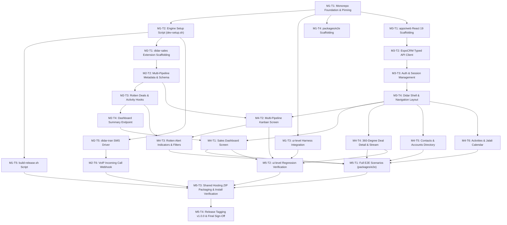

# سند اجرایی ASF: نقشه راه و وظایف فاز اول کلون دیدار (Didar CRM)

> **وضعیت:** تصویب‌شده و آماده ورود به کارخانه نرم‌افزار خودکار (ASF v6)  
> **معماری:** موتور EspoCRM 10.1.4 (بک‌اند) + رابط کاربری روزمره فروش Front-Office Headless (فرانت‌اند)  
> **دامنه:** صرفاً فاز اول (فاز دوم به صورت Full Headless در آینده اجرا خواهد شد)  
> **ابزار تست UI:** `/Users/moeini/Dev/ui-level`  
> **ابزار تست E2E:** پکیج مجزای `packages/e2e` مبتنی بر `monitoring-boilerplate`  
> **متدولوژی کدنویسی:** TDD سخت‌گیرانه (قرمز -> سبز) + واچ‌داگ و میکروبلد کامیت‌ها  

---

## ۱. اصول و قیدهای غیرقابل‌مذاکره سیستم (System Invariants)

1. **انجماد هسته (Engine Pinning):** هیچ فایلی از هسته رسمی EspoCRM ویرایش نخواهد شد. نسخه `10.1.4` در فایل `engine.version` پین شده و در اسکریپت راه‌اندازی به صورت Tarball مستقل دانلود و در `.gitignore` نادیده گرفته می‌شود.
2. **مرزبندی فاز اول (Hybrid Front-Office Boundary):** فقط ۶ تا ۸ صفحه اصلی کار روزمره فروشندگان (داشبورد، کانبان کاریز، جزئیات معامله، اشخاص، شرکت‌ها، فعالیت‌ها و تقویم شمسی) در فرانت‌اند اختصاصی ساخته می‌شوند. بخش‌های مدیریتی، سطوح دسترسی، متادیتا و تنظیمات سیستم در پنل بومی `/admin` باقی می‌مانند.
3. **مسیریابی یکپارچه بدون CORS (Same-Origin):** معماری تک‌پوشه‌ای آپاچی/NGINX:
   - `/api/v1/*` به API رسمی هسته EspoCRM.
   - `/admin/*` به پنل ادمین بومی هسته EspoCRM.
   - `/*` به SPA فرانت‌اند اختصاصی (`public/app/index.html`).
4. **متدولوژی TDD مکانیکی:**
   - کامیت اول: `test(scope): ...` شامل تست‌های واحد یا یکپارچگی که ابتدا باید با خطای مشخص شکست بخورند (Red Gate).
   - کامیت دوم: `feat(scope): ...` شامل پیاده‌سازی حداقل کد برای پاس شدن تست‌ها بدون دستکاری تست‌ها (Green Gate).
5. **گیت تست بصری با `ui-level`:** تمام کامپوننت‌ها و صفحات فرانت‌اند باید علاوه بر تست‌های عملکردی، با ابزار `/Users/moeini/Dev/ui-level` از نظر هندسه DOM، استایل‌های Computed، تطابق رنگ CIEDE2000 و دیف پیکسلی تأیید شوند.
6. **پایش سناریوهای E2E با `monitoring-boilerplate`:** کل گردش‌های اصلی کاربر در پکیج `packages/e2e` با سناریوهای Playwright پوشش داده می‌شوند.
7. **محافظت با واچ‌داگ (Watchdog Wrapper):** تمام دستورات سیستمی و ساب‌ایجنت‌ها با پیشوند `/usr/bin/timeout <seconds>s` اجرا می‌شوند.
8. **لایسنس:** کدهای اختصاصی پروژه تحت **The Unlicense** منتشر می‌شوند و کاملاً از هسته AGPL-3.0 ایزوله هستند.

---

## ۲. گراف وابستگی وظایف (Task DAG)

---

## ۳. فهرست تفصیلی وظایف برای کارخانه خودکار ASF

### مایل‌استون ۱: زیرساخت مونورپو، ابزارهای تست و بسته‌بندی

#### وظیفه `M1-T1`: پیاده‌سازی ساختار ریشه مونورپو و انجماد نسخه هسته
- **وابستگی:** ندارد
- **فایل‌های تحت تأثیر:**
  - `engine.version`
  - `.gitignore`
  - `deploy/htaccess.template`
  - `deploy/nginx.conf.template`
  - `package.json` (تنظیمات ورک‌اسپیس npm برای `apps/*` و `packages/*`)
- **شرح وظیفه:** ایجاد فایل `engine.version` حاوی نسخه `10.1.4`، تنظیم `.gitignore` برای نادیده گرفتن `engine/`، `dist/`، `build/`، `node_modules/` و فایل‌های کش، تنظیم قالب‌های وب‌سرور برای هدایت سه‌گانه (`/api/v1/`, `/admin/`, `/*`).
- **دستور اعتبارسنجی:**  
  `/usr/bin/timeout 30s test -f engine.version && grep -q "10.1.4" engine.version`
- **معیار پذیرش:** ساختار دایرکتوری‌ها و رول‌های `.htaccess` مطابق استاندارد پلن ۱ ایجاد شده باشند.
- **کامیت:** `chore(repo): scaffold monorepo structure and pin engine 10.1.4`

---

#### وظیفه `M1-T2`: اسکریپت دانلود و اتصال محلی هسته (`scripts/dev-setup.sh`)
- **وابستگی:** `M1-T1`
- **فایل‌های تحت تأثیر:**
  - `scripts/dev-setup.sh`
- **شرح وظیفه:** ایجاد اسکریپت Bash ایزوله و دارای واچ‌داگ که:
  1. نسخه پین‌شده در `engine.version` را می‌خواند.
  2. در صورت عدم وجود `engine/`، آرشیو رسمی را از مخزن دانلود یا از کش محلی اکسترکت می‌کند.
  3. پوشه `extensions/didar-*` را به صورت امن به `engine/application/Espo/Modules/` سیم‌لینک می‌کند.
  4. فایل `engine/data/config.php` نمونه را آماده می‌سازد.
- **دستور اعتبارسنجی:**  
  `/usr/bin/timeout 60s bash -n scripts/dev-setup.sh`
- **معیار پذیرش:** اسکریپت بدون خطا syntax check شود و دسترسی اجرایی (`chmod +x`) داشته باشد.
- **کامیت:** `feat(scripts): add dev-setup.sh for engine symlink and local dev`

---

#### وظیفه `M1-T3`: یکپارچه‌سازی ابزار تست بصری `ui-level`
- **وابستگی:** `M1-T1`
- **فایل‌های تحت تأثیر:**
  - `ui-level.config.json`
  - `package.json` (اسکریپت `npm run test:ui`)
- **شرح وظیفه:** اتصال ابزار `/Users/moeini/Dev/ui-level` به پروژه از طریق کانفیگ استاندارد. تنظیم آستانه انحراف رنگ CIEDE2000 حداکثر ۲.۰، تعریف سلکتورهای حیاتی کارت‌های کانبان، سایدبار و فرم‌ها، و تنظیم مد دیمون برای تست‌های پیوسته.
- **دستور اعتبارسنجی:**  
  `/usr/bin/timeout 30s npx --prefix /Users/moeini/Dev/ui-level ui-level doctor`
- **معیار پذیرش:** فایل `ui-level.config.json` ایجاد شده و با ابزار `ui-level` بدون خطای پیکربندی اعتبارسنجی شود.
- **کامیت:** `test(infra): integrate ui-level visual and geometry test config`

---

#### وظیفه `M1-T4`: راه‌اندازی پکیج تست‌های سنتتیک E2E (`packages/e2e`)
- **وابستگی:** `M1-T1`
- **فایل‌های تحت تأثیر:**
  - `packages/e2e/package.json`
  - `packages/e2e/monitor.config.js`
  - `packages/e2e/.env.example`
  - `packages/e2e/lib/runner.js`
  - `packages/e2e/test/offline-harness.test.js`
- **شرح وظیفه:** ساختاردهی پکیج مستقل تست E2E بر اساس معماری `monitoring-boilerplate` (شامل سناریوهای Playwright، مدیریت سشن، ثبت اسکرین‌شات از خطاها و قابلیت اجرای آفلاین Mock).
- **روال TDD:**
  - Red: نوشتن تست آفلاین `packages/e2e/test/offline-harness.test.js` که اجرای یک سناریوی نمونه را مطالبه می‌کند.
  - Green: پیاده‌سازی `lib/runner.js` و اطمینان از پاس شدن تست.
- **دستور اعتبارسنجی:**  
  `/usr/bin/timeout 60s npm --prefix packages/e2e test`
- **معیار پذیرش:** تست‌های ساختار و کانفیگ E2E با خروجی سبز پاس شوند.
- **کامیت:**  
  - `test(e2e): add offline harness test for monitoring scenarios`  
  - `feat(e2e): initialize packages/e2e from monitoring-boilerplate architecture`

---

#### وظیفه `M1-T5`: اسکریپت تولید بسته تک‌فایل هاست اشتراکی (`scripts/build-release.sh`)
- **وابستگی:** `M1-T2`
- **فایل‌های تحت تأثیر:**
  - `scripts/build-release.sh`
- **شرح وظیفه:** ایجاد اسکریپت ساخت پکیج خروجی که:
  1. فرانت‌اند `apps/web` را با Vite کامپایل می‌کند (`npm run build`).
  2. هسته پین‌شده EspoCRM را در دایرکتوری موقت `build/release/` کپی می‌کند.
  3. اکستنشن‌های `extensions/*` را در `application/Espo/Modules/` ادغام می‌کند.
  4. فایل‌های استاتیک فرانت‌اند را در `public/app/` قرار می‌دهد.
  5. رول‌های `.htaccess` مسیریابی را جایگذاری کرده و بسته واحد `didar-crm-v1.0.0.zip` را تولید می‌کند.
- **دستور اعتبارسنجی:**  
  `/usr/bin/timeout 60s bash -n scripts/build-release.sh`
- **معیار پذیرش:** اسکریپت بدون خطای Bash ساخته شود و ساختار خروجی بدون نیاز به Node.js یا Composer در سمت سرور مشتری باشد.
- **کامیت:** `feat(scripts): add build-release.sh for standalone single-zip delivery`

---

### مایل‌استون ۲: اکستنشن‌های بک‌اند EspoCRM به روش TDD

#### وظیفه `M2-T1`: اسکلت ماژول و مانیفست `didar-sales`
- **وابستگی:** `M1-T2`
- **فایل‌های تحت تأثیر:**
  - `extensions/didar-sales/manifest.json`
  - `extensions/didar-sales/composer.json`
  - `extensions/didar-sales/tests/ModuleRegistrationTest.php`
- **روال TDD:**
  - Red: تست PHPUnit برای بررسی وجود مانیفست، نام ماژول `DidarSales` و سازگاری با EspoCRM 10.1.4.
  - Green: پیاده‌سازی مانیفست و تعاریف ماژول مطابق با الگوهای ماژولار استخراج‌شده از EspoCRM.
- **دستور اعتبارسنجی:**  
  `/usr/bin/timeout 60s vendor/bin/phpunit extensions/didar-sales/tests/ModuleRegistrationTest.php`
- **معیار پذیرش:** ماژول با ساختار استاندارد EspoCRM لود شود.
- **کامیت:**  
  - `test(backend): assert didar-sales manifest and module registration`  
  - `feat(backend): implement didar-sales extension scaffold`

---

#### وظیفه `M2-T2`: متادیتا و متدهای چندکاریزه فروش (Multi-Pipeline)
- **وابستگی:** `M2-T1`
- **فایل‌های تحت تأثیر:**
  - `extensions/didar-sales/Resources/metadata/entityDefs/Opportunity.json`
  - `extensions/didar-sales/Resources/metadata/entityDefs/Pipeline.json`
  - `extensions/didar-sales/Resources/metadata/entityDefs/PipelineStage.json`
  - `extensions/didar-sales/tests/PipelineMetadataTest.php`
- **شرح وظیفه:** افزودن فیلد پیوندی `pipelineId` و `pipelineStageId` روی موجودیت `Opportunity` و تنظیم روابط Foreign Key متادیتایی برای پشتیبانی از کاریزهای چندگانه دیدار و مراحل متوالی آنها.
- **روال TDD:**
  - Red: تستی که صحت فیلدهای جدید `Opportunity` و امکان فیلتر کردن بر اساس `pipelineId` را می‌سنجد.
  - Green: تزریق تعاریف متادیتا در ساختار استاندارد ماژول.
- **دستور اعتبارسنجی:**  
  `/usr/bin/timeout 60s vendor/bin/phpunit extensions/didar-sales/tests/PipelineMetadataTest.php`
- **معیار پذیرش:** تعاریف فیلدها در ORM EspoCRM بدون تداخل با هسته لود شوند.
- **کامیت:**  
  - `test(backend): assert multi-pipeline field definitions on Opportunity`  
  - `feat(backend): add multi-pipeline metadata to didar-sales extension`

---

#### وظیفه `M2-T3`: منطق تشخیص معامله پوسیده (Rotten Deals Logic & Hook)
- **وابستگی:** `M2-T2`
- **فایل‌های تحت تأثیر:**
  - `extensions/didar-sales/Hooks/Opportunity/CalculateRotten.php`
  - `extensions/didar-sales/Hooks/Note/UpdateOpportunityActivity.php`
  - `extensions/didar-sales/Resources/metadata/entityDefs/Opportunity.json` (فیلدهای `isRotten`, `lastActivityAt`, `rottenDays`)
  - `extensions/didar-sales/tests/RottenDealsHookTest.php`
- **شرح وظیفه:**  
  1. اگر معامله بیش از `rottenDays` مرحله کاریز خود فاقد هرگونه فعالیت (یادداشت، تماس، وظیفه) باشد، فلگ `isRotten = true` شود.
  2. با ثبت هر رکورد در Stream (یادداشت، تماس، تسک)، فیلد `lastActivityAt` به‌روزرسانی شده و وضعیت پوسیدگی بلافاصله ریست شود.
- **روال TDD:**
  - Red: تستی که معامله‌ای با تاریخ فعالیت قدیمی را پوسیده فرض کرده و بررسی می‌کند که پس از ثبت یادداشت، `isRotten` غیرفعال شود.
  - Green: پیاده‌سازی هوک‌های پس از ذخیره (After-Save Hooks) در `CalculateRotten.php`.
- **دستور اعتبارسنجی:**  
  `/usr/bin/timeout 60s vendor/bin/phpunit extensions/didar-sales/tests/RottenDealsHookTest.php`
- **معیار پذیرش:** تست‌های منطق زمان پوسیدگی و هوک ثبت تعامل با موفقیت پاس شوند.
- **کامیت:**  
  - `test(backend): assert rotten deal calculations and activity hook triggers`  
  - `feat(backend): implement rotten days calculation and stream activity hook`

---

#### وظیفه `M2-T4`: اندپوینت سبک تجمیع داشبورد فروش (`/api/v1/DidarDashboard/summary`)
- **وابستگی:** `M2-T3`
- **فایل‌های تحت تأثیر:**
  - `extensions/didar-sales/Controllers/DidarDashboard.php`
  - `extensions/didar-sales/Services/DashboardSummaryService.php`
  - `extensions/didar-sales/Resources/routes.json`
  - `extensions/didar-sales/tests/DashboardSummaryApiTest.php`
- **شرح وظیفه:** ایجاد کنترلر اختصاصی برای بازگرداندن داده‌های تجمیعی داشبورد (تعداد و ارزش کل معاملات در هر مرحله، تعداد معاملات نیازمند اقدام فوری/پوسیده، آمار فعالیت‌های عقب‌افتاده) در قالب یک پاسخ سبک JSON به‌منظور کاهش تعداد ریکوئست‌های فرانت‌اند.
- **روال TDD:**
  - Red: تست فراخوانی اندپوینت `GET /api/v1/DidarDashboard/summary` و اعتبارسنجی ساختار JSON پاسخ.
  - Green: پیاده‌سازی متدهای کوئری بهینه از طریق Doctrine DBAL و Orm EntityManager.
- **دستور اعتبارسنجی:**  
  `/usr/bin/timeout 60s vendor/bin/phpunit extensions/didar-sales/tests/DashboardSummaryApiTest.php`
- **معیار پذیرش:** زمان پاسخ‌دهی زیر ۱۵۰ میلی‌ثانیه و بدون N+1 query.
- **کامیت:**  
  - `test(backend): assert DidarDashboard summary endpoint response schema`  
  - `feat(backend): implement DidarDashboard summary API endpoint`

---

#### وظیفه `M2-T5`: اسکلت ماژول `didar-iran` و درایور پیامک ایرانی
- **وابستگی:** `M1-T2`
- **فایل‌های تحت تأثیر:**
  - `extensions/didar-iran/manifest.json`
  - `extensions/didar-iran/Sms/KavenegarSender.php`
  - `extensions/didar-iran/Resources/metadata/app/sms.json`
  - `extensions/didar-iran/tests/KavenegarSenderTest.php`
- **شرح وظیفه:** پیاده‌سازی اینترفیس پیامک رسمی EspoCRM با درایور کاوه‌نگار (پشتیبانی از ارسال خدماتی و الگو / Pattern).
- **روال TDD:**
  - Red: تست Mock برای ارسال پیامک، اعتبارسنجی شماره‌های ایران (`09...` و `+98...`) و هندل خطاهای API.
  - Green: کدنویسی درایور ارسال پیامک بر اساس مکانیزم ماژول‌های اس‌ام‌اس EspoCRM.
- **دستور اعتبارسنجی:**  
  `/usr/bin/timeout 60s vendor/bin/phpunit extensions/didar-iran/tests/KavenegarSenderTest.php`
- **معیار پذیرش:** تست‌های ارسال موفق و شکست پیامک در مد Mock با ۱۰۰٪ پوشش کد پاس شوند.
- **کامیت:**  
  - `test(backend): mock unit tests for Kavenegar SMS driver`  
  - `feat(backend): implement Kavenegar SMS provider driver for didar-iran`

---

#### وظیفه `M2-T6`: وب‌هوک تماس ورودی تلفن ابری (VoIP Caller Popup Webhook)
- **وابستگی:** `M2-T5`
- **فایل‌های تحت تأثیر:**
  - `extensions/didar-iran/Controllers/DidarVoip.php`
  - `extensions/didar-iran/Services/VoipLookupService.php`
  - `extensions/didar-iran/Resources/routes.json`
  - `extensions/didar-iran/tests/VoipWebhookTest.php`
- **شرح وظیفه:** ایجاد اندپوینت `POST /api/v1/DidarVoip/webhook` که هنگام زنگ خوردن تلفن ابری (مثلاً سیموتل، ویپ ایران یا دفتر شما)، شماره تماس‌گیرنده را دریافت کرده و در صورت وجود در اشخاص یا شرکت‌ها، مشخصات مشتری و آخرین معاملات باز او را برمی‌گرداند.
- **روال TDD:**
  - Red: تست ارسال پیلود وب‌هوک و اعتبارسنجی تطابق شماره تلفن با رکورد مخاطب.
  - Green: پیاده‌سازی سرویس جستجوی سریع شماره تلفن و ثبت خودکار لاگ تماس ورودی.
- **دستور اعتبارسنجی:**  
  `/usr/bin/timeout 60s vendor/bin/phpunit extensions/didar-iran/tests/VoipWebhookTest.php`
- **معیار پذیرش:** جستجوی شماره تلفن‌های دارای صفر، بدون صفر یا با کد ۹۸ به درستی نرمال‌سازی شود.
- **کامیت:**  
  - `test(backend): assert VoIP webhook lookup with phone normalization`  
  - `feat(backend): implement Didar VoIP webhook endpoint and contact lookup`

---

### مایل‌استون ۳: فرانت‌اند React SPA و لایه احراز هویت به روش TDD

#### وظیفه `M3-T1`: راه‌اندازی فرانت‌اند `apps/web` (React 19 + Vite + Tailwind + RTL)
- **وابستگی:** `M1-T1`
- **فایل‌های تحت تأثیر:**
  - `apps/web/package.json`
  - `apps/web/vite.config.ts`
  - `apps/web/tailwind.config.js`
  - `apps/web/src/index.css` (فونت وزیرمتن و متغیرهای رنگی دیدار)
  - `apps/web/index.html` (`dir="rtl"`, `lang="fa"`)
  - `apps/web/src/test/setup.ts`
- **شرح وظیفه:** ایجاد پروژه فرانت‌اند با بیلد خروجی بهینه SPA، اتصال کامپوننت‌های پایه `shadcn/ui`، تنظیمات کامل راست‌چین (RTL) و فونت وزیرمتن با ظاهری دقیقاً منطبق بر دیدار.
- **روال TDD:**
  - Red: تستی در Vitest که بارگذاری DOM با صفت `dir="rtl"` و کلاس‌های اصلی CSS را بررسی می‌کند.
  - Green: پیکربندی و راه‌اندازی فایل‌های پروژه.
- **گیت تست بصری:** اعتبارسنجی با `ui-level` برای فونت و جهت راست‌چین.
- **دستور اعتبارسنجی:**  
  `/usr/bin/timeout 60s npm --prefix apps/web run test`
- **معیار پذیرش:** بیلد Vite با `npm --prefix apps/web run build` بدون خطا خروجی دهد.
- **کامیت:**  
  - `test(web): assert RTL root attributes and test harness in apps/web`  
  - `feat(web): initialize React 19 Vite TypeScript app with Tailwind RTL`

---

#### وظیفه `M3-T2`: لایه کلاینت تایپ‌شده API و TanStack Query
- **وابستگی:** `M3-T1`
- **فایل‌های تحت تأثیر:**
  - `apps/web/src/lib/api-client.ts`
  - `apps/web/src/lib/query-client.ts`
  - `apps/web/src/types/espocrm.ts`
  - `apps/web/src/test/api-client.test.ts`
- **شرح وظیفه:** پیاده‌سازی کلاینت شبکه بر پایه `fetch` استاندارد با اینترسپتورهای خودکار برای افزودن هدر `Espo-Authorization`، مدیریت کدهای خطای ۴۰۱ و ۴۰۳، هندلینگ خطاهای شبکه و کشینگ هوشمند با `TanStack Query`.
- **روال TDD:**
  - Red: تست‌های واحد Vitest برای ارسال هدرهای احراز هویت و تبدیل خطاهای API به خطاهای تایپ‌شده.
  - Green: پیاده‌سازی کلاس کلاینت و اینترفیس‌های پاسخ EspoCRM.
- **دستور اعتبارسنجی:**  
  `/usr/bin/timeout 60s npm --prefix apps/web test src/test/api-client.test.ts`
- **معیار پذیرش:** کلیه ریکوئست‌ها تایپ‌های سخت‌گیرانه TypeScript داشته باشند.
- **کامیت:**  
  - `test(web): mock tests for EspoCRM API client and error interceptors`  
  - `feat(web): implement typed API client and TanStack Query integration`

---

#### وظیفه `M3-T3`: صفحه ورود، احراز هویت و ذخیره سشن کاربر
- **وابستگی:** `M3-T2`
- **فایل‌های تحت تأثیر:**
  - `apps/web/src/features/auth/components/LoginForm.tsx`
  - `apps/web/src/features/auth/hooks/useAuth.ts`
  - `apps/web/src/features/auth/authStore.ts`
  - `apps/web/src/test/LoginForm.test.tsx`
- **شرح وظیفه:** فرم ورود کاملاً شبیه دیدار (فیلدهای نام کاربری/رمز عبور، پیام‌های خطای فارسی، دکمه ورود با وضعیت در حال بارگذاری)، متصل به `/api/v1/App/user` و خروج با Destroy Token.
- **روال TDD:**
  - Red: تست کامپوننت با React Testing Library برای ورود موفق، اعتبارسنجی فرم با Zod و نمایش پیام خطای ۴۰۱.
  - Green: پیاده‌سازی کامپوننت و هوک سشن.
- **گیت تست بصری با `ui-level`:**  
  `npx ui-level check --target http://localhost:5173/login --selector ".didar-login-card"`
- **دستور اعتبارسنجی:**  
  `/usr/bin/timeout 60s npm --prefix apps/web test src/test/LoginForm.test.tsx`
- **معیار پذیرش:** توکن کاربر با رعایت امنیت در حافظه و کوکی Http-Only یا ذخیره‌ساز سشن قرار گیرد.
- **کامیت:**  
  - `test(web): test LoginForm validation and auth state dispatch`  
  - `feat(web): implement Didar-style login screen and auth provider`

---

#### وظیفه `M3-T4`: پوسته اصلی برنامه (Shell)، سایدبار و نوار جستجوی دیدار
- **وابستگی:** `M3-T3`
- **فایل‌های تحت تأثیر:**
  - `apps/web/src/components/layout/AppShell.tsx`
  - `apps/web/src/components/layout/Sidebar.tsx`
  - `apps/web/src/components/layout/GlobalSearchBar.tsx`
  - `apps/web/src/components/layout/UserNav.tsx`
  - `apps/web/src/test/AppShell.test.tsx`
- **شرح وظیفه:** طراحی اسکلت اصلی با سایدبار عمودی راست‌چین (آیکون‌ها و عنوان بخش‌های کاریز، معاملات، اشخاص، فعالیت‌ها و تنظیمات)، هدر دارای جستجوی آنی در سراسر CRM (`/api/v1/GlobalSearch`)، دکمه افزودن سریع معامله و منوی کاربر.
- **روال TDD:**
  - Red: تست رندر شدن منوهای سایدبار و باز شدن پاپ‌اور جستجوی سراسری هنگام فشردن کلید میانبر `Ctrl+K`.
  - Green: پیاده‌سازی لایه‌بندی و کامپوننت‌های تعاملی.
- **گیت تست بصری با `ui-level`:** مقایسه ابعاد سایدبار و فاصله‌ها با استاندارد دیدار.
- **دستور اعتبارسنجی:**  
  `/usr/bin/timeout 60s npm --prefix apps/web test src/test/AppShell.test.tsx`
- **معیار پذیرش:** پوسته کاملاً واکنش‌گرا و سازگار با اندازه‌های مختلف مانیتور باشد.
- **کامیت:**  
  - `test(web): assert AppShell navigation items and global search shortcut`  
  - `feat(web): implement Didar master layout, sidebar, and search header`

---

### مایل‌استون ۴: صفحات عملیاتی روزمره فروش به روش TDD و تست بصری

#### وظیفه `M4-T1`: داشبورد آمار فروش و قیف معاملات
- **وابستگی:** `M3-T4`, `M2-T4`
- **فایل‌های تحت تأثیر:**
  - `apps/web/src/pages/DashboardPage.tsx`
  - `apps/web/src/features/dashboard/components/KpiCard.tsx`
  - `apps/web/src/features/dashboard/components/SalesFunnelChart.tsx`
  - `apps/web/src/features/dashboard/components/PendingActivitiesWidget.tsx`
  - `apps/web/src/test/DashboardPage.test.tsx`
- **شرح وظیفه:** نمایش کارت‌های شاخص کلیدی فروش دیدار (مبلغ فروش ماه، تعداد معاملات باز، کارهای معوقه)، نمودار میله‌ای قیف فروش مراحل کاریز و لیست کارهای اولویت‌دار امروز با تاریخ شمسی.
- **روال TDD:**
  - Red: تست رندر اعداد تجمیعی و نمایش اسکلتون هنگام بارگذاری داده‌ها از `/api/v1/DidarDashboard/summary`.
  - Green: پیاده‌سازی کامپوننت‌های کارت، نمودار SVG تمیز و لیست وظایف.
- **گیت تست بصری با `ui-level`:** بررسی تطابق رنگ‌های سبز و نارنجی KPI و فاصله‌بندی کارت‌ها.
- **دستور اعتبارسنجی:**  
  `/usr/bin/timeout 60s npm --prefix apps/web test src/test/DashboardPage.test.tsx`
- **معیار پذیرش:** داده‌های مالی با فرمت‌بندی ریال/تومان فارسی و بدون هیچ بار اضافی در لود اولیه نمایش داده شوند.
- **کامیت:**  
  - `test(web): assert Dashboard KPI cards and pending tasks rendering`  
  - `feat(web): implement Didar sales dashboard and funnel visualization`

---

#### وظیفه `M4-T2`: کانبان‌بورد تعاملی کاریز فروش (Kanban with Drag & Drop)
- **وابستگی:** `M3-T4`, `M2-T2`
- **فایل‌های تحت تأثیر:**
  - `apps/web/src/pages/KanbanPage.tsx`
  - `apps/web/src/features/kanban/components/KanbanBoard.tsx`
  - `apps/web/src/features/kanban/components/KanbanColumn.tsx`
  - `apps/web/src/features/kanban/components/DealCard.tsx`
  - `apps/web/src/features/kanban/hooks/useKanbanDeals.ts`
  - `apps/web/src/test/KanbanBoard.test.tsx`
- **شرح وظیفه:** ستون‌های مراحل فروش کاریز بر اساس `@dnd-kit`، نمایش کارت‌های معامله شامل عنوان، نام مشتری، مبلغ، تاریخ آخرین فعالیت، امکان جابجایی کارت بین ستون‌ها و ارسال درخواست `PUT /api/v1/Kanban/order` با به‌روزرسانی آنی خوش‌بینانه (Optimistic UI Update).
- **روال TDD:**
  - Red: شبیه‌سازی جابجایی یک معامله بین دو ستون و تأیید فراخوانی صحیح متد انتقال وضعیت.
  - Green: کدنویسی بورد کانبان با ری‌اکت و کنترلرهای درگ‌اند‌دراپ.
- **گیت تست بصری با `ui-level`:** بررسی ثبات پیکسلی ستون‌ها هنگام اسکرول افقی و شکل کارت‌های در حال درگ.
- **دستور اعتبارسنجی:**  
  `/usr/bin/timeout 60s npm --prefix apps/web test src/test/KanbanBoard.test.tsx`
- **معیار پذیرش:** جابجایی کارت بدون لگ و با انیمیشن روان در مرورگر انجام شود.
- **کامیت:**  
  - `test(web): test drag-and-drop state mutation in KanbanBoard`  
  - `feat(web): implement interactive multi-pipeline Kanban board`

---

#### وظیفه `M4-T3`: نشانگر و فیلتر معاملات پوسیده (Rotten Deal Alert Badges)
- **وابستگی:** `M4-T2`, `M2-T3`
- **فایل‌های تحت تأثیر:**
  - `apps/web/src/features/kanban/components/RottenBadge.tsx`
  - `apps/web/src/features/kanban/components/KanbanFilterBar.tsx`
  - `apps/web/src/test/RottenBadge.test.tsx`
- **شرح وظیفه:** کارت معاملاتی که وضعیت `isRotten = true` دارند با نوار قرمز اختصاصی دیدار و متن «X روز بدون پیگیری» مشخص شوند؛ افزودن دکمه تاگل فیلتر فوری «فقط معاملات پوسیده» در بالای کاریز.
- **روال TDD:**
  - Red: تستی که کارت معامله دارای `isRotten: true` را چک کرده و انتظار دارد بج قرمز و کلاس هشدار رندر شود.
  - Green: پیاده‌سازی کامپوننت بج و فیلتر کلاینتی/سروری.
- **دستور اعتبارسنجی:**  
  `/usr/bin/timeout 60s npm --prefix apps/web test src/test/RottenBadge.test.tsx`
- **معیار پذیرش:** وضعیت پوسیدگی بلافاصله پس از ثبت فعالیت جدید روی کارت محو شود.
- **کامیت:**  
  - `test(web): assert RottenBadge appearance on stagnant deal cards`  
  - `feat(web): implement rotten deal visual indicators and filter bar`

---

#### وظیفه `M4-T4`: صفحه جامع ۳۶۰ درجه جزئیات معامله و تایم‌لاین تعاملات
- **وابستگی:** `M3-T4`
- **فایل‌های تحت تأثیر:**
  - `apps/web/src/pages/DealDetailPage.tsx`
  - `apps/web/src/features/deals/components/DealSidebar.tsx`
  - `apps/web/src/features/deals/components/DealTimeline.tsx`
  - `apps/web/src/features/deals/components/QuickLogBar.tsx`
  - `apps/web/src/test/DealDetailPage.test.tsx`
- **شرح وظیفه:**  
  - ستون راست: اطلاعات قرارداد، مبلغ، مرحله، اطلاعات تماس مخاطب، دکمه تغییر مرحله و بستن معامله (برد/باخت).  
  - ستون وسط/چپ: تایم‌لاین تاریخی تعاملات (`/api/v1/Opportunity/:id/stream`) به همراه تب‌های ثبت سریع یادداشت، ثبت تماس تلفنی، ایجاد جلسه و تعریف کار بعدی.
- **روال TDD:**
  - Red: تست رندر استریم تعاملات و ارسال موفق یک یادداشت جدید با پاک شدن فیلد ورودی.
  - Green: پیاده‌سازی دو ستونه صفحه جزئیات معامله به سبک اصیل دیدار.
- **گیت تست بصری با `ui-level`:** ارزیابی چیدمان تایم‌لاین و تراز عمودی آیکون‌های تماس و جلسه.
- **دستور اعتبارسنجی:**  
  `/usr/bin/timeout 60s npm --prefix apps/web test src/test/DealDetailPage.test.tsx`
- **معیار پذیرش:** ثبت سریع بدون رفرش کل صفحه تایم‌لاین را بلافاصله آپدیت کند.
- **کامیت:**  
  - `test(web): test DealDetailPage stream rendering and quick log submission`  
  - `feat(web): implement 360-degree deal detail view with unified timeline`

---

#### وظیفه `M4-T5`: دایرکتوری و پروفایل اشخاص و شرکت‌ها (Contacts & Accounts)
- **وابستگی:** `M3-T4`
- **فایل‌های تحت تأثیر:**
  - `apps/web/src/pages/ContactsPage.tsx`
  - `apps/web/src/pages/AccountsPage.tsx`
  - `apps/web/src/features/contacts/components/ContactsTable.tsx`
  - `apps/web/src/features/contacts/components/ContactQuickCreateModal.tsx`
  - `apps/web/src/test/ContactsTable.test.tsx`
- **شرح وظیفه:** جدول سریع و سبک بر پایه `TanStack Table` شامل نام، شرکت، شماره تماس، ایمیل و تاریخ آخرین تعامل، دارای جستجوی سروری، قابلیت صفحه‌بندی و مودال ثبت سریع شخص/شرکت جدید.
- **روال TDD:**
  - Red: تست فیلتر نام در جدول و اعتبارسنجی شماره موبایل در مودال ایجاد سریع.
  - Green: پیاده‌سازی جدول و فرم‌های ساخت مخاطب.
- **دستور اعتبارسنجی:**  
  `/usr/bin/timeout 60s npm --prefix apps/web test src/test/ContactsTable.test.tsx`
- **معیار پذیرش:** کلیک روی هر شماره امکان تماس مستقیم (`tel:`) را فعال کند.
- **کامیت:**  
  - `test(web): test contacts table pagination and modal validation`  
  - `feat(web): implement contacts and accounts table views and create modal`

---

#### وظیفه `M4-T6`: فعالیت‌ها، پیگیری‌ها و تقویم شمسی فروش
- **وابستگی:** `M3-T4`
- **فایل‌های تحت تأثیر:**
  - `apps/web/src/pages/ActivitiesPage.tsx`
  - `apps/web/src/features/activities/components/JalaliCalendarView.tsx`
  - `apps/web/src/features/activities/components/ActivityItemRow.tsx`
  - `apps/web/src/features/activities/components/ActivityCreateModal.tsx`
  - `apps/web/src/test/ActivitiesPage.test.tsx`
- **شرح وظیفه:** نمای لیست پیگیری‌های امروز، فردا و معوقه به همراه نمای تقویم شمسی ماهانه و هفتگی (`date-fns-jalali`). امکان تیک زدن کار به عنوان انجام‌شده و تعیین وظیفه بعدی در همان لحظه (هسته رفتار دیدار: هیچ معامله‌ای بدون کار بعدی رها نمی‌شود).
- **روال TDD:**
  - Red: تستی که تاریخ میلادی را به شمسی صحیح نگاشت کرده و تیک زدن فعالیت را آزمایش می‌کند.
  - Green: پیاده‌سازی تقویم و لیست وظایف با پشتیبانی کامل تاریخ هجری شمسی.
- **دستور اعتبارسنجی:**  
  `/usr/bin/timeout 60s npm --prefix apps/web test src/test/ActivitiesPage.test.tsx`
- **معیار پذیرش:** محاسبات کبیسه و تبدیل تاریخ در لایه کلاینت با تقویم رسمی ایران ۱۰۰٪ مطابقت داشته باشد.
- **کامیت:**  
  - `test(web): test Jalali date conversion and activity toggle action`  
  - `feat(web): implement team activities list and Jalali sales calendar`

---

### مایل‌استون ۵: سناریوهای E2E، تست‌های رگرسیون بصری و گیت تحویل

#### وظیفه `M5-T1`: پیاده‌سازی سناریوهای پایش E2E در `packages/e2e`
- **وابستگی:** `M1-T4`, `M4-T1`, `M4-T2`, `M4-T4`, `M4-T5`, `M4-T6`
- **فایل‌های تحت تأثیر:**
  - `packages/e2e/scenarios/01-login-and-session.js`
  - `packages/e2e/scenarios/02-kanban-drag-and-drop.js`
  - `packages/e2e/scenarios/03-deal-creation-and-rotten.js`
  - `packages/e2e/scenarios/04-timeline-quick-log.js`
  - `packages/e2e/scenarios/05-contacts-search.js`
  - `packages/e2e/scenarios/06-jalali-calendar-activities.js`
  - `packages/e2e/run-all.js`
- **شرح وظیفه:** نگارش سناریوهای سطح بالا بر اساس هسته `monitoring-boilerplate` که کل رفتار کاربر را روی مرورگر کرومیوم تست می‌کنند:
  1. لاگین و بررسی ماندگاری سشن.
  2. کشیدن معامله از مرحله «تماس اولیه» به «جلسه حضوری».
  3. ساخت معامله جدید و تأیید نمایش بج پوسیدگی در صورت عدم فعالیت.
  4. ثبت یادداشت در استریم و محو شدن برچسب پوسیدگی.
  5. جستجوی شخص در دایرکتوری.
  6. ثبت و تیک زدن وظیفه در تقویم شمسی.
- **دستور اعتبارسنجی:**  
  `/usr/bin/timeout 180s npm --prefix packages/e2e run test:e2e`
- **معیار پذیرش:** تمام سناریوهای شش‌گانه در حالت هدلس بدون فیلیر اجرا شده و در صورت بروز خطا اسکرین‌شات ثبت کنند.
- **کامیت:** `test(e2e): implement complete 6-scenario synthetic monitoring suite`

---

#### وظیفه `M5-T2`: اجرای ارزیابی رگرسیون بصری و هندسی با `ui-level`
- **وابستگی:** `M1-T3`, `M4-T1`, `M4-T2`, `M4-T4`
- **فایل‌های تحت تأثیر:**
  - `tests/ui-level/specs/kanban.spec.json`
  - `tests/ui-level/specs/deal-detail.spec.json`
  - `tests/ui-level/specs/dashboard.spec.json`
  - `reports/ui-level-report.json`
- **شرح وظیفه:** اجرای گیت اول (Gate 1: هندسه DOM و استایل‌های Computed، تطابق رنگ CIEDE2000) و گیت دوم (Gate 2: تفاضل پیکسلی با `odiff-bin`) با ابزار `/Users/moeini/Dev/ui-level` در مقابل رفرنس‌های تاییدشده طراحی دیدار.
- **دستور اعتبارسنجی:**  
  `/usr/bin/timeout 90s npx --prefix /Users/moeini/Dev/ui-level ui-level check --config ui-level.config.json`
- **معیار پذیرش:** خطای هندسی صفر و دلتای رنگ زیر آستانه بحرانی $\Delta E_{00} < 2.0$.
- **کامیت:** `test(ui): verify pixel and computed CSS geometry with ui-level engine`

---

#### وظیفه `M5-T3`: اعتبارسنجی بسته نهایی هاست اشتراکی و تست نصب
- **وابستگی:** `M1-T5`, `M5-T1`, `M5-T2`
- **فایل‌های تحت تأثیر:**
  - خروجی بیلد: `dist/didar-crm-v1.0.0.zip`
  - `tests/installer/MockInstallTest.php`
- **شرح وظیفه:** اجرای اسکریپت `scripts/build-release.sh` و تست خودکار باز کردن زیپ، بررسی وجود دایرکتوری‌های `public/api/v1/`، `public/app/`، قوانین `.htaccess` و اجرای سناریوی نصب آزمایشی.
- **دستور اعتبارسنجی:**  
  `/usr/bin/timeout 120s bash scripts/build-release.sh && test -f dist/didar-crm-v1.0.0.zip`
- **معیار پذیرش:** فایل زیپ تولیدشده خودکفا بوده و هیچ وابستگی اجرایی به کامپایلر فرانت‌اند یا کامپوزر روی سرور مقصد نداشته باشد.
- **کامیت:** `chore(release): generate and verify standalone didar-crm-v1.0.0.zip`

---

#### وظیفه `M5-T4`: همگام‌سازی نسخه‌ها، مستندسازی و تگ رسمی نسخه ۱
- **وابستگی:** `M5-T3`
- **فایل‌های تحت تأثیر:**
  - `README.md`
  - `CHANGELOG.md`
  - `docs/API.md`
  - `docs/USER_MANUAL_FA.md`
  - `package.json`
- **شرح وظیفه:** به‌روزرسانی مستندات راهنمای نصب و راه‌اندازی فارسی، مستندات API اختصاصی ماژول‌های فروش و وب‌هوک، درج گزارش تغییرات نسخه ۱.۰.۰ و ثبت تگ Git.
- **دستور اعتبارسنجی:**  
  `/usr/bin/timeout 30s git status --porcelain`
- **معیار پذیرش:** ورکینگ‌تری کاملاً تمیز بوده و نسخه در تمام فایل‌ها `1.0.0` باشد.
- **کامیت:** `docs(release): finalize documentation, changelog, and tag v1.0.0`

---

## ۴. جمع‌بندی استراتژی تحویل و گذار به فاز ۲

- **در پایان فاز اول:** محصولی کامل، سریع و بومی با فرانت اختصاصی شبیه دیدار و هسته قدرتمند و پین‌شده EspoCRM در قالب یک فایل ZIP آماده بارگذاری روی هاست اشتراکی تحویل می‌شود.
- **پلن فاز دوم (آینده):** پس از تثبیت فروش و فیدبک کاربران، لایه رندر داینامیک متادیتا (`DynamicFieldRenderer`) و رابط فارسی تنظیمات ساخته شده و هسته Backbone.js به‌طور کامل حذف خواهد شد. هیچ بخشی از فرانت‌اند فاز اول دور ریخته نمی‌شود، بلکه به عنوان هسته Front-Office در فاز ۲ گسترش خواهد یافت.
