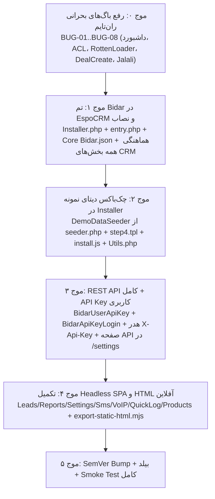

# گزارش جامع بازبینی کد، ممیزی تطابق با دیدار و پلن تکمیل BidarCRM

> **وضعیت سند:** **فقط پلن (Plan Only — بدون پیاده‌سازی)**  
> **نسخه پلن:** v2.0 (پس از بازبینی عمیق خط‌به‌خط هسته EspoCRM 10.1.4، اکستنشن‌ها، فرانت Headless، تم بومی، نصاب و `seeder.php`)  
> **تاریخ بازبینی:** ۳ آذر ۱۴۰۵ (2026-11-23)  
> **دامنه بازبینی:** هسته `engine/` (EspoCRM 10.1.4)، اکستنشن‌های `extensions/bidar-*`، فرانت Headless (`apps/web/`)، تم بومی (`client/custom/modules/bidar-theme/`)، نصاب (`engine/install/`)، اسکریپت‌های بیلد (`scripts/`)، قالب‌های استقرار (`deploy/`) و سیدر مرجع `/Users/moeini/Dev/bidar-crm/seeder.php`  
> **مراجع ASF بررسی‌شده:** [FEATURES_AND_SCENARIOS.md](../research/FEATURES_AND_SCENARIOS.md)، [YOUTUBE_WALKTHROUGHS.md](../research/YOUTUBE_WALKTHROUGHS.md)، [asf-phase-1-tasks.md](./asf-phase-1-tasks.md)، [bidar-didar-core-gap.md](./bidar-didar-core-gap.md)، [bidar-iran-localization.md](./bidar-iran-localization.md)، [bidar-theme-and-frontend.md](./bidar-theme-and-frontend.md)، [bidar-whitelabel.md](./bidar-whitelabel.md)

---

## بخش ۱: جمع‌بندی اجرایی بازبینی کد و باگ‌های بحرانی کشف‌شده در ران‌تایم (P0 Runtime Defects)

بازبینی خط‌به‌خط کدبیس `/Users/moeini/Dev/didar` نشان داد با وجود سبز بودن تست‌های واحد فعلی (که روی آرایه‌های ماک اجرا می‌شوند)، **۹ نقص واقعی ران‌تایم و معماری** وجود دارد که کلون ایجادشده را در استقرار واقعی دچار خطا یا عدم تطابق با دیدار می‌کند:

| شناسه | شدت | فایل و خط دقیق (`file:line`) | شرح دقیق نقص مشاهده‌شده در کد واقعی |
| :---: | :---: | :--- | :--- |
| **`BUG-01`** | 🔴 P0 | `extensions/bidar-sales/Api/GetDashboardSummary.php:180` و `Services/DashboardSummaryService.php:78-79` | اندپوینت داشبورد فیلد ناموجود `stageProbability` را می‌خواند و `probability` و `pipelineStageId` را ارسال نمی‌کند؛ سرویس نیز `$stage === 'Closed Won'` / `'Closed Lost'` را چک نمی‌کند. در ران‌تایم EspoCRM آمار **`wonCount`, `wonAmount`, `lostCount`, `conversionRate`, `lossReasonsBreakdown` همگی صفر می‌شوند** و نگاشت مراحل کاریز با `mappedStatus`/`pipelineStageId` شکست می‌خورد. |
| **`BUG-02`** | 🔴 P0 | `extensions/bidar-sales/Api/GetDashboardSummary.php:192` و `Services/DashboardSummaryService.php:189` | کوئری فعالیت‌های معوق روی `Task` شرط `['status' => 'Planned']` گذاشته است؛ در حالی که وضعیت‌های `Task` در EspoCRM برابر `'Not Started'` و `'Started'` است (`'Planned'` متعلق به `Call`/`Meeting` است). در نتیجه **`overdueActivitiesCount` برای تسک‌ها همیشه صفر است**. |
| **`BUG-03`** | 🔴 P0 | `extensions/bidar-sales/Api/GetDashboardSummary.php:159-174` | با وجود اضافه شدن `$acl->check('Opportunity', 'read')`، کوئری ORM مستقیماً از `getRDBRepository('Opportunity')->where(...)->find()` استفاده می‌کند و از `SelectBuilderFactory` + `applyAccessControl()` عبور نمی‌کند؛ بنابراین کاربر غیرمدیر با سطح دسترسی `own`/`team` آمار **کل سازمان** را می‌بیند. همچنین `BidarGoal` هرگز کوئری نمی‌شود و `DashboardPage.tsx:143` همیشه روی عدد ثابت `100,000,000` فالبک می‌زند. |
| **`BUG-04`** | 🔴 P0 | `extensions/bidar-sales/FieldProcessing/Opportunity/RottenLoader.php:37` | `RottenLoader` فیلد ناموجود `stageProbability` را به‌جای `$entity->get('stage')` می‌خواند؛ بنابراین معاملات `Closed Won` و `Closed Lost` با `lastActivityAt` قدیمی به‌اشتباه **پوسیده (`isRotten = true`)** علامت می‌خورند. |
| **`BUG-05`** | 🔴 P0 | `apps/web/src/features/kanban/components/DealCreateModal.tsx:121` | هنگام ساخت معامله، `stage: selectedStage?.id || selectedStage?.name || 'Prospecting'` ارسال می‌شود. ارسال شناسه ۱۷ کاراکتری `PipelineStage` در فیلد Enum `Opportunity.stage` (به‌جای `mappedStatus` و `pipelineId` + `pipelineStageId`) باعث **خطای Validation سرور (HTTP 400)** می‌شود. علاوه بر این، `Pipelines.php:80` در EspoCRM 10.1.4 هنگام فعال بودن `pipelines: true` فیلد `stage` را `readOnly` می‌کند و از `pipelineStageId` استنتاج می‌نماید. |
| **`BUG-06`** | 🔴 P0 | `apps/web/src/pages/DealDetailPage.tsx:80-113` | متد `handleAddNote(text, _type)` پارامتر `_type` (`Call`, `Meeting`, `Task`, `Note`) را نادیده می‌گیرد و برای هر ۴ تب `QuickLogBar.tsx` صرفاً `POST /Note` می‌زند. هیچ `Call`، `Meeting` یا `Task` واقعی در صفحه جزئیات معامله ثبت نمی‌شود و پیوست فایل نیز ندارد. |
| **`BUG-07`** | 🔴 P0 | `engine/install/core/Installer.php:266-277, 398` و `engine/install/entry.php:77, 198` | لیست تم‌های نصاب در `getThemeList()` هاردکد شده و `'Bidar'` ندارد؛ خط ۳۹۸ پیش‌فرض را `'Espo'` می‌گذارد؛ `entry.php:198` استایل‌شیت اولیه نصاب را روی `'Espo'` و خط ۷۷ زبان پیش‌فرض را روی `'en_US'` قفل کرده؛ و `Bidar.json` در هسته `application/Espo/Resources/metadata/themes/` وجود ندارد. |
| **`BUG-08`** | 🟠 P1 | `extensions/bidar-iran/Support/JalaliHelper.php:19, 93` و `IranValidators.php:67` | متد `toJalaliDate()` بدون تنظیم منطقه زمانی `Asia/Tehran` تبدیل انجام می‌دهد (اختلاف یک روزه حوالی نیمه‌شب UTC)، پارامتر `$tz` در `getJalaliMonthRange()` بی‌استفاده است، و Regex کد پستی `/^[13-9]{5}[0-9]{5}$/` کدهای پستی معتبر دارای رقم `0` یا `2` در جایگاه‌های ۲ تا ۵ را رد می‌کند. |
| **`BUG-09`** | 🟠 P1 | `engine/application/Espo/Tools/UserSecurity/Api/PostApiKeyGenerate.php:53` و `apps/web/` | ساخت API Key در هسته EspoCRM منحصراً محدود به `isEffectiveAdmin()` روی `ApiUser` در `/admin` است؛ کاربران عادی پنل امکان ساخت API Key شخصی ندارند و در پنل Headless نیز هیچ صفحه/اندپوینت مدیریت API Key وجود ندارد. |

---

## بخش ۲: گردآوری امکانات دیدار (از اسناد ASF) و ماتریس راستی‌آزمایی پیاده‌سازی واقعی

جدول زیر تمام امکانات استخراج‌شده از اسناد تحقیقاتی و ویدئوهای رسمی دیدار در ASF را در برابر پیاده‌سازی واقعی بک‌اند و فرانت‌اند راستی‌آزمایی می‌کند:

| # | امکان استخراج‌شده از دیدار | مرجع ASF | وضعیت بک‌اند و API | وضعیت فرانت Headless (`apps/web/`) | وضعیت دقیق و شکاف مشاهده‌شده (`file:line`) |
| :---: | :--- | :--- | :---: | :---: | :--- |
| ۱ | **کاریز معاملات و کانبان چندگانه + Drag & Drop** | `FEATURES #1`, `YT #1` | 🟢 کامل | 🟢 کامل | `KanbanPage.tsx`, `KanbanBoard.tsx`, `PipelineSelector.tsx`, `useKanbanDeals.ts` — نام‌گذاری ۱۰۰٪ «کاریز» (۰ مورد «خط لوله»). **نیاز به بررسی:** هماهنگی `pipelineId`/`pipelineStageId` با `Pipelines.php` هسته ۱۰.۱.۴. |
| ۲ | **رهگیری معاملات پوسیده (`isRotten`)** | `FEATURES #2`, `YT #1` | 🟡 دارای باگ `BUG-04` | 🟢 کامل | `RottenDealCalculator.php` سالم است، اما `RottenLoader.php:37` فیلد ناموجود `stageProbability` را می‌خواند. |
| ۳ | **ثبت سریع معامله + دکمه «فروش موفق»** | `YT #2`, `GAP-04` | 🟢 کامل | 🔴 دارای باگ `BUG-05` + ناقص | `DealCreateModal.tsx:121` مقدار نامعتبر در `stage` می‌فرستد؛ خط ۳۲۶ `<input type="date">` میلادی دارد؛ انتخابگر جستجوپذیر `Contact`/`Account` و جدول اقلام محصول ندارد. |
| ۴ | **صفحه ۳۶۰ درجه معامله + ثبت یادداشت/تماس/جلسه/کار + تایم‌لاین** | `FEATURES #3`, `YT #2` | 🟢 کامل | 🔴 دارای باگ `BUG-06` | `QuickLogBar.tsx` ۴ تب دارد ولی `DealDetailPage.tsx:80` فقط `POST /Note` می‌زند. پیوست فایل (`/Attachment`) و دکمه پین وجود ندارد. |
| ۵ | **دلایل شکست معامله (`lossReason`) + مودال اجباری** | `GAP-01`, `YT #2` | 🟢 کامل | 🟢 کامل | `Opportunity.json`, `LossReasonModal.tsx`, `KanbanPage.tsx:156`, `DealDetailPage.tsx:135`. *(به‌دلیل `BUG-01` آمار آن در گزارش داشبورد صفر نشان داده می‌شود).* |
| ۶ | **محصولات و اقلام سبک معامله با جمع خودکار** | `GAP-02` | 🟢 کامل (`BidarProduct`, `BidarDealItem`, `RecalculateOpportunityAmount.php`) | ❌ ناموجود | صفر کامپوننت UI در `DealDetailPage.tsx`، `DealCreateModal.tsx` و `/settings`. |
| ۷ | **نمای پیش‌بینی فروش (Forecast View) بر اساس ماه شمسی** | `GAP-06` | 🟢 کامل | 🟢 کامل | `KanbanPage.tsx:78, 294` با جمع کل و جمع موزون. |
| ۸ | **مدیریت اشخاص، شرکت‌ها و گروه‌بندی مشتریان (`customerGroups`)** | `FEATURES #4`, `YT #4`, `GAP-05` | 🟢 کامل (`Contact.json`, `Account.json`, `IranValidators`) | 🟡 ناقص | (۱) `AccountsPage.tsx` دکمه/مودال «شرکت جدید» ندارد. (۲) صفحه جزئیات شخص/شرکت نیست. (۳) `customerGroups` و فیلدهای ایران (`nationalCode`, `nationalId`, `shebaNumber`, `postalCode`) در UI نیستند. (۴) دکمه خروجی CSV فارسی (`PersianCsvExporter`) نیست. |
| ۹ | **سرنخ‌های فروش (`Leads`) و تبدیل یک‌کلیکه به معامله** | `bidar-theme-and-frontend.md §3.1` | 🟢 بومی (`/Lead`, `/Lead/action/convert`) | ❌ ناموجود | مسیر `/leads` و `LeadsPage.tsx` در `App.tsx` و `Sidebar.tsx` وجود ندارد. |
| ۱۰ | **فعالیت‌ها، پیگیری روزانه، تقویم شمسی و کانبان کارها** | `FEATURES #5`, `YT #3`, `GAP-10`, `IR-11` | 🟢 کامل (`Task.json` دارای `kanbanViewMode: true`) | 🟡 ناقص | لیست اجندا و `JalaliCalendarView.tsx` هست؛ اما: (۱) تب کانبان کارها در `ActivitiesPage.tsx` پیاده نشده؛ (۲) تعطیلات رسمی ایران (`IR-11`) و ورود طبیعی زمان («فردا ساعت ۱۰») نیست؛ (۳) پرامپت خودکار پیگیری بعدی هنگام تیک زدن کار پیاده نشده. |
| ۱۱ | **داشبورد، KPIها، گزارش‌های نشانگر و هدف‌گذاری (`BidarGoal`)** | `FEATURES #6`, `YT #5`, `GAP-03`, `GAP-07` | 🔴 دارای `BUG-01`, `BUG-02`, `BUG-03` | 🟡 ناقص | `DashboardPage.tsx` کارت‌ها، قیف، دلایل باخت و ویجت هدف را دارد، اما `topSalesReps` و `leadSourceBreakdown` نمایش داده نمی‌شوند، فیلتر دوره شمسی (`jalaliPeriod`) و کارشناس در UI نیست، هدف فروش روی `100,000,000` هاردکد فالبک می‌زند، و صفحه `/reports` + CRUD هدف فروش وجود ندارد. |
| ۱۲ | **جستجوی سراسری (`Ctrl+K`)، پین‌شده‌ها و زنگوله اعلان‌ها** | `YT #4`, `GAP-08` | 🟢 بومی (`/GlobalSearch`, `/Notification`) | 🔴 ساختگی / Stubbed | (۱) `GlobalSearchBar.tsx` به‌جای مودال `Ctrl+K` از `/GlobalSearch`، صفحه را به `/contacts?search=...` می‌فرستد. (۲) دکمه «پین‌شده‌ها» در `AppShell.tsx:75` فقط به `/kanban` می‌رود. (۳) زنگوله اعلان‌ها در `UserNav.tsx:37` دکمه تزئینی بدون `onClick` است. |
| ۱۳ | **صندوق پیامک، قالب‌ها و پیامک گروهی (کاوه‌نگار)** | `FEATURES #7`, `GAP-09` | 🟢 کامل (`KavenegarSender`, `SmsCampaignService`, `PostSendSms`, `BidarSmsTemplate`, `BidarSmsMessage`) | ❌ ناموجود | هیچ `SmsModal.tsx`، شمارنده کاراکتر فارسی (۷۰/۶۷) یا UI تاریخچه/قالب در `apps/web/` وجود ندارد. |
| ۱۴ | **وب‌هوک کالرآیدی تلفن ابری (VoIP Caller ID Popup)** | `FEATURES #8`, `YT #6` | 🟢 کامل (`PostVoipWebhook`, `VoipLookupService`, `IranPhoneNormalizer`) | ❌ ناموجود | هیچ پاپ‌آپ تماس ورودی یا مکانیزم Poll/SSE در `AppShell.tsx` پیاده نشده است. |
| ۱۵ | **تنظیمات ساده مدیر فروش و فرم‌ساز سرنخ (`LeadCapture`)** | `GAP-11`, `GAP-12` | 🟢 بومی (`LeadCapture`, `BidarProduct`, `BidarGoal`) | ❌ ناموجود | صفحه `/settings` در `App.tsx` وجود ندارد. |
| ۱۶ | **سرویس REST API و ساخت API Key توسط کاربر** | الزام جدید کاربر | 🟡 فقط Admin `ApiUser` در `/admin` | ❌ ناموجود | کاربر عادی نمی‌تواند API Key بسازد (`PostApiKeyGenerate.php:53`) و UI مدیریت کلیدها در SPA وجود ندارد. |

---

## بخش ۳: پلن معماری و فنی ۴ الزام کلیدی (اجراپذیر و اتمی برای ASF)



---

### مسیر A: سرویس REST API کامل + ساخت و مدیریت API Key توسط کاربر

#### معماری استاندارد روی EspoCRM 10.1.4 (بدون دستکاری یک خط از هسته):
بر اساس بررسی `engine/application/Espo/Core/Authentication/Login/MethodResolver.php`، `LoginFactory.php:46`، `Authentication.php:204, 309, 748` و `Result.php:205`:
- EspoCRM متدهای احراز هویت API را از متادیتای `Resources/metadata/authenticationMethods/*.json` می‌خواند و کلاس تعیین‌شده در `"implementationClassName"` را اجرا می‌کند.
- هنگامی که هدر `Espo-Authorization` وجود ندارد و هدر `X-Api-Key` ارسال می‌شود، `Authentication.php:204` **به صورت خودکار بدون ایجاد سشن/کوکی (Stateless)** کاربر را لاگین می‌کند و کل موتور ACL/RBAC/Teams روی همان کاربر اجرا می‌شود.

#### گام‌های دقیق پیاده‌سازی (در ماژول بک‌اند + فرانت Headless):
1. **موجودیت `BidarUserApiKey` (در `extensions/bidar-sales/` یا ماژول مستقل `extensions/bidar-api/`):**
   - `Resources/metadata/scopes/BidarUserApiKey.json`: `entity: true, object: false, acl: false, tab: false` (کنترل دسترسی اختصاصی در کنترلر بر اساس مالکیت `userId` یا `isAdmin`).
   - `Resources/metadata/entityDefs/BidarUserApiKey.json`:
     - `name` (`varchar`, required — برچسب قابل تشخیص کلید، مثلاً «وب‌سایت فروشگاهی»)
     - `userId` (`foreignId` / لینک `belongsTo` به `User` — مالک کلید)
     - `keyPrefix` (`varchar(16)` — پیشوند غیرحساس جهت نمایش در لیست، مثلاً `bdr_live_7a9c...`)
     - `keyHash` (`varchar(64)`, unique index — هش `hash('sha256', $plainKey)`؛ متن خام کلید **هرگز** در دیتابیس ذخیره نمی‌شود)
     - `isActive` (`bool`, default `true`)
     - `expiresAt` (`datetime`, nullable)
     - `lastUsedAt` (`datetime`, nullable)
     - `allowedIpList` (`array`, optional — محدودسازی IP در صورت تمایل کاربر)
2. **کلاس احراز هویت `BidarApiKeyLogin` (سازگار ۱۰۰٪ با `ApiUser` بومی و کلیدهای شخصی کاربران):**
   - ثبت در `Resources/metadata/authenticationMethods/ApiKey.json`:
     ```json
     {
       "api": true,
       "credentialsHeader": "X-Api-Key",
       "implementationClassName": "Espo\\Modules\\BidarSales\\Authentication\\BidarApiKeyLogin"
     }
     ```
   - منطق `BidarApiKeyLogin implements Espo\Core\Authentication\Login`:
     1. خواندن `$apiKey = $request->getHeader('X-Api-Key')`.
     2. **اولویت اول (سازگاری کامل عقب‌رو):** فراخوانی `$this->userFinder->findApiApiKey($apiKey)` برای پشتیبانی کامل از `ApiUser`های ساخته‌شده توسط ادمین در `/admin`.
     3. **اولویت دوم (کلید شخصی کاربر پنل):** جستجو در `BidarUserApiKey` با `keyHash = hash('sha256', $apiKey)` و `isActive = true`؛ بررسی `expiresAt` (عدم انقضا) و تطابق امن با `hash_equals`؛ واکشی کاربر مالک (`User`) و بررسی `$ownerUser->isActive() && !$ownerUser->isSystem() && !$ownerUser->isPortal()`.
     4. ثبت غیرمسدودکننده `lastUsedAt` و بازگرداندن **`Result::success($ownerUser)->withBypassSecondStep()`** (تأییدشده در `Result.php:205` — تا کاربران دارای 2FA نیز بدون خطا از REST API استفاده کنند).
     5. **تضمین امنیتی (Zero Privilege Escalation):** کلید شخصی دقیقاً و منحصراً مجوزهای ACL کاربر مالک خود را دارد.
3. **اندپوینت‌های REST API مدیریت کلیدها (در `Resources/routes.json` با `"actionClassName"`):**
   - `GET /BidarApiKey` ← لیست کلیدهای کاربر جاری (فقط `id, name, keyPrefix, isActive, expiresAt, lastUsedAt, createdAt` — هرگز `keyHash` برنگردد).
   - `POST /BidarApiKey` ← ساخت کلید جدید `bdr_` + `bin2hex(random_bytes(24))`؛ بازگرداندن `plainKey` **فقط یک‌بار** در پاسخ HTTP 200/201.
   - `DELETE /BidarApiKey/:id` ← ابطال/حذف کلید (بررسی مالکیت: فقط `ownerUserId === currentUser.id` یا `isAdmin`، در غیر این صورت `403 Forbidden`).
   - `POST /BidarApiKey/:id/rotate` ← تولید هش جدید و بازگرداندن یک‌باره کلید جدید.
4. **بستن شکاف‌های پوشش REST API (اطمینان از انجام ۱۰۰٪ کارهای پنل با API):**
   - افزودن اندپوینت `GET /BidarExport/:entityType` (متصل به `PersianCsvExporter.php` با رعایت کامل ACL روی `Opportunity`, `Contact`, `Account`, `Lead`, `Task`).
   - اصلاح `GetDashboardSummary.php` برای اعمال واقعی ACL رکوردی (`SelectBuilderFactory` + `applyAccessControl()`), بازگرداندن `goal` از `BidarGoal`، و رفع `BUG-01`, `BUG-02`, `BUG-03`.
   - پاس‌ترو هدر `X-Api-Key` در `deploy/htaccess.template` (`RewriteRule .* - [E=HTTP_X_API_KEY:%{HTTP:X-Api-Key}]`) و `deploy/nginx.conf.template`.
   - مستندسازی کامل احراز هویت `X-Api-Key` و جدول کامل عملیات (ساخت/ویرایش معامله، کاریز، مخاطب، شرکت، سرنخ، فعالیت، یادداشت، محصول/اقلام معامله، هدف فروش، پیامک، داشبورد و خروجی CSV) همراه با نمونه‌های `curl` در `docs/API.md`.
5. **رابط کاربری مدیریت کلیدهای API در پنل Headless (`apps/web/`):**
   - تب **«کلیدهای API و توسعه‌دهندگان»** درون صفحه `/settings` (دسترسی مستقیم از `UserNav.tsx` برای همه کاربران مجاز، نه فقط ادمین).
   - شامل: فرم ساخت کلید با نام و انقضا، مودال نمایش یک‌باره کلید + دکمه کپی، جدول کلیدهای فعال + دکمه لغو/چرخش، و بلوک آماده تست سریع `cURL` و لینک OpenAPI (`/api/v1/OpenApi`).

---

### مسیر B: راستی‌آزمایی و تکمیل تبدیل HTML پروتوتایپ به Headless SPA (`apps/web/`)

#### یافته‌های دقیق ممیزی:
1. سیم‌لینک `docs/prototype` به مسیر ناموجود `/Users/moeini/Dev/bidar-crm/source/html/bidar-prototype/` اشاره می‌کند و شکسته است.
2. فایل `/Users/moeini/Dev/bidar-crm/source/html/main.html` صرفاً پوسته پایه سرور EspoCRM است نه پروتوتایپ صفحات دیدار.
3. فایل‌های مرجع `tests/ui-level/refs/*.html` (۸ فایل) هنوز به `cdn.jsdelivr.net` و `cdn.tailwindcss.com` وابسته‌اند، در حالی که `apps/web/` کاملاً روی فونت لوکال `Vazirmatn-Variable.woff2` و Tailwind v3.4.15 است.
4. صفحات و قابلیت‌های زیر از پلن قبلی (`bidar-theme-and-frontend.md` و `bidar-didar-core-gap.md`) هنوز در `apps/web/src/` پیاده‌سازی یا تکمیل نشده‌اند:

#### گام‌های دقیق پیاده‌سازی (Track B):
1. **اصلاح باگ‌های عملکردی صفحات موجود در `apps/web/src/`:**
   - **`DealCreateModal.tsx`:** اصلاح خط ۱۲۱ برای ارسال `pipelineId` و `pipelineStageId` + `stage: asWon ? 'Closed Won' : (selectedStage?.mappedStatus || 'Prospecting')`؛ افزودن انتخابگر جستجوپذیر `Contact` و `Account`؛ جایگزینی `<input type="date">` با انتخابگر تاریخ شمسی اختصاصی؛ امکان افزودن سریع اقلام محصول.
   - **`DealDetailPage.tsx` + `QuickLogBar.tsx`:** اصلاح خط ۸۰ جهت ارسال واقعی بر اساس `type`:
     - `Note` $\rightarrow$ `POST /Note` (`type: 'Post'`) + پشتیبانی پیوست فایل (`POST /Attachment`).
     - `Call` $\rightarrow$ `POST /Call` (`status: 'Held'`, `direction`, `parentType: 'Opportunity'`, `parentId`).
     - `Meeting` $\rightarrow$ `POST /Meeting` (`status: 'Planned'`, `dateStart`, `dateEnd`, `parentType: 'Opportunity'`, `parentId`).
     - `Task` $\rightarrow$ `POST /Task` (`status: 'Not Started'`, `dateEnd`, `parentType: 'Opportunity'`, `parentId`).
   - **`DealDetailPage.tsx` (بخش محصولات معامله — `GAP-02`):** افزودن کامپوننت `DealItemsPanel.tsx` برای نمایش، افزودن، ویرایش تخفیف/تعداد و حذف `BidarDealItem` متصل به `BidarProduct` با بازخوانی خودکار مبلغ کل `Opportunity.amount`.
   - **`GlobalSearchBar.tsx`:** تبدیل به مودال شناور `Ctrl+K` / `Cmd+K` متصل به `GET /api/v1/GlobalSearch?q=...` با گروه‌بندی نتایج در ۳ دسته (معاملات، اشخاص، شرکت‌ها) و ناوبری کیبوردی (Arrow Up/Down/Enter/Escape).
   - **`AppShell.tsx` (پین‌شده‌ها — `GAP-08`):** پیاده‌سازی سرویس `src/lib/pinned.ts` روی `localStorage` (`bidar_pinned_items` تا ۱۰ آیتم) + دراپ‌داون واقعی پین‌شده‌ها در هدر + دکمه سنجاق در هدر `DealDetailPage`، `ContactsPage` و `AccountsPage`.
   - **`UserNav.tsx` (اعلان‌ها):** اتصال زنگوله به `GET /api/v1/Notification?maxSize=10` و نمایش پنل بازشو با دکمه «خوانده شد» (`POST /Notification/action/markAllRead`).
   - **`ContactsPage.tsx` & `AccountsPage.tsx`:** افزودن `AccountCreateModal.tsx` (دکمه «شرکت جدید»)، نمایش/فیلتر چیپ‌های `customerGroups` (`GAP-05`)، فیلدهای ایران (`nationalCode`, `nationalId`, `postalCode`, `shebaNumber`) با اعتبارسنجی کلاینت، دکمه ارسال پیامک مستقیم، و دکمه خروجی CSV فارسی (`/api/v1/BidarExport/...`).
   - **`ActivitiesPage.tsx`:** افزودن تب سوم **«کانبان کارها»** (`GAP-10` متصل به `/Kanban/Task`)، پرامپت خودکار «ثبت نتیجه و تنظیم پیگیری بعدی» هنگام تیک زدن فعالیت، تعطیلات رسمی ایران (`IR-11`) روی `JalaliCalendarView.tsx` و پارسر زبان طبیعی تاریخ فارسی («فردا ساعت ۱۰»).
   - **`DashboardPage.tsx`:** افزودن فیلتر بازه شمسی (`jalaliPeriod`: ماه جاری / ماه قبل / فصل جاری) و کارشناس، نمایش جدول `topSalesReps` و `leadSourceBreakdown`، و اتصال واقعی `SalesGoalWidget` به `summary.goal`.
2. **افزودن ۳+۱ صفحه و ۲ کامپوننت سراسری جاافتاده در `App.tsx` و `Sidebar.tsx`:**
   - **`/leads` (`LeadsPage.tsx`):** جدول سرنخ‌ها، فیلتر وضعیت، مودال ایجاد سرنخ، و اکشن تبدیل یک‌کلیکه (`POST /Lead/action/convert`) به معامله + شخص + شرکت.
   - **`/reports` (`ReportsPage.tsx`):** نمای تحلیلی کامل (قیف نرخ تبدیل، بهترین فروشندگان، شیوه آشنایی، دلایل باخت، سرعت فروش، فیلتر دوره شمسی و کارشناس، و خروجی CSV).
   - **`/settings` (`SettingsPage.tsx`):** ۵ تب برای مدیر فروش و کاربر:
     1. **کلیدهای API و توسعه‌دهندگان** (`BidarApiKey` — برای تمام کاربران مجاز)
     2. **محصولات و خدمات** (`BidarProduct` CRUD)
     3. **اهداف فروش** (`BidarGoal` CRUD)
     4. **قالب‌های پیامک و صندوق ارسال** (`BidarSmsTemplate` و تاریخچه `BidarSmsMessage`)
     5. **فرم جذب سرنخ وب** (`LeadCapture` + کد Embed `<iframe>`)
   - **`SmsModal.tsx`:** مودال سراسری پیامک با انتخاب قالب آماده، جایگزینی متغیرها، شمارنده هوشمند کاراکتر فارسی (۷۰ کاراکتر صفحه اول، ۶۷ کاراکتر صفحات بعدی) و ارسال تکی/گروهی روی `POST /BidarSms/send`.
   - **`VoipCallToast.tsx`:** پاپ‌آپ گوشه پایین چپ برای نمایش تماس ورودی (مخاطب، شرکت، معاملات باز، دکمه باز کردن پرونده و ثبت یادداشت تماس) متصل به مکانیزم رویداد تماس ورودی از وب‌هوک VoIP.
3. **اصلاح وضعیت `docs/prototype` و تولید اسنپ‌شات HTML استاتیک آفلاین:**
   - حذف سیم‌لینک شکسته `docs/prototype` (یا جایگزینی با پوشه واقعی تولیدشده توسط اسکریپت).
   - ایجاد اسکریپت `scripts/export-static-html.mjs` جهت تولید خودکار اسنپ‌شات‌های HTML استاتیک ۱۰۰٪ آفلاین (بدون CDN) از روی بیلد واقعی React (`apps/web/dist/`) برای تمام صفحات (`/login`, `/dashboard`, `/kanban`, `/deals/:id`, `/leads`, `/contacts`, `/accounts`, `/activities`, `/reports`, `/settings`) و همگام‌سازی `tests/ui-level/refs/*.html` با آن‌ها.

---

### مسیر C: الحاق کامل تم `Bidar` در EspoCRM، انتخاب قالب و پیش‌فرض شدن در Installer، و هماهنگی همه بخش‌های CRM

#### ریشه‌یابی کامل و تأییدشده (۴ نقطه شکست در نصاب + ۵ ناهماهنگی در تم بومی):
1. `engine/install/core/Installer.php:266-277`: متد `getThemeList()` هاردکد شده و `'Bidar'` ندارد.
2. `engine/install/core/Installer.php:398`: پیش‌فرض ذخیره روی `'Espo'` قفل است.
3. `engine/install/entry.php:77, 198`: زبان پیش‌فرض روی `'en_US'` و استایل‌شیت اولیه روی `'Espo'` قفل است (حتی وقتی `defaults/config.php` روی `'Bidar'` و `'fa_IR'` تنظیم شده باشد!).
4. `application/Espo/Resources/metadata/themes/Bidar.json` در هسته وجود ندارد (فقط در اکستنشن است) و `scripts/dev-setup.sh` نیز `BidarTheme`, `BidarBrand` و کلاینت `bidar-theme` را به `engine/` سیم‌لینک نکرده است.

#### گام‌های دقیق پیاده‌سازی (Track C):
1. **تزریق کامل تم `Bidar` به لایه هسته و نصاب (از طریق `scripts/apply-whitelabel.php` و `scripts/build-release.sh` — بدون تغییر فایل خام `.cache/EspoCRM-10.1.4.zip`):**
   - **کپی `Bidar.json` به متادیتای تم‌های هسته:** در `build-release.sh` (و `dev-setup.sh`) کپی `extensions/bidar-theme/Resources/metadata/themes/Bidar.json` به `${targetDir}/application/Espo/Resources/metadata/themes/Bidar.json` و کپی ترجمه `"themes": { "Bidar": "بیدار (پیش‌فرض RTL)" }` در `install/core/i18n/{fa_IR,en_US}/install.json`.
   - **متد جدید `patchInstallerThemes()` در `scripts/apply-whitelabel.php`:**
     1. پچ `install/core/Installer.php`: قرار دادن `'Bidar'` به‌عنوان **عنصر اول** آرایه بازگشتی `getThemeList()` (یا استخراج پویا از `array_keys($this->getMetadata()->get(['themes']) ?? [])` با اولویت اول `'Bidar'`) + تغییر خط ۳۹۸ به `'theme' => $saveData['theme'] ?? 'Bidar'`.
     2. پچ `install/entry.php`:
        - تغییر خط ۷۷ به خواندن زبان پیش‌فرض از کانفیگ (`'fa_IR'`) به‌جای `'en_US'`.
        - تغییر خط ۱۹۸ به `$theme = $_SESSION['install']['theme'] ?? $installer->getConfig()->get('theme') ?? 'Bidar';` تا نصاب از همان ثانیه اول با تم بیدار رندر شود.
     3. افزودن متادیتای RTL و فونت محلی `Vazirmatn-Variable.woff2` به `install/core/tpl/index.tpl` (وقتی `userLang` برابر `fa_IR` یا `ar_AR` باشد، `<html dir="rtl" lang="fa">` روی نصاب اعمال شود).
   - **تکمیل `scripts/dev-setup.sh`:**
     - سیم‌لینک هر ۴ اکستنشن (`BidarSales`, `BidarIran`, `BidarBrand`, `BidarTheme`) به `engine/custom/Espo/Modules/`.
     - سیم‌لینک `client/custom/modules/bidar-iran` و `client/custom/modules/bidar-theme` به `engine/client/custom/modules/`.
     - اجرای `php scripts/apply-whitelabel.php --target=engine` یا کپی `Bidar.json` در حالت توسعه.
2. **هماهنگ‌سازی کامل تمامی بخش‌های CRM بومی (`/admin`) با تم `BidarTheme`:**
   - **نوار نشانگر جدول در RTL (`bidar-data.css:21-34` + `bidar-rtl.css`):** در حالت `html[dir="rtl"]` انتقال `::before` از `left: 0; border-left` به `right: 0; left: auto; border-right` و `border-top-right-radius`.
   - **کانبان بومی EspoCRM (`div.list-kanban` در `bidar-data.css` + `bidar-rtl.css` + `bidar-dark.css`):** تکمیل استایل ستون‌ها، اسکرول افقی راست‌به‌چپ، کارت‌های کانبان، حاشیه رنگی معاملات راکد (`isRotten`)، وضعیت Drag Placeholder و پالت حالت تاریک.
   - **داشبورد و ابزارک‌های بومی (`/admin` Dashlets):** هماهنگی هدر ویجت‌ها، نمودارهای Flot/Chartist در حالت RTL، و رنگ‌های `bidarDark`.
   - **تطابق متادیتای `Bidar.json:35`:** تغییر `"navbarHeight": 43` به `"navbarHeight": 48` هم‌تراز با مقدار پیش‌فرض `"side": 48` در `mappedParams` (حذف پرش ۵ پیکسلی هنگام لود).
   - **حفظ فونت Monospace (`bidar-fonts.css`):** استثنا کردن `code, pre, kbd, samp, .ace_editor, .monospace` از قاعده فونت وزیرمتن `!important` تا ویرایشگر فرمول و کد در `/admin` خوانا بماند.
   - **هماهنگی با `JalaliDatePicker` در `/admin` (`client/custom/modules/bidar-iran/`):** اعمال متغیرهای CSS تم بیدار (`--bidar-primary`, `--bidar-surface`, `--bidar-text`, `--bidar-border`) روی پاپ‌آپ تقویم شمسی در هر دو حالت روشن و تیره (`[data-bidar-scheme="dark"]`).
   - **تأیید همگام‌سازی باندل JS تم (`client/custom/modules/bidar-theme/lib/module-bidar-theme.js`):** اطمینان از اینکه `column-resizer.js` XOR (`isClassicLayout(view) !== isRtl`) و `page-a11y.js` RTL هر دو در فایل باندل کامپایل‌شده `lib/module-bidar-theme.js` موجود و همگام با `src/` باشند.

---

### مسیر D: افزودن چک‌باکس «وارد کردن دیتای نمونه / دمو» در پروسه Install با کدهای `/Users/moeini/Dev/bidar-crm/seeder.php`

#### تحلیل فنی دقیق نصاب و ساختار `seeder.php`:
1. در فایل `/Users/moeini/Dev/bidar-crm/seeder.php` (۴۵۵ خط)، تمام عملیات با `$em = $container->get('entityManager')` و به‌صورت Idempotent انجام شده و شامل ۶ دسته داده است: کاریز اصلی فروش + ۶ مرحله (`rottenDays`)، ۶ شرکت، ۶ مخاطب، ۶ معامله (شامل ۱ معامله پوسیده نمونه)، ۵ وظیفه + ۲ تماس، و ۴ یادداشت استریم.
2. فایل `/Users/moeini/Dev/didar/scripts/seed-sample-data.php` (۸۳۹ خط) نسخه توسعه‌یافته‌تر همین کد است که علاوه بر ۶ دسته فوق، تنظیمات برند/ایران، ۵ جلسه (`Meeting`)، ۵ سرنخ (`Lead`)، ۴ ایمیل و پایگاه دانش را هم ایجاد می‌کند.
3. **نکته حیاتی معماری نصاب (کشف‌شده در `engine/install/core/Utils.php:34-54` و `engine/public/install/js/install.js:244-279`):**
   - پس از `step3` (ساخت کاربر Admin در `createUser.php`)، ویزارد وارد **`step4`** (`step4.tpl` — تنظیمات منطقه‌ای و نهایی) می‌شود و با کلیک روی Next، اکشن AJAX `savePreferences` را صدا زده و سپس به `finish` می‌رود.
   - فایل `engine/install/core/Utils.php` دارای یک **Whitelist ثابت از نام اکشن‌های مجاز** است! بنابراین اگر اکشن جدیدی به نام `seedDemoData` اضافه شود، حتماً باید در `Utils::checkActionExists()` ثبت شود — یا اجرای سیدر پس از `savePreferences` با ثبت مجوز اکشن جدید انجام گردد.
   - فایل `/Users/moeini/Dev/bidar-crm/seeder.php` از `echo` مستقیم و `exit(1)` استفاده می‌کند و در مسیر خارج از بسته توزیع است؛ پس نباید مستقیم `include` شود، بلکه باید به یک کلاس تمیز PSR-4 داخل ماژول `BidarSales` تبدیل شود تا در بسته هاست اشتراکی (بدون مسیر محلی `/Users/moeini/...`) کار کند و خروجی JSON ایجکس نصاب را خراب نکند.

#### گام‌های دقیق پیاده‌سازی (Track D):
1. **ایجاد کلاس `Espo\Modules\BidarSales\Seed\DemoDataSeeder` (`extensions/bidar-sales/Seed/DemoDataSeeder.php`):**
   - پیاده‌سازی کامل و ۱۰۰٪ Idempotent تمام داده‌های `/Users/moeini/Dev/bidar-crm/seeder.php` به‌علاوه تکمیل آن با:
     - ۵ جلسه تقویم (`Meeting`)، ۵ سرنخ فروش (`Lead`)، ۴ ایمیل و پایگاه دانش (از `scripts/seed-sample-data.php`).
     - داده‌های نمونه موجودیت‌های جدید بیدار: ۴ محصول (`BidarProduct`)، اقلام نمونه روی معاملات (`BidarDealItem`)، ۱ هدف فروش ماهانه شمسی (`BidarGoal`)، ۲ قالب پیامک آماده (`BidarSmsTemplate`)، و برچسب‌های `customerGroups` روی شرکت‌ها و مخاطبان + ۱ معامله `Closed Lost` با `lossReason` جهت نمایش زنده نمودار دلایل شکست.
   - **امضای تمیز بدون عوارض جانبی وب:**
     ```php
     public function seed(?string $assignedUserId = null, ?callable $logger = null): array
     ```
     - مقدار `assignedUserId` (شناسه کاربر Admin ساخته‌شده در `step3`) روی معاملات، وظایف، تماس‌ها و جلسات ثبت می‌شود تا بلافاصله در داشبورد، کاریز و `topSalesReps` برای ادمین دیده شوند.
     - بازگرداندن آرایه خلاصه تعداد رکوردهای ایجادشده (`['pipelines' => 1, 'accounts' => 6, 'contacts' => 6, 'opportunities' => 7, ...]`).
   - تبدیل `scripts/seed-sample-data.php` به یک Wrapper کوتاه CLI که همین `DemoDataSeeder` را فراخوانی می‌کند (Single Source of Truth).
2. **افزودن چک‌باکس به ویزارد نصب (`/install/`) از طریق `scripts/apply-whitelabel.php`:**
   - **قالب `install/core/tpl/step4.tpl`:** افزودن یک ردیف چک‌باکس تمیز در انتهای فرم تنظیمات `step4.tpl`:
     - فیلد: `<input type="checkbox" name="importDemoData" value="1" class="main-element form-checkbox" checked>`
     - برچسب فارسی: **«وارد کردن داده‌های نمونه / دمو (کاریز فروش، مشتریان، معاملات، فعالیت‌ها و محصولات نمونه)»**
     - برچسب انگلیسی: **«Import sample / demo data (Sales pipeline, accounts, contacts, deals, activities & products)»**
   - **اسکریپت کلاینت `public/install/js/install.js`:**
     - در `setSystemSett()`: ثبت `this.systemSettings.importDemoData = $('[name="importDemoData"]').is(':checked') ? '1' : '0';`.
     - در `step4()`: پس از موفقیت AJAX `savePreferences`، اگر `importDemoData === '1'` بود، نمایش لودر (`self.showLoading()`) و فراخوانی اکشن مستقل `POST index.php` با `{ action: 'seedDemoData' }`، سپس انتقال به `finish` (تا ریسک Timeout در هاست اشتراکی کاهش یابد و خطای احتمالی به‌صورت شفاف در `#msg-box` نمایش داده شود).
   - **اکشن سرور `install/core/actions/seedDemoData.php` + ثبت در `install/core/Utils.php`:**
     - اضافه کردن `'seedDemoData'` به آرایه مجاز `Utils::checkActionExists()`.
     - در `seedDemoData.php`: اجرا در قالب `ob_start()` / `try-catch` / `ob_clean()` + `echo json_encode(['success' => true, 'summary' => ...])` با استفاده از `$installer`'s `Application` (تنظیم `setupSystemUser()`، یافتن اولین کاربر Admin ایجادشده در `step3` و فراخوانی `(new DemoDataSeeder($em))->seed($adminUserId)`).
     - **حفظ امنیت پس از نصب:** همانند سایر اکشن‌های نصاب، `entry.php:129` دسترسی پس از اتمام نصب (`isInstalled() && !isset($_SESSION['install']['installProcess'])`) را مسدود می‌کند تا هیچ فرد خارجی نتواند پس از نصب، اکشن `seedDemoData` را فراخوانی کند.
   - **نمایش وضعیت در صفحه پایانی (`install/core/tpl/finish.tpl`):** نمایش پیغام کوتاه در صورت وارد شدن موفق داده‌های دمو.

---

## بخش ۴: نقشه اجرایی موج‌بندی‌شده (ASF Task DAG — آماده اجرا پس از تأیید شما)

| موج | شناسه تسک | عنوان و شرح دقیق | فایل‌های هدف | گیت تایید الزامی (Verify Gate) |
| :---: | :---: | :--- | :--- | :--- |
| **۰** | `FIX-01` | رفع `BUG-01..BUG-04` در داشبورد فروش و `RottenLoader` (خواندن `stage`/`probability`/`pipelineStageId`، وضعیت‌های واقعی `Task`، اعمال `SelectBuilderFactory` ACL، کوئری `BidarGoal`) | `extensions/bidar-sales/Api/GetDashboardSummary.php`, `Services/DashboardSummaryService.php`, `FieldProcessing/Opportunity/RottenLoader.php` | تست‌های قرمز←سبز PHPUnit روی ACL رکوردی، Won/Lost، Task overdue و `BidarGoal` |
| **۰** | `FIX-02` | رفع `BUG-08` در `JalaliHelper.php` (Timezone تهران و تبدیل UTC بازه ماه) و `IranValidators.php` (Regex کد پستی) | `extensions/bidar-iran/Support/JalaliHelper.php`, `IranValidators.php` | تست‌های PHPUnit حوالی نیمه‌شب UTC (`21:30 UTC`) و کد پستی‌های دارای `0`/`2` |
| **۱** | `THM-01` | تزریق تم `Bidar` به نصاب و هسته (`Installer.php`, `entry.php`, `Bidar.json` در هسته، ترجمه‌ها، RTL نصاب) + تکمیل `dev-setup.sh` | `scripts/apply-whitelabel.php`, `scripts/build-release.sh`, `scripts/dev-setup.sh`, `extensions/bidar-theme/` | PHPUnit + گیت ۹ در `clean-install-smoke.sh` (تأیید وجود `'Bidar'` در `getThemeList()` و پیش‌فرض `entry.php` و `Installer.php`) |
| **۱** | `THM-02` | هماهنگ‌سازی کامل همه بخش‌های CRM بومی با `BidarTheme` (RTL گوشه لیست، کانبان بومی، داشبورد، `navbarHeight: 48`، استثناء `code/pre`، همگام‌سازی `JalaliDatePicker` و باندل `lib/module-bidar-theme.js`) | `client/custom/modules/bidar-theme/css/*`, `lib/*`, `extensions/bidar-theme/Resources/metadata/themes/Bidar.json`, `client/custom/modules/bidar-iran/` | `BidarThemeMetadataTest` + ممیزی بصری پنل `/admin` در حالت روشن/تیره و RTL |
| **۲** | `SEED-01` | ساخت `DemoDataSeeder` از روی `/Users/moeini/Dev/bidar-crm/seeder.php` (+ محصولات، اقلام، هدف، قالب پیامک، سرنخ‌ها و جلسات) و اتصال CLI `scripts/seed-sample-data.php` | `extensions/bidar-sales/Seed/DemoDataSeeder.php`, `scripts/seed-sample-data.php`, `extensions/bidar-sales/tests/Unit/DemoDataSeederTest.php` | تست واحد Idempotency (اجرای دوبار بدون رکورد تکراری) و انتساب به `adminUserId` |
| **۲** | `SEED-02` | افزودن چک‌باکس `importDemoData` به `step4.tpl`، `install.js`، `seedDemoData.php` و ثبت در `Utils.php` از طریق پچر بیلد | `scripts/apply-whitelabel.php`, `scripts/build-release.sh`, `tests/installer/clean-install-smoke.sh` | گیت ۱۰ در `clean-install-smoke.sh`: تأیید وجود چک‌باکس، اکشن `seedDemoData` در `Utils.php` و اجرای بدون خطای سینتکس |
| **۳** | `API-01` | پیاده‌سازی `BidarUserApiKey`، کلاس `BidarApiKeyLogin` (سازگار با `X-Api-Key` و 2FA)، روت‌های CRUD کلید، اندپوینت `BidarExport` و پاس‌ترو هدر در `.htaccess`/`nginx` | `extensions/bidar-sales/` (یا `extensions/bidar-api/`), `deploy/htaccess.template`, `deploy/nginx.conf.template`, `docs/API.md` | تست واحد/یکپارچه‌سازی ساخت کلید توسط کاربر عادی، عدم ارتقای سطح دسترسی (ACL parity)، چرخش و لغو کلید |
| **۴** | `WEB-01` | رفع باگ‌های فوری `apps/web/`: `DealCreateModal` (`BUG-05` + انتخابگر مخاطب/شرکت + تقویم شمسی)، `DealDetailPage` (`BUG-06` + `DealItemsPanel`), `GlobalSearch` واقعی (`Ctrl+K`), `Pinned Items` و زنگوله اعلان‌ها | `apps/web/src/pages/*`, `apps/web/src/features/*`, `apps/web/src/components/layout/*` | `npm --prefix apps/web run test:ci` با تست‌های جدید روی هر اکشن |
| **۴** | `WEB-02` | ساخت صفحات و مودال‌های جاافتاده دیدار: `LeadsPage` (`/leads`)، `ReportsPage` (`/reports`)، `SettingsPage` (`/settings` شامل API Keys، محصولات، اهداف، پیامک، فرم سرنخ)، `SmsModal`، `AccountCreateModal` + `customerGroups`، کانبان کارها و `VoipCallToast` | `apps/web/src/pages/*`, `apps/web/src/features/*`, `apps/web/src/App.tsx`, `Sidebar.tsx` | Vitest 100% سبز + `npm --prefix apps/web run build` بدون خطای TypeScript |
| **۴** | `WEB-03` | رفع سیم‌لینک شکسته `docs/prototype` و ساخت `scripts/export-static-html.mjs` جهت تولید اسنپ‌شات‌های HTML استاتیک ۱۰۰٪ آفلاین (حذف CDN از `tests/ui-level/refs/`) | `scripts/export-static-html.mjs`, `tests/ui-level/refs/*.html` | اجرای `export-static-html.mjs` و تأیید صفر لینک `cdn.jsdelivr.net` / `cdn.tailwindcss.com` |
| **۵** | `REL-01` | ارتقای نسخه (`SemVer` هماهنگ در تمام فایل‌ها و مانیفست‌ها)، بیلد بسته نهایی و پاس کردن کامل گیت‌های انتشار | `package.json`, `composer.json`, `extensions/*/manifest.json`, `CHANGELOG.md`, `dist/bidar-crm-v*.zip` | `phpunit` + `vitest` + `build-release.sh` + `verify-zip-structure.sh` + `clean-install-smoke.sh` (۱۰/۱۰ گیت) + صفر مورد «خط لوله» |

---

## بخش ۵: چک‌لیست پذیرش نهایی (پس از اجرای پلن)

- [ ] **دقت کلون دیدار و رفع باگ‌های ران‌تایم:** تمام ۹ باگ ران‌تایم (`BUG-01` تا `BUG-09`) بسته شده و کل ۱۶ قابلیت جدول بخش ۲ به‌صورت End-to-End (بک‌اند + REST API + UI) کار می‌کنند.
- [ ] **REST API و API Key برای کاربران:** هر کاربر مجاز در `/settings` (و ادمین در `/admin` یا `/settings`) می‌تواند API Key بسازد، کپی کند، بچرخاند یا لغو کند و تمام عملیات مجاز پنل خود را با هدر `X-Api-Key` روی `/api/v1/*` اجرا نماید.
- [ ] **تبدیل کامل HTML به Headless:** تمام صفحات و جریان‌های کاربری در `apps/web/` کامل، متصل به API واقعی و بدون داده ساختگی هستند و اسنپ‌شات HTML استاتیک آفلاین (بدون CDN) از روی React تولید می‌شود.
- [ ] **تم `Bidar` در EspoCRM و نصاب:** در صفحه اول `/install/` تم `Bidar` در صدر لیست وجود دارد و به صورت پیش‌فرض انتخاب شده است؛ پس از نصب نیز تمام بخش‌های CRM بومی (`/admin`) در حالت روشن/تیره و RTL با تم بیدار هماهنگ‌اند.
- [ ] **چک‌باکس دیتای نمونه در Installer:** در گام نصب گزینه «وارد کردن داده‌های نمونه / دمو» وجود دارد و با تیک زدن آن، کلاس `DemoDataSeeder` (بر پایه `/Users/moeini/Dev/bidar-crm/seeder.php`) تمام داده‌های نمونه را به صورت Idempotent و با مالکیت کاربر Admin وارد دیتابیس می‌کند.
- [ ] **واژگان و بسته‌بندی:** صفر مورد استفاده از «خط لوله» (۱۰۰٪ «کاریز» / «کاریز فروش»)، صفر وابستگی آنلاین فونت/CDN، و پاس شدن ۱۰۰٪ تست‌های واحد و دود هاست اشتراکی.
